# 软件设计文档（架构设计与系统设计）

| 项 | 内容 |
| --- | --- |
| 文档版本 | **v1.3**（v1.0 = 2026-10-12 成稿；v1.1 = 同日按外部评阅意见修订 15 项，见 §13.4；v1.2 = 同日提交前精进 4 项，见 §13.5；**v1.3 = 同日按第二轮评阅意见修订 9 项**，见 §13.6） |
| 课程实验 | 实验 2：软件设计文档生成（架构设计与系统设计），**个人完成** |
| 作者 | Le0n3rd |
| 设计对象 | 命令行客户端 `lowspec`（Python 包名 `agent-sec-perf`）：端侧单机、CPU-only、无 GPU / 无 KVM |
| 选题 | 端侧模型能力探索与综合治理——受限环境下能力感知的智能体运行时与安全治理框架 |
| 需求基线 | **沿用实验 1 需求分析文档 v1.3**（2026-09-28，49 条编号化需求，编号规则 `REQ-<模块>-<序号>`）；基线说明与追溯矩阵见 §1 与 §11，需求变更说明见 §13 |
| 实现现状口径 | 截至 2026-09-28 仓库事实；符号：✅ 已实现且有可执行验证载体 · 🟡 已实现/部分实现但验证不全 · ⛔ 未开工（无可运行载体） |

---

> **本文件的定位（先读这一段）**
>
> 1. 本文件回答"**系统做成什么样、为什么这么做、怎么验证**"：围绕实验 1 的 49 条需求，
>    给出架构、模块、流程、接口、数据、界面、非功能、异常处理八个方面的设计，
>    以及设计决策与权衡、需求追溯矩阵、测试与验证考虑、需求来源与变更说明。
> 2. **本文件不修改任何需求**：需求编号、优先级与验收标准一律以实验 1 文档
>    （[`experiment-1-requirements/01-需求分析文档.md`](../experiment-1-requirements/01-需求分析文档.md)）
>    与项目需求规格（[`../requirements/srs.md`](../../requirements/srs.md)）为准；
>    设计阶段发现的**实现缺口**按项目流程登记为待办（§13.3），**不改需求**。
> 3. **项目内部已有更细的设计文档，本文件与其口径一致、不重复造第二份真源**：
>    分层与选型的决策在 [`../adr/`](../../adr/)，字段级契约在
>    [`../design/interfaces/`](../../design/interfaces/README.md)，威胁模型在
>    [`../design/threat-model/`](../../design/threat-model/README.md)，
>    总体架构在 [`../design/architecture.md`](../../design/architecture.md)。
>    **冲突时以项目内部文档为准**（它们与代码同步维护），并登记到 §13.3。
>   为保住"仅读本文件"的自洽性，本文件给出与契约一致的**最小字段子集**（§5.2/§6.2）——
>   它们是**导读性复述**，不是第二份定义；发现复述与契约不一致时，以契约为准。
> 4. **"设计态"与"已实现"分开读**：本文件描述的是**设计**；各处标注的 ✅/🟡/⛔ 是
>    **同一时点的实现事实**，用于说明"设计有多少已有载体"，**不得**把"设计已写"读成"已经跑通"。
> 5. **本文件不含"安全已到位"的结论**：威胁模型当前为 **15 条，已缓解并验证 1 / 部分缓解 12 / 未缓解 2**
>    （`T-04` 提示注入、`T-10` 网络出站仍未缓解）；设计应对见 §8.3，状态以威胁模型目录为唯一真源。
> 6. **图表**：全文用 Mermaid（纯文本、可 diff、可评审、零新增依赖），
>    结构自检命令与结果见附录 A；语义正确性靠 §12 的测试判据保证，不靠"图好看"。

---

## 目录

- [1. 需求基线说明（设计输入与追溯依据）](#1-需求基线说明设计输入与追溯依据)
  - 1.1 需求基线来源
  - 1.2 核心问题、目标用户与主要功能（摘要）
  - 1.3 设计范围与需求的对应总览
  - 1.4 设计对需求基线的处理原则
- [2. 架构设计](#2-架构设计)
  - 2.1 总体分层架构
  - 2.2 依赖方向与架构不变量（R1~R5）
  - 2.3 组件划分与职责总表
  - 2.4 部署与运行视图
    - 2.4.1 运行期资源视图（容量与预算的单一视图）
  - 2.5 架构与选题规模的匹配（防过度设计）
  - 2.6 设计态—实现状态对照表（与架构图分离）
- [3. 模块设计](#3-模块设计)
  - 3.1 模块边界总表
  - 3.2 关键模块内部结构
    - 3.2.1 `harness/`（编排层，9 件）
    - 3.2.2 `security/` 与 `observability/`（横切层）
    - 3.2.3 `foundation/`（两个"唯一入口"）
    - 3.2.4 `cli/` 与 `bench/`
    - 3.2.5 未开工模块的设计态说明（⛔ 部分，与已实现部分同粒度）
  - 3.3 模块间耦合与依赖注入
- [4. 关键流程设计](#4-关键流程设计)
  - 4.1 装配流程（会话建立之前）
  - 4.2 主流程：一次多步任务（正常路径）
  - 4.3 工具调用决策序列（顺序本身是契约）
  - 4.4 分支路径：高危操作审批（三选项 + 无通路即拒绝）
  - 4.5 异常路径：两类"没执行"的处置相反（本项目最易实现错之处）
  - 4.6 流程要素 ↔ 模块/接口/数据对应表
  - 4.7 模型侧关键分支与检查点恢复（⛔/🟡 部分，【规划态】标注）
    - 4.7.1 档位探测 → 配置生效（【规划态】，`REQ-MODEL-06`/`REQ-PERF-06`）
    - 4.7.2 模型不可用 → 重试 → 降级 → 失败（部分已实现）
    - 4.7.3 检查点恢复（含损坏与不一致分支）
    - 4.7.4 上下文预算与压缩触发（✅ 已实现，`harness/context/`）
- [5. 接口设计](#5-接口设计)
  - 5.1 内部接口总表（边界处形态）
  - 5.2 契约层接口（字段级以 [`../design/interfaces/`](../../design/interfaces/README.md) 为准）
    - 5.2.1 `ModelClient`（模型访问，`REQ-MODEL-03`）
    - 5.2.2 `Tool` / `ToolRegistry` / `ExecutionContext`（工具侧，`REQ-TOOL-01/03`）
    - 5.2.3 `PolicyEngine`（安全判定，`REQ-SEC-01/02`）
    - 5.2.4 `AuditSink`（证据面，`REQ-SEC-06`）
    - 5.2.5 `ApprovalGate`（审批通路，`REQ-SEC-02`/`REQ-UX-02`）
    - 5.2.6 `ArgumentValidator`（信任边界，`ADR-0020`）
    - 5.2.7 领域包加载（`REQ-HARNESS-08`）
    - 5.2.8 `Session`（编排入口，`REQ-HARNESS-01/05`）
    - 5.2.9 重复调用 / 并发调用后果，与两个待定接口的签名
  - 5.3 外部系统与第三方接口
    - 5.3.1 本地推理服务 `llama-server`（✅ 已实现）
    - 5.3.2 云端 OpenAI 兼容端点（⛔ 未开工，`REQ-MODEL-03/05`）
    - 5.3.3 文件系统接口（✅ 已实现）
    - 5.3.4 环境变量（✅ 已实现）
    - 5.3.5 第三方工具协议（⛔ 未开工，`REQ-TOOL-02`）
  - 5.4 接口一致性约束
- [6. 数据设计](#6-数据设计)
  - 6.1 数据实体总览
  - 6.2 关键实体与字段
    - 6.2.1 审计事件 `AuditEvent`（一行一个 JSON，只追加）
    - 6.2.2 会话事件 `SessionEvent`（JSONL 输出与终端渲染的载体）
    - 6.2.3 领域包 `pack.toml`（声明式，闭集键）
    - 6.2.4 配置（用户级/项目级 TOML）
    - 6.2.5 检查点 `SessionState` 与模型资产、基准产物
  - 6.3 格式与约束（汇总）
  - 6.4 一致性策略
  - 6.5 重启后一致性核对（跨进程/异常中断）
- [7. 界面与交互设计要点](#7-界面与交互设计要点)
  - 7.1 用户角色 × 界面形态矩阵
  - 7.2 交互式 CLI
  - 7.3 非交互 CLI 与退出码契约
  - 7.4 不可信输出的净化
  - 7.5 规划中的界面（未开工，如实登记）
  - 7.6 安装、分发与平台可移植性（`REQ-UX-03` / `REQ-PLAT-01~03`）
- [8. 非功能设计](#8-非功能设计)
  - 8.1 性能
  - 8.2 可靠性
  - 8.3 安全
  - 8.4 可扩展性
  - 8.5 可维护性
  - 8.6 约束、假设与外部依赖
  - 8.7 关键非功能项的四要素与可扩展性演练
- [9. 异常与故障处理设计](#9-异常与故障处理设计)
  - 9.1 设计原则
  - 9.2 故障模式与处理路径（F-1 ~ F-19）
  - 9.3 恢复策略
- [10. 设计决策与权衡](#10-设计决策与权衡)
  - 10.1 总体路线（实验 1 §1.5）
  - 10.2 分层方案（ADR-0015 §3/§4，加权评分）
  - 10.3 关键选型与被否决方案汇总
  - 10.4 刻意不自研清单（防范围失控）
- [11. 需求追溯矩阵](#11-需求追溯矩阵)
  - 11.1 追溯方法
  - 11.2 需求 → 设计元素（49 条）
    - 11.2.1 模型层 `MODEL`（6 条）
    - 11.2.2 代理核心 `HARNESS`（8 条）
    - 11.2.3 安全 `SEC`（9 条）
    - 11.2.4 效率与性能 `PERF`（8 条）
    - 11.2.5 工具 `TOOL`（3 条）
    - 11.2.6 交互 `UX`（6 条）
    - 11.2.7 可观测 `OBS`（2 条）
    - 11.2.8 平台与工程 `PLAT`/`OPS`（7 条）
    - 11.2.9 非功能需求 → 设计元素（实验 1 §4 + §2.6）
    - 11.2.10 落点单薄需求的最小设计正文
  - 11.3 覆盖率自检（逐条核对记录）
- [12. 测试与验证考虑](#12-测试与验证考虑)
  - 12.1 测试分层与机器检查
  - 12.2 关键设计判据的验证方式（可执行）
  - 12.3 判据 → 用例映射（使文档内结论可被外部独立检查）
  - 12.4 变异探针（证明断言"非恒过"）
  - 12.5 测量纪律（`REQ-PERF-08`）
  - 12.6 验收判定规则（实验 1 §5.2）
- [13. 需求来源与变更说明](#13-需求来源与变更说明)
  - 13.1 来源声明
  - 13.2 编号一致性核对
  - 13.3 设计阶段的澄清与登记（不改需求）
  - 13.4 v1.1 变更说明（2026-10-12，按外部评阅意见修订）
  - 13.5 v1.2 变更说明（2026-10-12，提交前最后精进）
  - 13.6 v1.3 变更说明（2026-10-12，按第二轮外部评阅意见修订）
- [14. 术语表](#14-术语表)
- [15. 参考资料与权威源指针](#15-参考资料与权威源指针)
  - 15.1 引用清单（使"仅凭本提交物"可核对）
- [附录 A：图表自检与修订记录](#附录-a图表自检与修订记录)
- [附录 B：提交清单对照与自检](#附录-b提交清单对照与自检)
- [附录 C：需求基线最小清单](#附录-c需求基线最小清单)

---

# 1. 需求基线说明（设计输入与追溯依据）

## 1.1 需求基线来源

| 项 | 内容 |
| --- | --- |
| 基线文档 | 实验 1《需求分析文档》**v1.3**（2026-09-28）：[`experiment-1-requirements/01-需求分析文档.md`](../experiment-1-requirements/01-需求分析文档.md) |
| 项目内对应规格 | [`../requirements/srs.md`](../../requirements/srs.md)（SRS）；两处编号规则一致（`REQ-<模块>-<序号>`），**逐条可对应** |
| 需求总数 | **49 条**功能需求（§3.2）+ 非功能需求（§4，性能/易用/安全/可靠/隐私/可维护） |
| 优先级分布 | **高 20 / 中 26 / 低 3**（判据 = "本期不实现即不可交付"，与实验 1 §2.10 发布分层绑定） |
| 需求变更 | **无**。本设计不改任何需求编号、优先级与验收标准；变更说明见 §13 |

**为什么必须固定基线**：评分与后续实现都要求"每条设计元素可回溯到某条需求"。
本文件 §11 的追溯矩阵以实验 1 的 49 个编号为行，任何"需求有、设计缺"的项都会在矩阵中暴露为空洞。

## 1.2 核心问题、目标用户与主要功能（摘要）

**核心问题**（实验 1 §1.2）："部署端侧模型"与"把模型用起来（agent 化 + 安全地执行）"之间的**集成层缺失**，分两个可分别验证的子问题：

| 子问题 | 问什么 | 交付形态 |
| --- | --- | --- |
| **P-A 能力探索** | 能力受限的模型（2B/4B/8B、4-bit、CPU-only）在受限环境里能力边界在哪、怎么探测、怎么按边界适配 | 能力档位、探针、按档位适配的 Harness（工具裁剪、提示分级、校验-修复环） |
| **P-B 综合治理** | 如何用系统手段把模型行为收在授权与资源边界内（不指望模型不犯错） | 能力模型与 default-deny、审批门、受限执行与降级、审计与可回放、资源约束 |

**目标用户**（两类，实验 1 §2.1；画像为推导出的设计假设，未经用户验证）：

| 群体 | 画像 | 本期定位 |
| --- | --- | --- |
| A：受限环境下的工作者 | 离线/内网开发者、现场技术人员；设备 4B 级可用 | **主线**（界面 = CLI，双形态） |
| B：数字能力受限人群 | 不熟悉智能设备；错误代价可能很高 | 机制验证场景（同一内核 + 领域包 + 输出护栏；GUI 未开工） |

**主要功能**（= 49 条需求的模块分组）：模型管理（`MODEL`）、代理核心（`HARNESS`）、
安全（`SEC`）、效率与性能（`PERF`）、工具（`TOOL`）、交互（`UX`）、
可观测（`OBS`）、平台与工程（`PLAT`/`OPS`）。逐条清单见 §11.2。

**非功能需求要点**（实验 1 §4，设计应对见 §8）：性能（8 GiB 可跑、有可复现基线）、
易用（一条命令安装、退出码语义稳定、中文优先）、安全（default-deny、fail-secure、
指令-数据分离、可回放审计）、可靠（中断可恢复、证据不丢失）、隐私（默认全本地）、
可维护（严格类型、分层机器检查、文档同变更）。

## 1.3 设计范围与需求的对应总览

| 设计要素 | 本文件章节 | 覆盖的需求分组（详见 §11 追溯矩阵） |
| --- | --- | --- |
| 架构设计 | §2 | 全部（分层与部署是需求的共同载体） |
| 模块设计 | §3 | `MODEL` `HARNESS` `SEC` `OBS` `TOOL` `PERF` `PLAT` |
| 关键流程设计 | §4 | `HARNESS` `SEC` `UX` |
| 接口设计 | §5 | `MODEL` `TOOL` `SEC` `OBS` `HARNESS` `UX` |
| 数据设计 | §6 | `SEC` `OBS` `PERF` `HARNESS` `UX` |
| 界面与交互 | §7 | `UX`（含 A/B 两类用户与 CI 脚本角色） |
| 非功能设计 | §8 | 非功能需求全部 + `PERF` `PLAT` `OPS` |
| 异常与故障处理 | §9 | `HARNESS` `SEC` `MODEL` `OPS` |
| 设计决策与权衡 | §10 | 全部（每条决策指向 ADR） |
| 需求追溯矩阵 | §11 | 全部 49 条功能需求 + 非功能需求（§11.2.9） |
| 测试与验证考虑 | §12 | 全部（验收判据的可执行化） |
| 需求来源与变更说明 | §13 | 全部 |

## 1.4 设计对需求基线的处理原则

1. **编号只引用、不新造**：本文件不引入新需求编号；确需新增需求时，按实验 1 §8.3 的
   变更规则（编号只增不复用、先改规格再动实现）走项目流程，**不在设计文档里私自强占编号**。
2. **设计缺口 ≠ 需求缺陷**：设计评审发现"某需求无设计载体"时，处置是**补设计**；
   发现"需求本身不可实现/不可验证"时，处置是**登记待裁决**（§13.3），**不**静默改需求。
3. **实现缺口如实标注**：⛔ 表示该设计已有规格但**实现未开工**——它是待办，不是"设计没有"。

---

# 2. 架构设计

## 2.1 总体分层架构

系统采用 **四层纵向 + 两个横切能力层 + 一个零行为契约层 + 一个独立评测子系统** 的结构
（决策见 [ADR-0015](../../adr/0015-layering-and-reuse-boundary.md)，总体架构文档见
[`../design/architecture.md`](../../design/architecture.md) §1）：

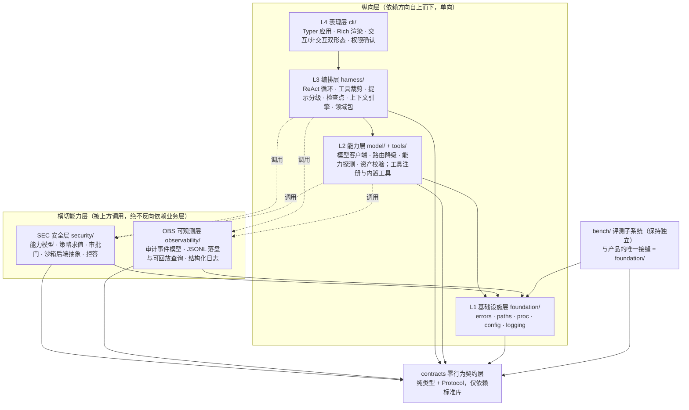

**图 D-1 读法**：实线是分层依赖，虚线是横切调用；两者都单向，由机器检查强制（§2.2）。
**本图只画设计态**——各模块的实现进度（✅/🟡/⛔）集中放在 §2.6 的对照表，**不混入架构图**，
避免读者把"画了"读成"跑了"。
各层职责：

| 层 | 包 | 职责（一句话） | 对应子问题 |
| --- | --- | --- | --- |
| L4 表现层 | `cli/` | 参数解析、装配、事件流渲染/序列化、退出码、权限确认交互 | P-A/P-B 的人机界面 |
| L3 编排层 | `harness/` | ReAct 循环、工具裁剪、提示分级、上下文装配、检查点、领域包、参数校验 | **P-A 主落点** |
| L2 能力层 | `model/` `tools/` | 模型客户端（本地/云端统一抽象）、内置工具注册与执行 | P-A/P-B |
| L1 基础设施层 | `foundation/` | 错误层次、路径校验、唯一子进程入口、配置、日志脱敏 | P-B 的执行收口 |
| 横切 SEC | `security/` | 能力模型、default-deny 策略求值、审批门、沙箱后端抽象、拒答 | **P-B 主落点** |
| 横切 OBS | `observability/` | 审计事件模型、JSONL 落盘与可回放查询、结构化日志 | P-B 的证据面 |
| 零行为契约 | `contracts/` | 全部跨层类型的字段/Protocol 定义（无行为） | 工程可维护性 |
| 评测子系统 | `bench/` | 基准轮次、环境指纹、测量纪律、数据归档（`bench/data` 分支） | P-A 的度量 |

## 2.2 依赖方向与架构不变量（R1~R5）

| 规则 | 内容 | 为什么需要它 |
| --- | --- | --- |
| **R1** | 纵向层只能向下依赖（`cli → harness → model/tools → foundation`），禁止向上 | 向上依赖会让"上层改一处、下层跟着动"；`foundation` 一旦能 import `tools`，"唯一子进程入口"就被绕过 |
| **R2** | `security/` `observability/` 不得 import `harness/` `tools/` `model/` `cli/` | 横切层若反向依赖业务层就变成"业务层的一部分"，且安全判定的输入面会被污染 |
| **R3** | `contracts/` 不得依赖任何第三方包或本项目其它模块 | 契约是"所有层都能读的形状"；依赖扩散 = 版本耦合与信任面扩散到全仓 |
| **R4** | 全项目**唯一**子进程入口 `foundation/proc.py`；**唯一**路径校验入口 `foundation/paths.py` | 两个"失败代价不对称"的点：绕过一处 = 存在第二条未被审计的特权通道 |
| **R5** | 领域包只加载声明式配置（TOML），**禁止加载其中的 Python 代码** | 领域包是外部输入（可能随仓库走）；动态导入 = 把不可信仓库变成任意代码执行 |

**机器检查**（"约定只写在文档里"是本项目已复现过的失败模式）：上述规则落成
`tests/unit/test_architecture_layers.py` 的九条断言（依赖白名单逐层比对、契约层零第三方、
`subprocess` 字样只允许出现在 `foundation/proc.py`、全仓无 `shell=True`、
`resolve_within` 只定义在 `foundation/paths.py`、`src/` 无 `print(` 等），
并附变异探针证明"非恒过"。`harness/` 内部另有 `tests/unit/test_harness_internals.py`
（H1：harness 不 import L2/L4 实现；H2：叶子模块零依赖）。

## 2.3 组件划分与职责总表

| 模块 | 职责 | 关键公开接口（详见 §5） | 现状 |
| --- | --- | --- | --- |
| `cli/` | 装配 + 渲染 + 退出码 | `execute()` 入口；`ApprovalGate` 实现 | ✅ |
| `harness/` | 编排与适配 | `Session.run(task) -> Iterator[SessionEvent]` | ✅ |
| `model/` | 模型访问统一抽象 | `ModelClient.chat(messages, *, tools, …)` | 🟡（本地 ✅；云端/路由/探针/资产 ⛔） |
| `tools/` | 工具注册与执行 | `Tool.invoke(args, *, ctx)`；`ToolRegistry.resolve(name)` | 🟡（4 内置工具 ✅；search ⛔） |
| `foundation/` | 基础设施收口 | `proc.run/spawn`；`paths.resolve_within`；`load_config`；脱敏日志 | ✅ |
| `security/` | 授权与执行安全 | `PolicyEngine.decide(request)`；`CapabilitySet`；沙箱后端抽象 | 🟡（capabilities/policy ✅；sandbox/refusal ⛔） |
| `observability/` | 证据面 | `AuditSink.emit/flush`；`JsonlAuditSink` | 🟡（audit ✅；tracing ⛔） |
| `contracts/` | 零行为契约 | 12+ 类型与 8 个 Protocol | ✅ |
| `bench/` | 评测子系统 | 轮次运行、归档、索引 | ✅ |

## 2.4 部署与运行视图

**部署形态：端侧单机，无服务、无账号、无数据库、无多租户**（SRS `Won't`）。

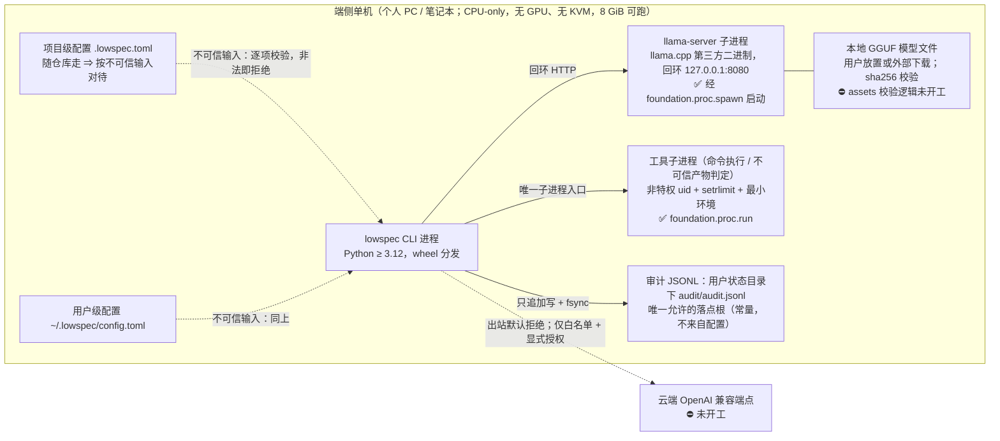

**图 D-2 部署与运行视图**：实线为已实现的交互；虚线为"规划中"或"默认拒绝"的交互。

**四条部署硬约束**（与 [`../../SECURITY.md`](../../../SECURITY.md) 一致）：

| # | 约束 | 落点 |
| --- | --- | --- |
| 1 | 单机、无服务、无账号体系 | SRS `Won't`；不引入追踪后端 |
| 2 | 无凭据存储：凭据只经环境变量注入，契约不含凭据字段 | `interfaces/README.md` C8 |
| 3 | 网络出站默认拒绝：`NETWORK_OUTBOUND` 默认不授予；`ExecutionContext.network_allowed` 默认 `False`；本地模型客户端强制回环 | `interfaces/tools.md` §2.4、`model/client.py` 回环主机白名单 |
| 4 | 无 GPU / 无 KVM：内存档位用 `RLIMIT_AS`（cgroup 在本平台实测静默失效） | [ADR-0007](../../adr/0007-sandbox-capability-matrix.md) §3.1 |

**运维面**：审计 JSONL（`REQ-SEC-06` 的可回放载体）+ `structlog` 结构化日志（脱敏管线）
+ 进程退出码（0~5 语义固定，§7.3）+ 无持久会话状态（每次追加即关闭文件句柄，崩溃最多影响正在写的一行）。
**回滚面**：产品端无数据库迁移、无服务端状态；回滚 = 换 wheel 版本 + 保留审计文件（只追加）。

### 2.4.1 运行期资源视图（容量与预算的单一视图）

> 把散在 §5/§8 的运行期参数合成一张表：**进程、内存、上下文、超时、重试**五类。
> 档位 → 模型/线程/上下文参数的映射中标注"未定"的项，随 `model/assets.py`（⛔ 规划态，§3.2.5）
> 落地后回填——[ADR-0011](../../adr/0011-tier-composition-revision.md) §8 已把"用实测数据校准
> 线程/上下文参数"列为**未完成后续行动**，本文不预先编造。

| 维度 | S 档（≤ 4 GiB） | M 档（8 GiB） | L 档（16 GiB） | 依据 |
| --- | --- | --- | --- | --- |
| 预置模型 | MiniCPM5-2B-Q4_K_M（1.56 GB） | Qwen3-4B-Q4_K_M（2.50 GB） | Qwen3-8B-Q4_K_M（5.03 GB） | ADR-0011 §5.1 |
| 常驻内存（实测峰值） | 2.68 GiB | 4.85 GiB | 8.70 GiB | §8.1（2026-09-15 实测） |
| 常驻内存目标 | ≤ 4 GiB（实测达成） | ≤ 8 GiB（实测达成） | ≤ 16 GiB | §8.1 |
| 推理进程 | `llama-server` 1 个（默认 `-np 1`；一个会话一个客户端实例） | 同左 | 同左 | model.md §4 |
| 工具子进程 | 每次调用经 `foundation.proc.run`（非特权 uid + `setrlimit` + 最小环境） | 同左 | 同左 | §3.2.3 |
| 进程级内存上限 | `RLIMIT_AS`（cgroup 在本平台实测静默失效 ⇒ 不用） | 同左 | 同左 | ADR-0007 §3.1 |
| 上下文长度 `-c` / 线程 `-t` / 批量 `-b` | **未定**（实测口径当前统一 4096） | 同左 | 同左 | ADR-0011 §8（未完成项） |
| 提示 token 预算 | `max_prompt_tokens=8192`，其中 `reserve_tokens=1024` 留给生成 | 同左 | 同左 | §4.7.4 |
| 单次生成上限 | `max_completion_tokens` 默认 `None`（服务端默认）；实测 384 失败 / 1536 通过 | 同左 | 同左 | §5.2.1 |
| 模型请求超时 | 可配，默认 60 s；本环境实测需 600 s | 同左 | 同左 | §5.2.1 |
| 工具调用超时 | `tool_timeout_s=30.0` | 同左 | 同左 | §5.2.8 |
| 步数 / 重试预算 | `max_steps=12`；瞬时重试 2；连续失败 3 | 同左 | 同左 | §9.2 |
| 输出体积上限 | 工具输出 64 KiB；模型响应体 1 MiB；参数 JSON 64 KiB | 同左 | 同左 | §5.2.2/§5.3.1 |
| 审计落盘 | 只追加 + 退出前 fsync；落点根为常量白名单 | 同左 | 同左 | §6.2.1 |

> **读法**：三档共享**同一套运行参数默认值**（进程模型、预算、超时、重试），档位差异只体现在
> **模型规模与内存预算**两行——这与"硬件档位决定能跑多大、能力档位决定给多少自由度"的两轴设计一致
> （§8.4）。并发会话数：**同一时刻一个会话**（单会话单线程，`ModelClient` 非线程安全），
> 多会话 = 多进程各自独立，无共享状态需要分配。

## 2.5 架构与选题规模的匹配（防过度设计）

选题是"单人 2~3 个月的端侧工具"，架构按**最小够用 + 可机器检查**取舍：

| 设计 | 为什么不砍 | 为什么不放大 |
| --- | --- | --- |
| 零行为契约层 | 打破"安全层需知 `ToolCall` 形状 / 工具层需调安全层"的循环依赖；让"只读契约写 fake 跑单测"成立 | 只放类型与 Protocol，**不放任何函数体逻辑**；新增类型以"有跨信任边界消费者"为判据 |
| 四层纵向 + 两横切 | 安全与可观测的**真实形态是横切**（在每个特权操作点被调用），纵向平铺无法表达 | 不拆出更多层（如独立的"记忆层""规划层"）——本期无对应需求 |
| `bench/` 独立于产品分层 | 评测节奏与产品解耦（协议版本、数据分支、可比时间序列） | 只共享 `foundation/` 一个接缝，不建"评测框架" |
| 手写 JSON-Schema 子集校验器 | 信任边界校验必须零依赖面 + 错误消息不可回显不可信内容（[ADR-0020](../../adr/0020-argument-validator-implementation.md)，4 候选加权 131/72/56/90） | 不引入 `jsonschema`/pydantic 通用引擎（依赖面与回显面双重扩大） |
| 自研 5 模块 | 正是子问题 P-A/P-B 的落点（模型层与探测、Harness、安全层、上下文引擎、领域包） | 推理内核、模型分发、隔离内核、密码学、通用 agent 框架**均不自研**（§10.4） |

## 2.6 设计态—实现状态对照表（与架构图分离）

> **为什么单独成表**：架构图回答"设计上谁依赖谁"，实现状态回答"哪部分已有载体"；
> 两者混在一张图里，读者会靠猜来区分"画了"与"跑了"。状态口径：截至 **2026-09-28** 仓库事实
> （2026-10-12 v1.1 复核无变化）；"已实现" = 存在非骨架实现且对应单测/机器检查。
> 依据列给提交哈希或文件名（**没有依据的"已实现"一律按未实现处理**）。

| 模块/组件 | 状态 | 依据 |
| --- | --- | --- |
| `foundation/` 五件（errors/paths/proc/config/logging） | ✅ | `617f564`（proc/paths/errors 由 bench 提升）、`33a0b87`（config/logging） |
| `contracts/` 六模块 | ✅ | `33cf6b8` 建骨架，后续按 `interfaces/` 各文件补齐 |
| `security/capabilities.py`、`security/policy.py` | ✅ | `f7f7628` |
| `security/sandbox/`、`security/refusal.py` | ⛔ | 目录/文件不存在；契约已定死（`interfaces/sandbox.md`），设计态说明见 §3.2.5 |
| `observability/audit.py` | ✅ | `e78c221` |
| `observability/tracing.py` | ⛔ | 文件不存在（`REQ-OBS-02`，Could） |
| `model/client.py`（本地 + 回环传输） | ✅ | `e38e512` |
| `model/router.py`、`probe.py`、`assets.py` | ⛔ | 文件不存在；设计态说明见 §3.2.5 |
| `tools/registry.py`、`files.py`、`shell.py` | ✅ | `f90e051` |
| `tools/search.py` | ⛔ | 文件不存在 |
| `harness/` 9 件 | ✅ | `fe82cce`~`5cd45f1` 系列共 10 笔（逐笔见 architecture.md §4.3） |
| `cli/` 3 件 | ✅ | `4baa9e8` / `b4a7213` / `663c266` |
| `bench/`（12 模块 + 4 夹具） | ✅ | 与产品唯一接缝 = `foundation/` |

> ⚠️ "已实现" ≠ "已跑通端到端" ≠ "威胁已缓解"：端到端证据以 `tests/integration/` 与 devlog 实跑记录为准，
> 威胁状态以威胁模型目录为唯一真源（§8.3）。

---

# 3. 模块设计

## 3.1 模块边界总表

| 模块 | 边界（负责 / 不负责） | 内部结构 | 现状 |
| --- | --- | --- | --- |
| `foundation/` | 负责：错误层次、路径白名单、子进程封装、配置加载、日志脱敏。**不负责**：任何业务判断 | `errors` `paths` `proc` `config` `logging` 五件 | ✅ |
| `contracts/` | 负责：跨层类型的字段/枚举/Protocol。**不负责**：任何行为（无 `__post_init__`、无函数体） | `model` `tools` `policy` `audit` `sandbox` `harness` 六模块 | ✅ |
| `security/` | 负责：能力模型、策略求值、审批语义、沙箱后端抽象、拒答判定。**不负责**：工具实现、界面 | `capabilities` `policy` ✅；`sandbox/` `refusal.py` ⛔ | 🟡 |
| `observability/` | 负责：审计事件落盘/查询、结构化日志装配。**不负责**：业务事件产生 | `audit` ✅；`tracing` ⛔ | 🟡 |
| `model/` | 负责：模型客户端（本地回环 + 规划中云端）、路由降级、能力探测、资产校验。**不负责**：推理本身（llama-server 子进程） | `client` ✅；`router` `probe` `assets` ⛔ | 🟡 |
| `tools/` | 负责：工具注册表（含摘要校验）、内置工具。**不负责**：策略判定 | `registry` `files` `shell` ✅；`search` ⛔ | 🟡 |
| `harness/` | 负责：循环、上下文装配、裁剪、提示、检查点、领域包、参数校验。**不负责**：终端交互、模型传输 | 9 件（§3.2.1） | ✅ |
| `cli/` | 负责：参数解析、装配、渲染/序列化、退出码、确认交互。**不负责**：业务逻辑 | `app` `render` `approval` | ✅ |
| `bench/` | 负责：基准轮次、环境指纹、归档与索引。**不负责**：产品运行路径 | 12 模块 + 4 夹具 | ✅ |

## 3.2 关键模块内部结构

### 3.2.1 `harness/`（编排层，9 件）

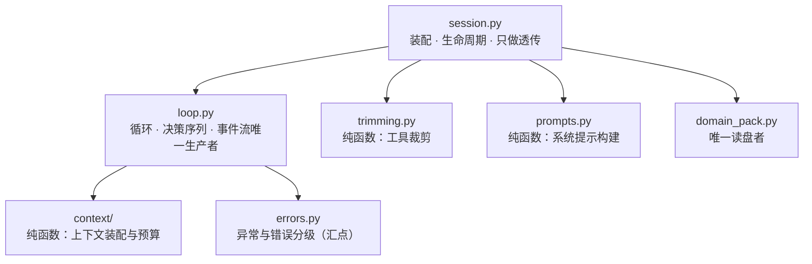

**图 D-3 `harness/` 内部调用方向**：`session` 装配后把**数据**（`exposed` 工具集、`system` 提示串、
`data_context` 数据消息、`pack_name`）传给 `loop`；叶子模块（`prompts`/`trimming`/`context`/
`checkpoint`/`domain_pack`）两两零依赖；`errors` 是唯一允许被 import 的汇点。

| 文件 | 职责 | 关键签名（权威定义见 [`../design/interfaces/harness.md`](../../design/interfaces/harness.md) §3.1） |
| --- | --- | --- |
| `session.py` | 装配期校验 + 生命周期（teardown 幂等） | `Session(*, session_id, config, model, registry, policy, approval=None, sink, validator, pack=None)` |
| `loop.py` | ReAct 循环 + 工具调用六步决策序列 + 事件生产 | `TaskLoop(*, session_id, config, model, registry, exposed, policy, approval, sink, validator, system, data_context, pack_name)` |
| `trimming.py` | 按能力档位 + 领域包白名单裁剪工具 | `select_tools(specs, *, tier, allowlist)`；`exposed_tool_names(...)`（必须派生自前者） |
| `prompts.py` | 系统提示**只由本方常量产生**（不收外部内容） | `build_system_prompt(tier)`；`pack_context_message(*, pack_name, fragments)` |
| `context/` | 消息装配 + token 预算 + 角色守卫 | `assemble(*, system, task, history, budget, data_context=())`（`data_context` 必须全为 `role=USER`） |
| `checkpoint.py` | 会话快照/还原（纯函数；落盘路径未决） | `to_payload(state)` / `from_payload(payload)` |
| `domain_pack.py` | 领域包加载（唯一读盘；fail-secure） | `load_pack(directory, *, roots, known_tools)` |
| `arguments.py` | 信任边界参数校验（手写 JSON-Schema 子集） | `SubsetArgumentValidator.validate(*, spec, arguments_json)` |
| `errors.py` | 错误分级与映射 | `classify_error` / `resolve_disposition` / `error_kind` |

**harness 内部两条硬约束**（机器检查 `test_harness_internals.py`）：
**H1**：`harness/**` 不得 import `model`/`tools`/`security`/`observability`/`cli` 的任何实现模块
（它们全部以构造注入的 Protocol 到达）——这是"只读契约写 fake 跑单测"的前提；
**H2**：叶子模块两两零依赖，`loop` 不 import `session`/`domain_pack`（数据以参数传入）。

### 3.2.2 `security/` 与 `observability/`（横切层）

| 组件 | 职责 | 关键设计 |
| --- | --- | --- |
| `security/capabilities.py` | 能力枚举解析与集合运算 | `parse_capabilities()`：未知名**拒绝不跳过**；`narrow_granted()`：只能收窄 |
| `security/policy.py` | `PolicyEngine.decide()` 四格决策 + 审批门语义 | 求值失败收敛为拒绝；**审计失败必须冒泡**（§4.5） |
| `security/sandbox/` ⛔ | 隔离后端抽象 + 逐维度探针 | 契约已定死（`IsolationMatrix`/`SandboxTier` L0/L1/L2-N/L2-C），实现未开工 |
| `security/refusal.py` ⛔ | 能力边界拒答判定 | 消费沙箱"未满足维度"；未开工 |
| `observability/audit.py` | JSONL 落盘 + 白名单 + 可回放查询 | 构造期再校验落点；`emit/flush` 失败冒泡（`AuditWriteError`） |
| `observability/tracing.py` ⛔ | 可选追踪钩子 | `REQ-OBS-02`（Could），未开工 |

### 3.2.3 `foundation/`（两个"唯一入口"）

| 文件 | 职责 | 安全含义 |
| --- | --- | --- |
| `paths.py` | `resolve_within(candidate, roots, *, what)`：`expanduser().resolve()` + 分量比较，越界抛 `PathNotAllowedError` | 全项目唯一路径校验入口（R4）；`..` 上跳与符号链接逃逸天然被拒 |
| `proc.py` | `run(argv, *, cwd, timeout_s, isolation)` / `spawn(...)`；`minimal_env(workdir)` | 全项目唯一子进程入口（R4）；不经 shell、参数列表传入；非特权 uid + `setrlimit`；**不继承父进程环境**（凭据不进子进程） |
| `config.py` | 用户级/项目级 TOML 加载与严格校验；`ALLOWED_AUDIT_ROOTS` 常量 | 未知段/未知键 ⇒ `ConfigError`；审计落点根为常量、配置不得影响 |
| `logging.py` | structlog 装配 + `sanitize_for_display` | 控制字符与 ESC 替换，防 ANSI 转义篡改终端 |
| `errors.py` | 全项目共享异常层次（基类 `BenchError`） | 单一层次，防"该兜的没兜住"；`AuditWriteError` 亦在此 |

### 3.2.4 `cli/` 与 `bench/`

- `cli/app.py`：装配顺序 §4.1；把装配期 `BenchError` 转为"中文错误 + 非零退出码"（**不得**回退默认落点）。
- `cli/render.py`：按 `SessionEvent.kind` 分支渲染（Rich）；JSON 模式只出 JSONL。
- `cli/approval.py`：`ApprovalGate` 实现；先 `emit(APPROVAL)` 再返回；无 TTY ⇒ `DENY`。
- `bench/`：与产品**唯一接缝是 `foundation/`**；产物按轮次 id 归档（[ADR-0026](../../adr/0026-benchmark-round-directory-keyed-by-round-id.md)），
  只由跑测脚本写 `bench/data` 分支，人手不得直接提交。

### 3.2.5 未开工模块的设计态说明（⛔ 部分，与已实现部分同粒度）

> 以下模块**实现未开工**，但契约层已定死字段；本小节给出与 §3.2.1~§3.2.4 同粒度的
> **内部结构与接口边界**，使未实现部分同样可评审。全部标注【规划态】，**不得**读作已实现。

**`security/sandbox/`（`REQ-SEC-05`）**【规划态】

- **组件划分**：`SandboxBackend` 抽象（`L1 RestrictedProcessBackend` / `L2 NamespaceBackend` / `L2 ContainerBackend`）+ 逐维度探针 + 档位选择器（档位由后端按探针结果选择，**不由调用方指定**）。
- **判定输入/输出**：输入 `SandboxRequest`（`argv`/`cwd`/`allowed_roots`/`timeout_s`/`env`/`network_allowed`，§5.1）；输出 `IsolationMatrix`（`tier` + 逐维度 `IsolationDimensionStatus` + `degraded`/`reason`）。
- **关键规则**：`enforced=True` **只能来自负向探针确实被阻止**（禁止以退出码判定——firejail fail-open 教训）；`mechanism=NONE ⇒ enforced=False`；`evidence` 为空 ⇒ 按未验证处理；`tier=L0` ⇒ 调用方**必须拒绝执行**；降级必记 `EXECUTION_DEGRADATION` 审计（禁止静默降级）。
- **边界（诚实结论）**：L1 档的 `FILESYSTEM`/`NETWORK` **不是内核隔离**，而是"白名单 + 审批 + 审计"（矩阵中如实记 `enforced=False`）；产品**不得依赖** `L2_CONTAINER`（目标设备无 docker，必须能在只有 L1 时运行）。

**接口边界（字段级内联，与 `contracts/sandbox.py` 一致；权威见 `interfaces/sandbox.md` §2）**：

| 类型 | 字段 | 语义 |
| --- | --- | --- |
| `SandboxRequest` | `argv: tuple[str, ...]` | 命令与参数；`argv[0]` **必须是绝对路径**（`proc.resolve_binary`） |
| | `cwd: Path` | 工作目录，必须落在 `allowed_roots` 内 |
| | `allowed_roots: tuple[Path, ...]` | 路径白名单根（经 `foundation.paths` 校验） |
| | `timeout_s: float` | 超时上限；**超时即失败、不重试**（重试会掩盖问题） |
| | `env: Mapping[str, str]` | 显式环境变量；**默认空 = 后端最小环境，不得继承 `os.environ`** |
| | `network_allowed: bool = False` | 出站仅在策略显式授予时为 `True` |
| `IsolationMatrix` | `tier: SandboxTier` | `l0` / `l1` / `l2-namespace` / `l2-container` |
| | `dimensions: Mapping[IsolationDimension, IsolationDimensionStatus]` | 逐维度状态；**未列出的维度按未隔离处理**（default-deny） |
| | `degraded: bool` / `reason: str \| None` | `degraded=True ⇒ reason` 必填，且必须产 `EXECUTION_DEGRADATION` 审计 |
| `IsolationDimensionStatus` | `dimension` / `enforced` / `mechanism` / `evidence` | `enforced=True` 只能来自负向探针；`mechanism=NONE ⇒ enforced=False`；`evidence` 为空 ⇒ 按未验证处理 |
| `SandboxResult` | `returncode` / `stdout` / `stderr` / `timed_out` / `truncated` / `duration_s` / `isolation` | `returncode` **不作为**隔离生效判据；`isolation` 随结果返回 ⇒ 每条执行记录自带"当时隔离了什么" |

**`security/refusal.py`（`REQ-SEC-08`）**【规划态】

- **输入/输出**：输入 = 沙箱未满足维度 + 策略层 `RiskLevel=CRITICAL` 语义；输出 = 拒答/放行/转人工判定 + `REFUSAL` 审计事件（`outcome=deny`）。
- **规则**：高代价场景**拒答或转人工**，不得"尽力尝试"；拒答正确率 ≥ 95% 的指标**无基线，不得作验收依据**（§8.3）。
- **未定项**：「高代价场景」的**判定口径**（场景分类从何而来）尚未设计——登记于 §13.3，不代决。

**`model/router.py`（`REQ-MODEL-05`）**【规划态】

- **输入/输出**：输入 = `ModelUnavailableError`（本地后端不可达）；输出 = 路由决策（降级到另一后端）+ `EXECUTION_DEGRADATION` 审计 + `ModelResponse.model_id` 记录**实际应答后端**（供"降级是否真的发生"的验证）。
- **边界**：云端后端可用**以出站白名单实现为前提**——`T-10` 未缓解前不得启用（fail-open 风险）。
- **流程**：模型不可用 → 重试（预算内）→ 降级/放弃的完整路径见 §4.7 图 D-9。

**`model/probe.py`（`REQ-MODEL-06`）**【规划态】

- **输入/输出**：输入 = 探针任务集 + 模型；输出 = `CapabilityTier`（**能力**档位；与 `HardwareTier` 两轴独立、**不得互转**，§8.4）。
- **规则**：会话启动探测一次、映射固定档位、运行中不调整（`REQ-PERF-06`）；档位成员已定案 3 档（§8.4）；"探测值 → 决策 → 生效配置"三段留痕。

**`model/assets.py`（`REQ-MODEL-01/02`）**【规划态】

- **输入/输出**：输入 = GGUF 文件路径 + 来源清单 + sha256；输出 = 可加载模型列表 + 按内存预算的选档建议（`HardwareTier` S/M/L ↔ 预置模型，`ADR-0011` §5.1）。
- **规则**：摘要不符即拒绝（fail-secure）；选档建议必须带**预算来源**（可查）。

**`harness/checkpoint.py` 的持久化**【规划态】

- **现状**：`to_payload`/`from_payload` 纯函数已实现（快照 + 严格 schema 还原）；**落盘路径未决**（`harness.md` U9-③）。
- **规定**：任何落盘必须沿用审计落点口径（根不来自不可信来源、先校验后创建）；恢复流程（含损坏与不一致分支）见 §4.7。

## 3.3 模块间耦合与依赖注入

| 机制 | 做法 | 收益 |
| --- | --- | --- |
| Protocol 注入 | `Session`/`TaskLoop` 的 `model`/`registry`/`policy`/`approval`/`sink`/`validator` 全部构造注入 | 上层只依赖 `contracts/`；单测可注入 fake，无需拉起真实实现 |
| 数据以参数传入 | `trimming` 收 `allowlist`、`prompts` 收 `fragments`、`loop` 收 `pack_name` | 叶子模块零依赖，可并行开工；两份判定必然漂移的风险被消除 |
| 错误冒泡三分法 | 业务失败 → `SessionEvent(kind="error")`；审计失败 → 冒泡；装配/配置失败 → 装配期异常 | 三类失败在退出码与事件流中均可归因 |
| 信任边界钉在 HARNESS | `arguments_json` 保持原始文本直到 `harness/arguments.py` 校验；`Tool.invoke` 只拿已校验参数 | "在工具内部偷偷解析 JSON"变成一处可见的违约 |

---

# 4. 关键流程设计

> 本节每条流程都标注：**正常路径、分支、异常路径**，以及流程中的判断/状态变化/数据读写
> 分别落在哪个模块、接口与数据实体（§4.6 汇总表）。

## 4.1 装配流程（会话建立之前）

装配由 `cli/app.py` 完成，**顺序有依赖、不可调换**：

| 步 | 动作 | 失败行为（fail-secure） |
| --- | --- | --- |
| 1 | `load_config()`：读用户级 + 项目级 TOML，逐文件校验（类型/长度/范围/**未知段或未知键**）后按键合并 | 任一已存在文件非法 ⇒ `ConfigError`（退出码 3），**不得**回退默认值 |
| 2 | 审计落点：`audit.directory` 经 `resolve_within(..., ALLOWED_AUDIT_ROOTS)` 解析为已 resolve 的绝对路径 | 越界 ⇒ `ConfigError`；**不得**回退默认目录 |
| 3 | 授予集合：`parse_capabilities()` 解析配置授予 | 未知名 ⇒ `UnknownCapabilityError`（**不跳过**——跳过会让拼写错误变成静默降权） |
| 4 | `JsonlAuditSink(directory)`：**先校验、后 mkdir**，构造期再校验白名单 | 越界 ⇒ `PathNotAllowedError`；目录不可创建 ⇒ `OSError` |
| 5 | `load_pack()`（若启用）：路径先校验后读；未知键/未知工具名/未知能力名/包内 `.py` ⇒ `DomainPackError` | **不得**降级为"无 pack 继续跑" |
| 6 | 能力收窄：`granted = 配置授予 ∩ pack.capabilities`（**只能收窄，绝不并集**） | —— |
| 7 | `PolicyEngine(granted=收窄后, sink, tool_risk=带包前缀)` → `ToolRegistry([...])` → `LocalLlamaClient` → `Session` | 风险等级非法 ⇒ 构造期 `TypeError`；模型起不来 ⇒ `ModelUnavailableError`（退出码 3） |

**默认值取向**：`CapabilitySet()` 默认空集（什么都没授予）、审计落点默认白名单内唯一根、
`network_allowed` 默认 `False`——**default-deny 不能靠调用方记得传参**。

## 4.2 主流程：一次多步任务（正常路径）

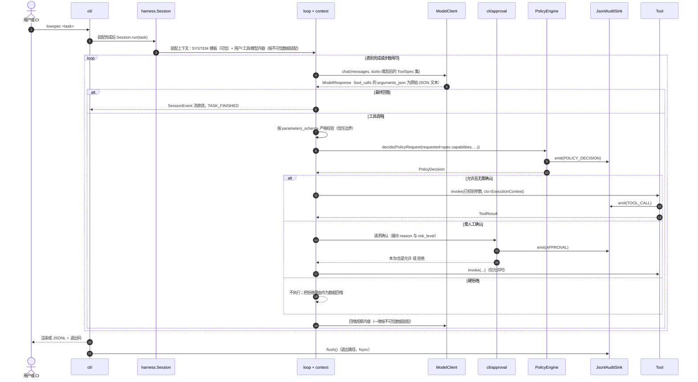

**图 D-4 主流程时序**（对应 UC-01；与 [`../design/architecture.md`](../../design/architecture.md) §5.2 同口径）。
路径上的关键数据结构：`ChatMessage`（信任判定在装配处，不在类型上）、
`ToolCallRequest.arguments_json`（原始文本，信任边界钉在 HARNESS 侧）、
`PolicyRequest.requested`（`frozenset[Capability]`，`missing = requested - granted`）、
`AuditEvent`（10 字段，§6.2.1）。

## 4.3 工具调用决策序列（顺序本身是契约）

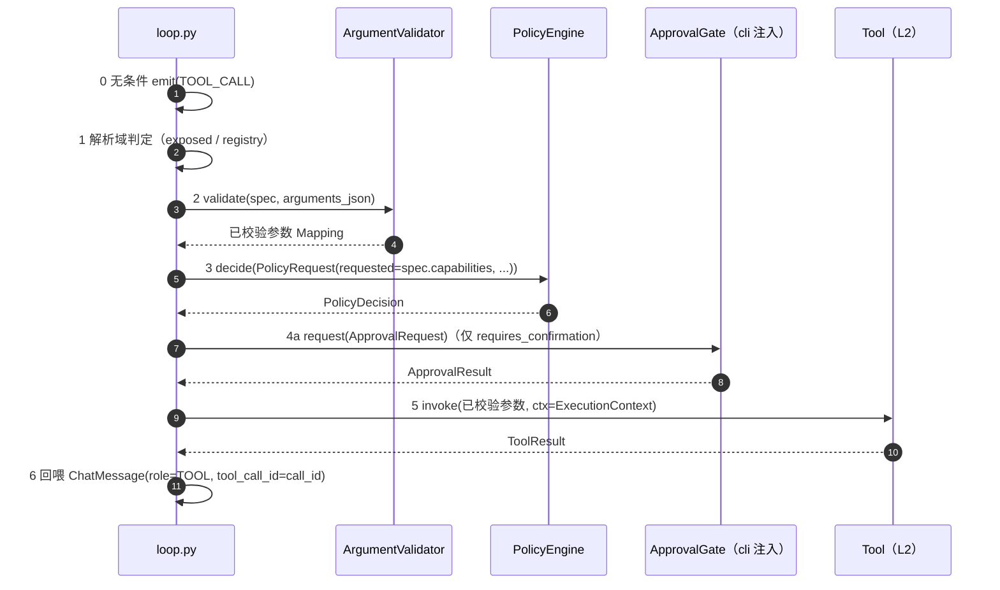

**图 D-5 决策序列**（权威定义见 [`../design/interfaces/harness.md`](../../design/interfaces/harness.md) §3.3）。
每步的入参/出参与分支处置：

| 步 | 动作 | 失败/分支处置 |
| --- | --- | --- |
| 0 | 无条件产出 `TOOL_CALL` 事件（模型请求过就是事实；`tool_name` 原样、不可信） | —— |
| 1 | 解析域判定：`call.name` 是否在 `exposed`（由 `trimming` 派生） | 在注册表但不在 `exposed` ⇒ `denied_reason="not_exposed"`；连注册表都没有 ⇒ `"unknown_tool"` ⇒ 跳 6b，**不构造 `PolicyRequest`、不调 `decide()`、不调 `invoke()`** |
| 2 | `validator.validate(spec, arguments_json)` | 失败 ⇒ `"invalid_arguments"` ⇒ 6b；回喂内容 = 校验器中文说明，**不回显原始 JSON** |
| 3 | `decide(PolicyRequest(...))` | `spec.capabilities` 为空集 ⇒ 工具声明缺陷，按 `invalid_arguments` 拒绝（**不得**构造空集请求） |
| 4 | 执行判定：需确认先看通路（`approval is None` ⇒ `"approval_denied"` ⇒ 6b）；否则 `request()`；不需要确认看 `allow` | `outcome is DENY` ⇒ `"approval_denied"`；`allow=False` ⇒ `"policy_denied"`；gate 抛异常/形状非法 ⇒ `ERROR(INTERNAL)` + **终止任务**（§4.5） |
| 5 | `ExecutionContext(...)` ⇒ `invoke(已校验参数, ctx)` | 工具抛未预期异常 ⇒ 记 `TOOL_CALL/ERROR` + 合成 `ToolResult(ok=False)`；**不回显异常消息**；`network_allowed` 本轮恒 `False` |
| 6a/6b | 已执行 ⇒ `TOOL_RESULT(result=…)`；未执行 ⇒ 先记 `TOOL_CALL/DENY`（含短码）再 `TOOL_RESULT(result=None, text=中文说明)` | 回喂消息 = `ChatMessage(role=TOOL, content=观察内容, tool_call_id=call_id)` |

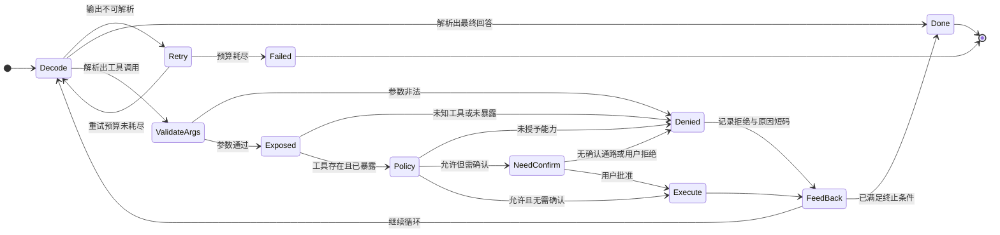

**图 D-6 工具调用决策状态机**。三条可被测试直接断言的约束：
① **拒绝发生在执行之前**（`Denied` 分支不经过 `Execute`）；
② **每条例外都留下审计**（`Denied` 与 `Execute` 都通向审计落点）；
③ **拒绝原因必须可分**（参数非法 / 未知工具或未暴露 / 未授予能力 / 审批拒绝，各自成边）。

## 4.4 分支路径：高危操作审批（三选项 + 无通路即拒绝）

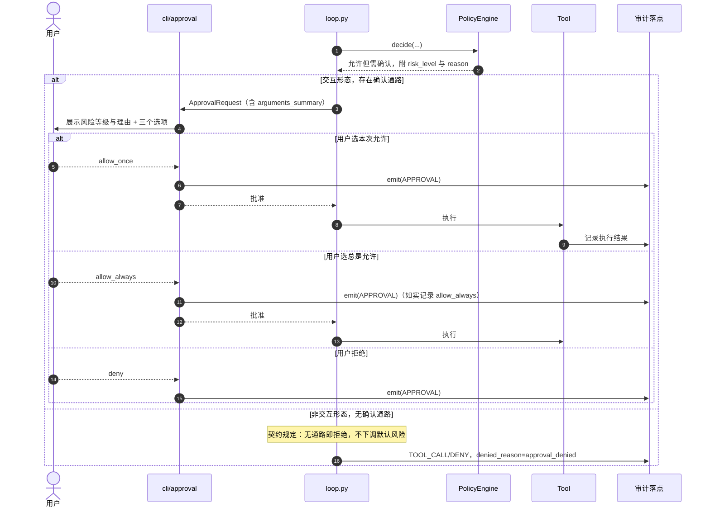

**图 D-7 审批时序**（fail-secure 规定 R1~R6 见 [`../design/interfaces/harness.md`](../../design/interfaces/harness.md) §2.5.5）：
无 gate / 无 TTY / gate 抛异常 / 应答形状非法 ⇒ **一律不执行**；`ALLOW_ALWAYS` 本轮等价于
`ALLOW_ONCE`（持久授权未决），但**必须如实记录**。风险说明必须来自 `PolicyDecision.reason`
（策略引擎生成），**不得**采信模型自述——否则"把危险操作包装成低风险描述"即可骗取确认。

## 4.5 异常路径：两类"没执行"的处置相反（本项目最易实现错之处）

| 情形 | 处置 | 为什么 |
| --- | --- | --- |
| **策略求值失败**（引擎内部异常） | **收敛为拒绝**：`allow=False, requires_confirmation=True, risk_level=CRITICAL`，异常**不得**逃逸为 allow | fail-secure：判不出就不放行 |
| **审计写入失败**（`emit`/`flush` 抛 `AuditWriteError`） | **原样冒泡**：不得被"求值收敛"吞掉、不得降级为告警；`loop` 在 `except Exception` **之前** `except AuditWriteError: raise` | 静默丢事件 = `REQ-SEC-06` 验收失败；把"证据面坏了"伪装成"普通拒绝"是更严重的缺陷 |
| **审批通路故障**（gate 抛异常/形状非法） | `ERROR(INTERNAL)` + 终止任务；**但** `AuditWriteError` 不适用此路径（按上一条冒泡） | 审批通路坏 = 权限判定的输入面不可用；继续跑等于在未知权限语义下继续 |

> 前两条表象都是"没执行"，但一个是**正常的默认拒绝**、一个是**系统坏了**——
> 混为一谈 = 把一次审计基础设施故障伪装成一次普通策略拒绝。
> （契约原文：[`../design/interfaces/policy.md`](../../design/interfaces/policy.md) §2.5、
> [`../design/interfaces/audit.md`](../../design/interfaces/audit.md) §2.4；落地证据含变异探针：
> 摘掉 `except AuditWriteError` 后两条行为级用例同时翻红。）

## 4.6 流程要素 ↔ 模块/接口/数据对应表

| 流程中的要素 | 类型 | 落点（模块） | 接口/契约 | 数据实体 |
| --- | --- | --- | --- | --- |
| 参数校验 | 判断 | `harness/arguments.py` | `ArgumentValidator.validate` | `ToolSpec.parameters_schema` |
| 能力判定 | 判断 | `security/policy.py` | `PolicyEngine.decide` | `Capability`/`RiskLevel`/`CapabilitySet` |
| 审批 | 判断+交互 | `cli/approval.py` | `ApprovalGate.request` | `ApprovalRequest`/`ApprovalResult` |
| 工具执行 | 动作 | `tools/*` | `Tool.invoke` + `ExecutionContext` | `ToolResult` |
| 路径/子进程收口 | 动作 | `foundation/` | `resolve_within` / `proc.run` | —— |
| 任务终态 | 状态变化 | `harness/loop.py` | `TaskStatus{COMPLETED,FAILED,LIMIT_REACHED}` | `SessionEvent.status` |
| 退出码 | 状态映射 | `cli/app.py` | 退出码契约（§7.3） | —— |
| 每次调用/决策 | 数据写 | `security/policy.py`、`tools/registry.py`、`harness/loop.py`、`cli/approval.py` | `AuditSink.emit` | `AuditEvent`（§6.2.1） |
| 会话快照 | 数据写 | `harness/checkpoint.py` | `to_payload`/`from_payload` | `SessionState`（§6.2.5） |

## 4.7 模型侧关键分支与检查点恢复（⛔/🟡 部分，【规划态】标注）

> 本节覆盖模型侧与状态侧的关键分支：**档位探测→配置生效**、**模型不可用→重试→降级→失败**、
> **检查点恢复**。已实现部分注明落点；未实现部分通篇【规划态】，**不得**读作已在跑。

### 4.7.1 档位探测 → 配置生效（【规划态】，`REQ-MODEL-06`/`REQ-PERF-06`）

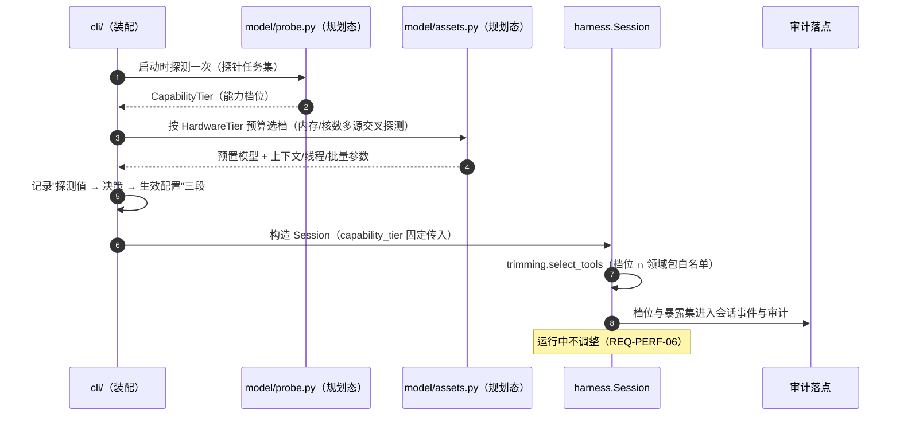

**图 D-8 档位探测与配置生效（规划态）**。三条硬规则：
① **两轴独立**——`CapabilityTier`（模型能力）与 `HardwareTier`（硬件预算）不得互转（§8.4）；
② 会话内 `exposed` 工具集**启动时算一次、运行中不变**（§3.2.1）；
③ **探测失败 ⇒ 取最保守档**（`BASIC`：工具最少、提示最结构化），不得因探测失败而放宽。

### 4.7.2 模型不可用 → 重试 → 降级 → 失败（部分已实现）

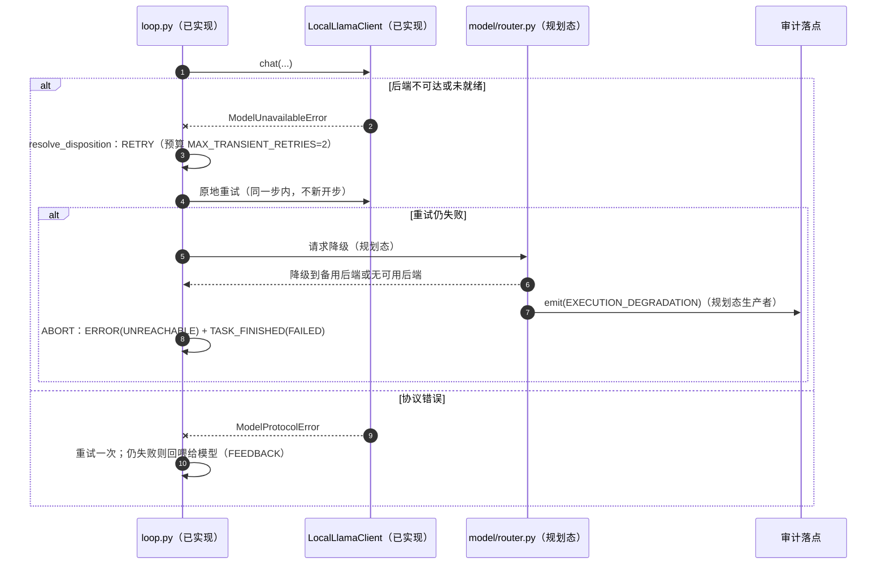

**图 D-9 模型不可用的处理路径**。**已实现**：重试预算（`MAX_TRANSIENT_RETRIES = 2`，
`harness/errors.py`）、`TRANSIENT`/`UNREACHABLE`/`PROTOCOL` 分级、事件流可见；
**规划态（⛔）**：`router.py` 降级与 `EXECUTION_DEGRADATION` 审计——当前 `ModelUnavailableError`
的既定处置是"重试 → 放弃"，**不得**表述为"已降级"。
模型调用总数上限 = `max_steps × (1 + MAX_TRANSIENT_RETRIES)`（重试不新开步，
`harness/loop.py` 的口径）。

### 4.7.3 检查点恢复（含损坏与不一致分支）

| 分支 | 触发 | 处置 |
| --- | --- | --- |
| 正常恢复 | 快照存在且 schema 合法 | `from_payload` 还原 `SessionState`（`session_id`/`task`/`step`/`messages`），从 `step` 继续；恢复后上下文一致（`REQ-HARNESS-05` 验收口径） |
| 快照损坏 / 字段缺失 / 类型不符 | `from_payload` 严格校验失败 | 抛 `SchemaError` ⇒ **拒绝恢复**（不部分恢复、不"尽力用能用的字段"）⇒ 按新任务开始或终止，由调用方**显式**决定 |
| `seq` 冲突（快照 `step` 与事件流不一致） | 恢复后继续产出事件 | 以**快照为准**重建循环状态；冲突事实记入事件流（中文说明），**不静默** |
| 落点不可用 | 快照不在允许根 / 不可读 | 按路径越界处置（拒绝，不回退默认）；**落点路径本身未决**（§13.3 第 5 项）⇒ 当前无持久化载体，本节为设计规定 |

> 与 §6.5「重启后一致性核对」合读：检查点是**会话内**恢复手段，审计/事件流是**跨重启**的
> 证据面；两者的读写都必须 fail-secure——坏了就拒绝，不猜。

### 4.7.4 上下文预算与压缩触发（✅ 已实现，`harness/context/`）

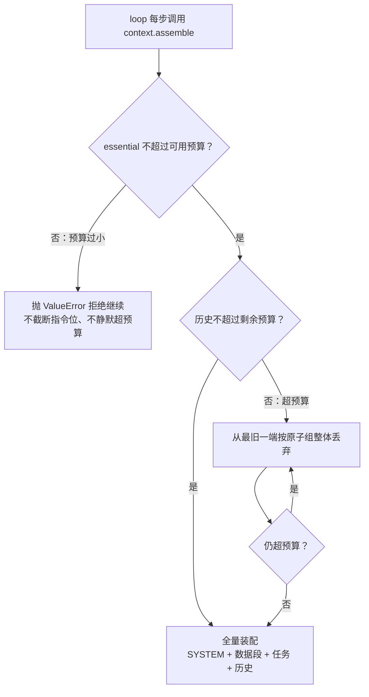

**图 D-10 上下文装配与压缩触发（已实现）**。关键设计：

| 项 | 规定 |
| --- | --- |
| 预算口径 | `ContextBudget(max_tokens=8192, reserve_tokens=1024)`（来自 `SessionConfig.max_prompt_tokens`）；可用提示预算 = `max_tokens - reserve_tokens` |
| 触发时机 | **每次模型调用前**装配时判定——不是定时、不是按步数 |
| 原子组 | "一条 `ASSISTANT` 及其 `tool_calls` 的全部 `TOOL` 回执"为一组；组内**要么全留、要么全丢** ⇒ 配对永不被切断（判据 `H-6`；`model.md` §2.1 的回指不变式） |
| 不可丢弃 | `SYSTEM` / `data_context` / 任务消息**永不**被丢弃；三者本身就超预算 ⇒ `ValueError`（fail-secure：不把"配置过小"伪装成"装配成功"） |
| token 估计 | 按**字符数**取保守上界（英文约 4 字符/token、中文约 1 字符/token；计入 `call_id`/`name`/`arguments_json`——漏计会变成下界 ⇒ 超预算放行）⇒ 高估 ⇒ 更早裁剪 ⇒ fail-secure |
| 连续性 | 保留的是历史的**连续后缀**（"中间挖空"比少给历史更糟） |
| 与 `REQ-PERF-02` 的关系 | 压缩/观察屏蔽机制已落地；"检索替代全量"与 **token 降幅 ≥ 30%** 指标：🟡 对照实验未做 ⇒ 按"未验证"表述（§8.1） |
| 与注入面的关系 | 压缩只改变"给多少历史"，**不改变**信任判定——`data_context` 的 `role=USER` 结构性守卫在装配前生效（判据 `H-10`/`S-new-6`） |

---

# 5. 接口设计

> 接口分两类：**内部模块接口**（§5.1~§5.2，以 `contracts/` 为权威）与
> **外部系统/第三方接口**（§5.3）。所有接口给出：名称/用途、输入/输出格式、错误约定、调用限制。
> 未实现的第三方能力**如实标注 ⛔**，不虚构参数与行为。

## 5.1 内部接口总表（边界处形态）

| 边界 | 接口形态 | 错误语义 | 并发假设 | 资源生命周期 |
| --- | --- | --- | --- | --- |
| `cli` ↔ `harness` | `Session.run(task) -> Iterator[SessionEvent]`（**同步**迭代器） | 业务失败以 `SessionEvent(kind="error")` 表达；逃逸的只有三类：`ConfigError`、审计写入失败、编程缺陷 | 单会话单线程；事件流串行产出 | `with Session(...)`；退出按序（当前可观察两步：`model.close()` → `sink.flush()`） |
| `harness` ↔ L2 | `ToolRegistry.resolve(name) -> Tool \| None`；`Tool.invoke(args, *, ctx) -> ToolResult`；`ModelClient.chat(messages, *, tools, ...) -> ModelResponse` | `ToolResult.ok=False` = 工具级失败（可回喂）；`ModelUnavailableError` ⇒ 路由降级；`ModelProtocolError` ⇒ 重试一次后回喂 | `ModelClient` **非线程安全**，一会话一实例 | `close()` 幂等；进程型后端由 `ExitStack` 托管 |
| L3/L2 ↔ SEC | `PolicyEngine.decide(PolicyRequest) -> PolicyDecision` | **fail-secure**：求值异常不得逃逸为 allow；审计 `emit()` 失败必须冒泡 | 无状态、纯函数式，可多线程 | 无 |
| 任意位置 ↔ OBS | `AuditSink.emit(AuditEvent) -> None` / `flush()` | 写入失败必须冒泡（`AuditWriteError`，底层 `OSError` 保留在 `__cause__`） | 实现内部串行化写入 | 进程退出前必须 `flush()`（fsync） |
| L2 ↔ FOUNDATION | `proc.run(argv, *, cwd, timeout_s, isolation)`、`spawn(...)`、`paths.resolve_within(candidate, roots, *, what)` | `IsolationError`（不得回退）、`ProtocolError`（超时/无法启动）、`PathNotAllowedError`（越界） | 阻塞式；进程句柄不跨线程共享 | 一次性工作目录由调用方创建与清理 |

**同步而非异步的裁决**（[`../design/interfaces/harness.md`](../../design/interfaces/harness.md) §2.9）：
`ADR-0015` §5.1.2 原文写 `AsyncIterator`，与同格"单会话单线程、事件流串行产出"自相矛盾，
且 `src/` 下无任何 `async def`；异步无收益面（`llama-server` 默认 `-np 1`）却要求重写 5 个模块 ⇒ 取同步。
被否决：全量 asyncio、`to_thread` 伪异步、`run()`/`arun()` 双接口。

## 5.2 契约层接口（字段级以 [`../design/interfaces/`](../../design/interfaces/README.md) 为准）

### 5.2.1 `ModelClient`（模型访问，`REQ-MODEL-03`）

| 项 | 内容 |
| --- | --- |
| 签名 | `chat(messages: Sequence[ChatMessage], *, tools: Sequence[ToolSpec] \| None = None, temperature: float = 0.0, max_tokens: int \| None = None, timeout_s: float = 60.0) -> ModelResponse`；`close() -> None` |
| 用途 | 本地/云端后端统一抽象：同一上层代码无差别调用两类模型 |
| 输入 | `messages`（`SYSTEM` 可信；`USER`/`TOOL`/`ASSISTANT` 一律不可信，只作数据）；`tools=None` 表示**不暴露任何工具**（default-deny） |
| 输出 | `ModelResponse(content, tool_calls, finish_reason, usage, model_id)`；`content` 与 `tool_calls` 至少一个非空，否则 `ModelProtocolError` |
| 错误约定 | `ModelUnavailableError`（后端不可达/未就绪/重试上限）⇒ 路由降级；`ModelProtocolError`（不符合契约）⇒ 重试一次后回喂 |
| 调用限制 | `timeout_s` 必须为正（`None` 不得当作无限等待，可经配置覆盖，本环境实测需 `600 s`）；非线程安全；`temperature` 固定 `0.0` 保证可复现 |

### 5.2.2 `Tool` / `ToolRegistry` / `ExecutionContext`（工具侧，`REQ-TOOL-01/03`）

| 接口 | 签名与用途 | 错误约定与限制 |
| --- | --- | --- |
| `Tool` | `spec -> ToolSpec`；`invoke(args: Mapping[str, object], *, ctx: ExecutionContext) -> ToolResult`。`args` **必须是已校验的结构化参数**——工具不得再解析原始 JSON | 工具级失败用 `ToolResult.ok=False`（可回喂），不用异常打断控制流 |
| `ToolRegistry` | `specs() -> Sequence[ToolSpec]`（**全量注册集，未裁剪**）；`resolve(name) -> Tool \| None`（未知工具返回 `None`，由调用方默认拒绝 + 审计，**不抛异常**） | 模型幻觉出不存在的工具是**预期的不可信输入**；`specs()` 若被裁剪，`not_exposed` 短码将永远不可达 |
| `ExecutionContext` | `session_id`/`call_id`/`working_dir`/`allowed_roots`/`timeout_s`/`network_allowed=False`。**不提供** `subprocess` 或 `Path.open` 后门 | `working_dir` 必须落在 `allowed_roots` 内（生产者义务）；不含凭据、不暴露 `os.environ` |
| `ToolSpec` | `name`/`description`/`parameters_schema`/`capabilities`/`source`/`description_digest`。摘要口径：`name+description+parameters_schema` 规范化 JSON 的 sha256 | 描述被篡改 ⇒ **拒绝注册**（fail-secure，不静默剔除）；`builtin` 可为 `None`（代码即来源） |

### 5.2.3 `PolicyEngine`（安全判定，`REQ-SEC-01/02`）

| 项 | 内容 |
| --- | --- |
| 签名 | `decide(request: PolicyRequest) -> PolicyDecision` |
| 输入 | `session_id`/`call_id`/`tool_name`/`arguments`（已校验参数，仍是**数据**）/`requested`（`frozenset[Capability]`，必须非空且元素必须是 `Capability` 实例）/`domain_pack` |
| 输出 | `PolicyDecision(allow, requires_confirmation, risk_level, reason, audit_id)`；`reason` 为**面向用户的中文理由**（`REQ-SEC-02` 必须展示） |
| 错误约定 | 求值失败 ⇒ 收敛为 `False/True/CRITICAL`；**审计失败 ⇒ 冒泡**；空集/含非法成员 ⇒ 硬拒绝 `False/False`（人工确认不得成为绕过 default-deny 的通道） |
| 调用限制 | 无状态纯函数；`requested` 的两条前置条件契约层无法强制（`frozenset` 表达不了非空）⇒ 由引擎 1a/1b 防御分支兜底 |

**`PolicyRequest` / `PolicyDecision` 最小字段表**（与契约一致的最小复述，权威见 `interfaces/policy.md` §2.3/§2.4）：

| 类型 | 字段 | 语义 |
| --- | --- | --- |
| `PolicyRequest` | `session_id: str` | 会话标识（审计关联） |
| | `call_id: str` | 本次操作标识；策略、审计、结果共用此 id |
| | `tool_name: str` | 被请求的工具名 |
| | `arguments: Mapping[str, object]` | **已校验**的结构化参数（仍是数据，不得拼接进命令/路径/正则） |
| | `requested: frozenset[Capability]` | 本次操作需要的能力集合；**必须非空**且元素必须是 `Capability` 实例（裸 `str` 即使取值合法也不合规） |
| | `domain_pack: str \| None` | 当前领域包标识（默认 `None`） |
| `PolicyDecision` | `allow: bool` / `requires_confirmation: bool` | 四格决策（§4.5） |
| | `risk_level: RiskLevel` | 本次操作的风险等级（供展示与审计） |
| | `reason: str` | **面向用户的中文理由**（确认界面必须展示） |
| | `audit_id: str` | = 本次决策的审计事件 `event_id`（可回放入口） |

### 5.2.4 `AuditSink`（证据面，`REQ-SEC-06`）

| 项 | 内容 |
| --- | --- |
| 签名 | `emit(event: AuditEvent) -> None`；`flush() -> None`（幂等） |
| 输入/输出 | 输入为 §6.2.1 的 10 字段事件；输出为 JSONL 落盘（一行一事件、只追加、`sort_keys`） |
| 错误约定 | `emit`/`flush` 失败**必须冒泡**（`AuditWriteError`；禁止吞异常或降级为告警） |
| 调用限制 | 落点根为常量 `ALLOWED_AUDIT_ROOTS`（配置不得影响）；构造期校验、先校验后 mkdir；`flush` 幂等 |

### 5.2.5 `ApprovalGate`（审批通路，`REQ-SEC-02`/`REQ-UX-02`）

| 项 | 内容 |
| --- | --- |
| 签名 | `request(request: ApprovalRequest) -> ApprovalResult` |
| 输入 | `session_id`/`call_id`/`tool_name`（不可信，展示前净化）/`risk_level`/`reason`/`arguments_summary`（由 harness 生成，口径见 §6.2.1 的 I8 与 `harness.md` §2.5.3） |
| 输出 | `ApprovalResult(outcome: ALLOW_ONCE/ALLOW_ALWAYS/DENY, audit_id)` |
| 错误约定 | 无 TTY ⇒ 必须返回 `DENY`（不阻塞等 stdin）；超时 ⇒ `DENY`（不抛异常）；每次必须先 `emit(APPROVAL)` 再返回 |
| 调用限制 | 实现归 `cli/approval.py`（R1 禁止 harness 依赖 cli）；harness 不检测 TTY、不设超时 |

**`ApprovalRequest` / `ApprovalResult` 最小字段表**（权威见 `interfaces/harness.md` §2.5.1）：

| 类型 | 字段 | 语义 |
| --- | --- | --- |
| `ApprovalRequest` | `session_id` / `call_id` | 关联键 |
| | `tool_name: str` | 原样取自模型请求 ⇒ **不可信数据**，展示前必须净化 |
| | `risk_level: RiskLevel` | 来自 `PolicyDecision` |
| | `reason: str` | 来自 `PolicyDecision.reason`（我方生成的中文理由，**不得**采信模型自述） |
| | `arguments_summary: str \| None` | 由 harness 生成（键名升序、≤ 400 字符、非标量标注形态）；只供展示，不得用于控制流 |
| `ApprovalResult` | `outcome: ApprovalOutcome` | `allow_once` / `allow_always` / `deny`（三值闭集） |
| | `audit_id: str` | = `cli/approval.py` 先发出的 `APPROVAL` 事件 `event_id` |

### 5.2.6 `ArgumentValidator`（信任边界，`ADR-0020`）

| 项 | 内容 |
| --- | --- |
| 签名 | `validate(*, spec: ToolSpec, arguments_json: str) -> Mapping[str, object]` |
| 用途 | 把"模型给的原始 JSON 文本"收敛为"已校验的结构化参数"；解析与校验**只能**发生在 HARNESS 侧 |
| 输入限制 | `arguments_json` 超过上限（`64 KiB`）⇒ 直接拒绝；子集外关键字（`enum`/`pattern` 等）⇒ 拒绝（不得静默忽略） |
| 错误约定 | 失败抛 `ToolArgumentsInvalidError`；错误消息**不得回显参数值或未声明键名**（只描述"哪个已声明的键、期望什么类型"） |
| 语义 | 未知键拒绝（`additionalProperties: false` 语义）；输出只含 schema 声明过的键；无状态纯函数 |

**受支持的 JSON-Schema 子集（封闭清单；权威见 [ADR-0020](../../adr/0020-argument-validator-implementation.md) §5.1）**：

顶层（对象）：

| 关键字 | 必需 | 语义 |
| --- | --- | --- |
| `type` | 是 | 必须为 `"object"`（其它值 ⇒ 声明缺陷） |
| `properties` | 是 | 参数名 → 属性 schema；可为空映射 |
| `required` | 否 | `list[str]`，每项必须出现在 `properties` 内 |
| `additionalProperties` | **是** | 必须**显式**为 `False`；缺失 / 为 `True` ⇒ 声明缺陷（"缺失被静默当作 False"会让校验器名不副实） |
| `description` | 否 | 注解，不参与校验 |

属性侧（按 `type` 分）：

| `type` | 允许的关键字 | 语义 |
| --- | --- | --- |
| `"string"` | `description` / `minLength` / `maxLength` | 长度按 Unicode 码点计；`minLength ≤ maxLength` |
| `"integer"` | `description` / `minimum` / `maximum` / `exclusiveMinimum` / `exclusiveMaximum` | **`bool` 不算整数**（`isinstance(True, int)` 为真 ⇒ 必须显式排除） |
| `"number"` | 同上（边界为数值） | 接受 `int`/`float`，排除 `bool`；必须 `math.isfinite` |
| `"boolean"` | `description` | — |
| `"array"` | `description` / `items` / `minItems` / `maxItems` | `items` 是**单个**属性 schema（不支持元组式 `items`） |

**尚未支持（出现即拒绝，属声明缺陷）**：`object`/`null` 类型、`enum`、`const`、`pattern`、`format`、
`oneOf`/`anyOf`/`allOf`/`not`、`$ref`/`$defs`、元组式 `items`、`patternProperties`、`propertyNames`、
`uniqueItems`、`multipleOf`。⇒ 理由：schema 是**我方生成的声明**，出现不支持的关键字必定是声明缺陷；
忽略它 = 让"声明了但没校验"静默存在（fail-open 的形状）。
**解析顺序**（写死以保证同一输入必得同一输出）：输入大小检查（≤ 64 KiB）→ schema 形状检查 →
未知键 → 缺必填 → 按 `properties` **键名升序**逐属性校验 → 返回只含已声明键的新 dict（不补默认值）。

### 5.2.7 领域包加载（`REQ-HARNESS-08`）

| 项 | 内容 |
| --- | --- |
| 签名 | `load_pack(directory: Path, *, roots: tuple[Path, ...], known_tools: frozenset[str]) -> DomainPack` |
| 输入 | 声明式 `pack.toml`（字段闭集见 §6.2.3）；`roots` **必填无默认**（"忘了传"不得退化为"任意路径"） |
| 输出 | `DomainPack(name, version, prompt_fragments, tool_allowlist, capabilities_allowlist, risk_overrides, output_format, source)` |
| 错误约定 | 未知键/未知段/未知工具名/未知能力名/未知风险等级/包内 `.py`·`.pyc`·`__pycache__` ⇒ `DomainPackError`；路径越界 ⇒ `PathNotAllowedError`；**任何失败都拒绝加载，不降级、不部分加载** |

### 5.2.8 `Session`（编排入口，`REQ-HARNESS-01/05`）

| 项 | 内容 |
| --- | --- |
| 签名 | `run(task: str) -> Iterator[SessionEvent]`；`close()`（幂等）；`__enter__`/`__exit__` |
| 用途 | 一次任务的多步编排；事件流是 `cli/` 与 `harness/` 之间唯一的业务载体 |
| 输入 | `task` 为自然语言（UTF-8，**不可信输入**）；装配参数 9 项见下表 |
| 输出 | `SessionEvent` 流（7 种 kind、14 字段、不变式 I1~I10，§6.2.2） |
| 错误约定 | 业务失败 ⇒ `ERROR`/`TASK_FINISHED` 事件；审计失败 ⇒ 冒泡；装配/配置失败 ⇒ 装配期异常 |
| 调用限制 | 单会话单线程；`seq` 跨 `run` 不重置；同一实例允许多次 `run` |

**`Session` 装配九项**（与 `interfaces/harness.md` §5.1 一致的最小复述；全部 keyword-only）：

| # | 参数 | 默认 | 装配失败处置 |
| --- | --- | --- | --- |
| 1 | `session_id: str` | 无默认（必填） | —— |
| 2 | `config: SessionConfig` | 无默认 | 字段非法 ⇒ `ConfigError`/`ValueError`；`working_dir` 越界 ⇒ `PathNotAllowedError` |
| 3 | `sink: AuditSink` | 无默认 | 越界 ⇒ `PathNotAllowedError`；目录不可创建 ⇒ `OSError`；**不得回退默认落点** |
| 4 | `policy: PolicyEngine` | 无默认 | 风险等级非法 ⇒ 构造期 `TypeError` |
| 5 | `registry: ToolRegistry` | 无默认 | 重名 / 外部来源摘要缺失或不一致 ⇒ `ToolRegistrationError`（**不静默剔除**） |
| 6 | `model: ModelClient` | 无默认 | 起不来 / 未就绪 ⇒ `ModelUnavailableError` |
| 7 | `approval: ApprovalGate \| None` | `None` | `None` ⇒ 需确认的调用**一律拒绝**（§4.4）；不得传恒放行的 gate |
| 8 | `validator: ArgumentValidator` | 无默认 | 选型已定案并落地（`ADR-0020`）；不得以"临时不校验"绕过 |
| 9 | `pack: DomainPack \| None` | `None` | `DomainPackError` / `PathNotAllowedError` ⇒ 装配期失败；不得降级为"无 pack 继续跑" |

装配顺序（有依赖、不可调换）：`config → sink → pack → 能力收窄 → policy → registry → model → Session`
（§4.1）；**收窄必须早于 `policy`**——`PolicyEngine` 构造后其 `granted` 是只读视图。

### 5.2.9 重复调用 / 并发调用后果，与两个待定接口的签名

**各接口的重复调用 / 并发调用后果**（集中列表，判据 = "同一接口被调两次会发生什么"必须可预期）：

| 接口 | 重复调用后果 | 并发调用后果 |
| --- | --- | --- |
| `ModelClient.chat` | 每次独立生成（各自计时/计 token）；`close()` **幂等** | **非线程安全**：一个会话一个实例，串行调用；并发 ⇒ 未定义 |
| `Tool.invoke` | 副作用由工具自身语义决定（命令执行类**不幂等**）——幂等性不由本接口保证，而由审批门 + 审计约束 | 由 `Session` 串行调用；不允许多线程同时 `invoke` |
| `ToolRegistry.specs()` / `resolve()` | 只读视图，重复调用返回**同一集合**（注册期后不变，无锁假设） | 可多线程读（只读） |
| `PolicyEngine.decide` | 无状态纯函数：同一输入 ⇒ 同一决策（确定性）；但**每次调用都会 emit 一条审计事件** ⇒ 重复调用 ⇒ 多条事件，属预期而非缺陷 | 无状态，可多线程 |
| `AuditSink.emit` | 追加一条（可重复）；`flush()` **幂等** | 实现内部锁串行化，可被多线程调用 |
| `ApprovalGate.request` | 每次弹一次确认、产一条 `APPROVAL` 事件；**不得**把 `ALLOW_ALWAYS` 缓存为持久授权（U3 未决，本轮等价 `ALLOW_ONCE`） | 阻塞式同步；harness 不设超时、不轮询 |
| `ArgumentValidator.validate` | 无状态纯函数：同一输入 ⇒ 同一输出 | 可并发（无共享状态） |
| `load_pack` | 每次**重新读盘校验**（无缓存）⇒ 重复加载有重复开销，但不被 TOCTOU 污染 | 纯函数式读盘；并发加载各自独立 |
| `Session.run` | 同一实例**允许多次 `run`**（`seq` 跨 `run` 不重置） | **单会话单线程**；并发 `run` 不允许 |

**两个待定接口的签名（【规划态】，未开工）**：

| 接口 | 签名（规划态） | 输入 / 输出 | 错误约定 |
| --- | --- | --- | --- |
| `security/refusal.py`（`REQ-SEC-08`） | `decide_refusal(request: RefusalRequest) -> RefusalDecision` | 输入：未满足的隔离维度 + 策略 `RiskLevel=CRITICAL` 语义；输出：拒答/放行/转人工 + `REFUSAL` 审计事件 | 判定失败 ⇒ **收敛为拒答**（fail-secure：判不出就不放行） |
| `tools/search.py`（`REQ-TOOL-01` 检索部分） | 与其它工具同 Protocol：`invoke(args, *, ctx) -> ToolResult` | 输入：查询词 + 根集合（经 `ExecutionContext.allowed_roots`）；输出：匹配行/文件列表（≤ 64 KiB 截断） | 路径越界 ⇒ `PathNotAllowedError` 收敛为 `ToolResult(ok=False)` + 审计；结果一律按**不可信数据**回喂 |

> ⚠️ 两者均**未开工**（⛔）：上表是设计态签名，供接口评审与后续实现对照，**不得**读作已实现。
> `RefusalRequest`/`RefusalDecision` 的字段随拒答组件设计时定案（"高代价场景"判定口径未定，见 §13.3）。

## 5.3 外部系统与第三方接口

### 5.3.1 本地推理服务 `llama-server`（✅ 已实现）

| 项 | 内容 |
| --- | --- |
| 身份 | llama.cpp 的 `llama-server` 二进制（第三方；版本 `0.4.1-dev`、commit `69eb250`——出处：项目调研记录与 `bench/runner.py` 的启动参数），由 `foundation.proc.spawn` 以子进程启动 |
| 协议 | **OpenAI 兼容 HTTP**：`GET /health`（就绪轮询）、`POST /v1/chat/completions`（非流式，`temperature=0`） |
| 地址限制 | **只连回环**（`127.0.0.1` / `::1` / `localhost`，其余构造期拒绝）；默认端口 `8080` |
| 输入/输出 | 输入：消息数组 + 可选 `tools`（`None` 时**完全省略**该字段）；输出：`choices` + `usage`；响应体按 `max_response_bytes`（1 MiB）分块计数，超限 ⇒ `ModelProtocolError` |
| 错误约定 | 起不来/未就绪 ⇒ `ModelUnavailableError`；不符合契约 ⇒ `ModelProtocolError` |
| 调用限制 | 超时必须显式为正；环境经 `minimal_env()`（不继承父进程凭据）；一个会话一个客户端实例 |
| **提交内可核对依据** | `src/agent_sec_perf/bench/runner.py`（spawn + `/health` 轮询 + 就绪超时 + **显式最小环境**）与 `src/agent_sec_perf/model/client.py`（回环主机白名单、`max_response_bytes`、`timeout_s` 校验）；版本/commit 的调研出处见 `docs/research/` 与 devlog 实跑记录——**本文不重复第二份版本台账** |

### 5.3.2 云端 OpenAI 兼容端点（⛔ 未开工，`REQ-MODEL-03/05`）

| 项 | 内容（规划态，实现前不得当作可用能力） |
| --- | --- |
| 身份 | 任何 OpenAI 兼容端点；经 `urllib3` 2.x（决策 `D3`，见 §10.3） |
| 约束（实测得到，出处可核） | ① `Retry.DEFAULT = Retry(total=3)` ⇒ **应显式关闭默认重试**；② SSE 的 chunk 边界 ≠ 事件边界 ⇒ 解析**必须自带行缓冲**。两条均为 [ADR-0015](../../adr/0015-layering-and-reuse-boundary.md) §8.2.1 的 `V-o` **实测结论**（2026-09-19，最小样例逐项验证）；对应判据见 §12.2 的 `V-cloud-1/2` |
| 安全前提 | 出站白名单未实现前，`NETWORK_OUTBOUND` 已授予**不等于**可以出站（`T-10` 未缓解；`network_allowed` 恒 `False`） |

### 5.3.3 文件系统接口（✅ 已实现）

| 接口 | 输入 | 输出 | 错误约定 | 限制 |
| --- | --- | --- | --- | --- |
| GGUF 模型文件 | 本地路径（用户放置或外部下载） | 加载后的模型服务 | 缺失 ⇒ 装配期失败（退出码 3） | 摘要校验逻辑（`model/assets.py`）⛔ 未开工 |
| 配置（用户级/项目级 TOML） | TOML 文本 | 校验后的配置对象 | 未知段/未知键/类型错误 ⇒ `ConfigError` | 项目级随仓库走 ⇒ **按不可信输入对待**；合并时只允许收窄权限 |
| 领域包 `pack.toml` | 目录路径 + TOML | `DomainPack` | 见 §5.2.7 | 只读 `pack.toml` 一个文件，不递归 |
| 审计 JSONL | `AuditEvent` | 一行一 JSON 的追加写 | `AuditWriteError` 冒泡 | 落点根为常量白名单；只追加 |

### 5.3.4 环境变量（✅ 已实现）

| 项 | 内容 |
| --- | --- |
| 用途 | 仅测试开关等有限用途；**不得作为权限来源** |
| 限制 | 执行模型产物/工具子进程时**不得继承**父进程环境（`minimal_env()`；`REQ-PERF-08`）；凭据只经环境变量注入给 CLI 自身，且**不进子进程、不进日志** |

### 5.3.5 第三方工具协议（⛔ 未开工，`REQ-TOOL-02`）

规划接入官方 MCP 参考实现；**安全层先于工具扩张**——引入外部工具来源 = 新信任边界，
须先有 `description_digest` 的防护对象与出站白名单，再谈接入（[ADR-0015](../../adr/0015-layering-and-reuse-boundary.md) §5.2.6）。

## 5.4 接口一致性约束

1. **同一事实只有一处权威**：字段级以 `interfaces/` 为准，签名形态以 ADR-0015 §5.1.2 为准，
   实现以 `contracts/` + `src/` 为准。本文件只做**汇总与导读**：§5.2/§6.2 的字段表是
   **与契约一致的最小复述**（让本文件可独立阅读），**不定义新字段、不改字段语义**；
   复述与契约不一致时以契约为准，并按 §0 第 3 条登记。
2. **变更顺序不可颠倒**：先改 `interfaces/`（说明动机与影响面）→ 再改 `contracts/` → 同步单测；
   触及决策（分层/依赖方向/选型）⇒ 新增 ADR。
3. **接口与流程、数据模型必须互相咬合**：§4.6 的对应表 + §11 的追溯矩阵即为此设计；
   `make check` 中的机器检查（契约 ↔ 实现、审计 kind↔outcome、分层白名单）负责在代码侧兜底。

---

# 6. 数据设计

## 6.1 数据实体总览

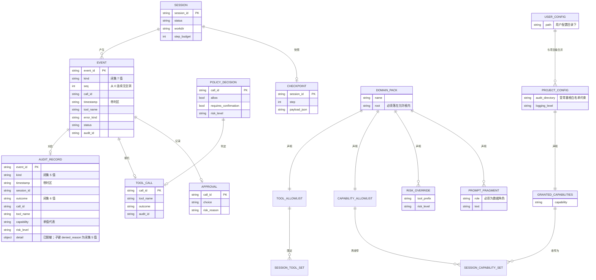

**图 D-11 数据模型**（与实验 1 [`05-行为与数据图表.md`](../experiment-1-requirements/05-行为与数据图表.md) 的 D-3/D-4 同口径，补入检查点实体）。
**存储形态**：全部为**文件 + 单机目录**，无数据库——审计/事件为 JSONL、配置与领域包为 TOML、
检查点为 JSON、模型资产为 GGUF、基准产物为结构化文件 + 索引。

## 6.2 关键实体与字段

### 6.2.1 审计事件 `AuditEvent`（一行一个 JSON，只追加）

> **字段计数口径**：`AuditEvent` 共 **10 个字段**（下表前 10 行）。
> 第 11 行 `detail["denied_reason"]` **不是独立字段，而是 `detail` 对象的子键**——
> `outcome=deny` 时必填；单列一行是因为它的取值是闭集、需与字段同级的可核对性。

| 字段 | 类型 | 必填 | 取值/约束 |
| --- | --- | --- | --- |
| `event_id` | string | ✅ | `uuid4().hex`；与 `PolicyDecision.audit_id` / `ToolResult.audit_id` 同源 |
| `kind` | string（**闭集 5 值**） | ✅ | `policy_decision` · `approval` · `tool_call` · `execution_degradation` · `refusal` |
| `timestamp` | string | ✅ | **带时区** ISO-8601（不带时区即非法） |
| `session_id` | string | ✅ | 会话标识 |
| `outcome` | string（**闭集 6 值**） | ✅ | `allow` · `deny` · `confirm` · `ok` · `error` · `degraded` |
| `call_id` | string \| null | 条件 | `tool_call`/`policy_decision` 必填 |
| `tool_name` | string \| null | 条件 | `tool_call` 必填 |
| `capability` | string \| null | 可选 | 满足 `capability is None` ⇔ `detail["requested"] == []`；**必须是合法能力值或 None，不得是裸 str** |
| `risk_level` | string \| null | 条件 | `policy_decision` 必填 |
| `detail` | object | ✅ | **已脱敏**；`policy_decision` 必有 `detail["requested"]`（升序 `list[str]`） |
| `detail["denied_reason"]`（**子键，非字段**） | string（**闭集 5 值**） | `outcome=deny` 时必填 | `unknown_tool` · `not_exposed` · `invalid_arguments` · `policy_denied` · `approval_denied` |

**图—表交叉核对**：§6.1 图 D-11 的 `AUDIT_RECORD` 实体字段与本表**逐字段一致**
（`detail` 在图内以对象形态标注其 `denied_reason` 子键）；`EVENT` 实体与 §6.2.2 的字段分组一致
（§6.2.2 按语义分组陈述，图内逐字段列出）。

三条必须连读的不变式：**I-D1** `deny` 专指"未执行"，不得用 `error` 代替；
**I-D2** `denied_reason` 是我方生成的定长短码，不含不可信内容；
**I-D3** 同一 `call_id` 允许多条事件 ⇒ 判据是"存在且可回放"，不是"恰好一条"。
（权威定义：[`../design/interfaces/audit.md`](../../design/interfaces/audit.md) §2，含 I1~I4 与落点白名单 P1~P7。）

### 6.2.2 会话事件 `SessionEvent`（JSONL 输出与终端渲染的载体）

| 字段 | 类型 | 语义 |
| --- | --- | --- |
| `kind` | 闭集 7 值 | `model_response` · `tool_call` · `policy_decision` · `approval_result` · `tool_result` · `error` · `task_finished` |
| `session_id` / `seq` / `timestamp` | string / int / string | `seq` 从 0 起**连续无空洞**、跨 `run` 不重置；时间戳带时区 |
| `call_id` / `tool_name` | string \| null | 关联键；`tool_name` 原样取自模型请求 ⇒ **不可信数据**，渲染前必须净化 |
| `response` / `decision` / `approval` / `result` | 嵌套对象 \| null | 按各自契约字段表递归展开 |
| `text` | string \| null | **我方生成**的中文说明；不得承载模型/工具原文或参数值 |
| `error_kind` / `status` | 闭集 \| null | `transient`/`unreachable`/`protocol`/`stalled`/`internal`；`completed`/`failed`/`limit_reached` |
| `audit_id` | string \| null | 可回放入口（`TOOL_RESULT` 必填非空） |

关键不变式（实现必须断言、测试必须覆盖）：I1 配对与串行（含三条可判定的例外）、
I2 决策与确认的相对位置、I3 `result is None` ⇔ 未执行、I4 审计可回放、
I6 终态唯一且最后、I7 `FAILED` ⇒ 至少一条 `ERROR`（反向不成立）、
I8 不可信内容的位置（干净字段）、I9 `seq` 连续、I10 无凭据。
（权威定义：[`../design/interfaces/harness.md`](../../design/interfaces/harness.md) §2.2。）

**完整 14 字段表**（与 `contracts/harness.py::SessionEvent` 一致；上表为按语义分组陈述，本表为逐字段清单）：

| # | 字段 | 类型 | 语义 |
| --- | --- | --- | --- |
| 1 | `kind` | `SessionEventKind` | 闭集 7 值（见上） |
| 2 | `session_id` | str | 与 `AuditEvent.session_id` 同源 |
| 3 | `seq` | int | 会话内从 0 连续无空洞；跨 `run` 不重置（I9） |
| 4 | `timestamp` | str | ISO-8601 带时区 |
| 5 | `call_id` | str \| null | 关联键（4 个工具类 kind 必填） |
| 6 | `tool_name` | str \| null | 原样取自模型请求 ⇒ **不可信**，渲染前净化 |
| 7 | `response` | ModelResponse \| null | 模型响应整体（`MODEL_RESPONSE` 必填） |
| 8 | `decision` | PolicyDecision \| null | 策略决策（`POLICY_DECISION` 必填） |
| 9 | `approval` | ApprovalResult \| null | 人工确认结果（`APPROVAL_RESULT` 必填） |
| 10 | `result` | ToolResult \| null | **`None` ⇒ 本次调用未执行**（I3） |
| 11 | `text` | str \| null | **我方生成**的中文说明；不得承载模型/工具原文或参数值（I8） |
| 12 | `error_kind` | SessionErrorKind \| null | 错误分级（`ERROR` 必填） |
| 13 | `status` | TaskStatus \| null | 任务终态（`TASK_FINISHED` 必填） |
| 14 | `audit_id` | str \| null | 可回放入口（`TOOL_RESULT` 必填非空，I4） |

**不变式逐条**（实现必须断言、测试必须覆盖）：

| 编号 | 内容 |
| --- | --- |
| I1 | 配对与串行：每条 `MODEL_RESPONSE.response.tool_calls[i]` 对应**恰好一条** `TOOL_CALL` 与**恰好一条** `TOOL_RESULT`（`call_id` 相同、`TOOL_CALL` 在前）；**唯一例外**：三条"我方不变量/基础设施故障"路径（审批通路故障、`resolve` 返回 `None`、工具 `audit_id` 为空）允许悬空 `TOOL_CALL`，但必须伴随 `ERROR(INTERNAL)` + `TASK_FINISHED(FAILED)`——可机器检查：悬空只允许出现在 FAILED+INTERNAL 的流里 |
| I2 | `TOOL_CALL` 与 `TOOL_RESULT` 之间**至多一条** `POLICY_DECISION` 与**至多一条** `APPROVAL_RESULT`（同一 `call_id`）；`APPROVAL_RESULT` 存在 ⇔ `requires_confirmation` 为真**且**配置了 `ApprovalGate` |
| I3 | `TOOL_RESULT.result is None` ⇔ 本次调用**未执行**；此时 `text` 非空、`audit_id` 非空。`result is not None` ⇒ 已执行，成败看 `result.ok`（**不得**用 `ok=False` 表示"未执行"） |
| I4 | `TOOL_RESULT.audit_id` 非空，且审计中存在 `kind=TOOL_CALL`、`call_id` 相同、`event_id == audit_id` 的事件；判据是"**存在且可回放**"，不是"恰好一条" |
| I5 | `POLICY_DECISION.audit_id == decision.audit_id`；`APPROVAL_RESULT.audit_id == approval.audit_id` |
| I6 | `TASK_FINISHED` **恰好一条**且是流中**最后一个**事件；`status`/`text` 均非空 |
| I7 | `status is FAILED` ⇒ 流中至少一条 `ERROR`；**反向不成立**（允许 `ERROR` 后最终 `COMPLETED`） |
| I8 | 事件**不得**出现原始 `arguments_json` 独立字段；`text` 不得包含参数值或未声明键名；不可信内容的合法去向只有 `response.content`/`result.content`/`result.error`/`tool_name` 四处 |
| I9 | `seq` 在同一 `Session` 实例内从 0 起连续无空洞 |
| I10 | 事件不含任何凭据字段，不暴露 `os.environ` |

### 6.2.3 领域包 `pack.toml`（声明式，闭集键）

| 段 | 键 | 必填 | 约束 |
| --- | --- | --- | --- |
| `[pack]` | `name` | ✅ | `^[a-z0-9][a-z0-9-]{0,63}$` |
| | `version` | ✅ | `MAJOR.MINOR.PATCH`（只校验形状） |
| | `description` | 可选 | ≤ 500 字符（校验后丢弃） |
| `[prompt]` | `fragments` | 可选 | ≤ 8 条，单条 ≤ 2000 字符；**永不进 SYSTEM 位** |
| `[tools]` | `allowlist` | ✅ | 必须是已知工具名；含未知名即拒绝 |
| `[security]` | `capabilities` | ✅ | 必须是已知能力名；与用户授予**求交集**（只收窄） |
| | `risk_overrides` | 可选 | 键为已知工具名，值为已知风险等级 |
| `[output]` | `format` | 可选 | 仅 `markdown` \| `text` |

硬约束：目录内出现 `.py`/`.pyc`/`__pycache__` ⇒ **拒绝加载**（模块不入内存、副作用不发生）；
`directory` 必须落在允许根内。⇒ 合起来即"**领域包是数据，不是代码**"的可执行形式。

### 6.2.4 配置（用户级/项目级 TOML）

| 项 | 约束 |
| --- | --- |
| 合并语义 | 用户级 + 项目级按键合并；**只允许收窄权限**（配置只能从授予集合里减，不能凭空增加） |
| 未知键 | 未知段/未知键 ⇒ `ConfigError`（"向前兼容地忽略"会让笔误变成静默放宽） |
| `audit.directory` | 必须是 `ALLOWED_AUDIT_ROOTS`（常量，**配置不得影响**）内的路径；越界 ⇒ `ConfigError`，不回退默认 |
| 信任级别 | 项目级配置**随仓库走 ⇒ 按不可信输入对待** |

### 6.2.5 检查点 `SessionState` 与模型资产、基准产物

| 实体 | 字段/结构 | 约束 |
| --- | --- | --- |
| 检查点 | `session_id` / `task` / `step` / `messages`（序列化为 JSON） | 纯函数快照/还原；还原严格校验，失败 ⇒ `SchemaError`；**落盘路径未决**，任何落盘必须沿用审计落点口径（根不来自不可信来源、先校验后创建） |
| 模型资产 | GGUF 文件 + sha256 摘要 + 来源 | 摘要不符即拒绝（`model/assets.py` ⛔ 未开工） |
| 基准产物 | 环境指纹 / 性能数据 / 能力数据 / 人读报告 / 索引，按轮次 id 归档 | 数据结构**强制**重复次数 ≥ 3 且极差自洽，不自洽即拒绝入库；只在同协议版本下跨轮比较；只由跑测脚本写 `bench/data` 分支 |

**数据生命周期与保留策略（三处未闭合项的具体化）**：

| 项 | 现状 | 设计规定 / 候选（含待裁决标注） |
| --- | --- | --- |
| 基准数据保留（`T-8`） | 实验 1 时间需求清单已定义 | **默认保留 30 天，可配置**；到期清理由跑测脚本执行（人手不得直接写 `bench/data`） |
| 审计文件保留 | 未设保留期 | **不自动清理**（证据面，只追加）；保留期策略属运维决策，本文不预设 |
| 审计文件轮换（§6.5 规则 2 的触发阈值） | 机制【规划态】：当前实现为"读取报错" | 候选 A：按大小（如 64 MiB）轮换；候选 B：按日期/会话轮换；候选 C：不轮换 + 读取侧容忍末行残行。**待裁决**（倾向 A+B：大小兜底、按会话可读）；无论选哪条，都不允许原地删行/补全 |
| 检查点落盘路径（§13.3 第 5 项） | 未决 | 候选 ①：用户状态目录下 `checkpoints/<session_id>.json`，根来自**常量白名单**（与审计同源）——倾向；候选 ②：工作目录内（随仓库走 ⇒ 不可信，**否决**）；候选 ③：仅内存（现状）。**待所有者裁决**；裁决前任何实现不得自行选 ② |

**关键字段取值域与默认值**（§6.2 各实体字段的"域"要素；来源 = 契约与实现的既定常量）：

| 字段 | 类型 | 取值域 / 默认值 | 来源 |
| --- | --- | --- | --- |
| `max_steps` | int | 正整数，默认 12 | SessionConfig |
| `max_consecutive_failures` | int | 正整数，默认 3 | SessionConfig |
| `MAX_TRANSIENT_RETRIES` | int | 2（同一步内重试，不新开步） | harness/errors.py |
| `tool_timeout_s` | float | 有限正数，默认 30.0 | SessionConfig |
| `max_prompt_tokens` | int | 正整数，默认 8192 | SessionConfig |
| `ContextBudget.reserve_tokens` | int | 非负且 `< max_tokens`，默认 1024 | harness/context |
| `max_completion_tokens` | int \| null | 正数或 `None`（服务端默认）；实测 384 失败 / 1536 通过 | SessionConfig |
| 模型 `timeout_s` | float | **必须为正**（`None` ≠ 无限等待），默认 60 s；本环境实测需 600 s | model.md §4 |
| `arguments_json` 上限 | 字节数 | 64 KiB | §5.2.6 |
| 工具输出上限 | 字节数 | 64 KiB（`MAX_TOOL_OUTPUT_BYTES`） | tools/registry.py |
| 模型响应体上限 | 字节数 | 1 MiB（`max_response_bytes`） | §5.3.1 |
| `session_id`/`call_id`/`event_id`/`audit_id` | str | `uuid4().hex`（32 位十六进制） | 契约 |
| `seq` | int | ≥ 0，会话内连续无空洞 | harness.md §2.2 |
| `pack.name` | str | `^[a-z0-9][a-z0-9-]{0,63}$` | §6.2.3 |

## 6.3 格式与约束（汇总）

| 格式 | 用途 | 约束 |
| --- | --- | --- |
| TOML | 配置、领域包 | `tomllib`（标准库）；未知键拒绝；UTF-8 |
| JSONL | 审计、事件流、JSON 输出 | 一行一个 JSON 对象；`ensure_ascii=False`；`sort_keys=True`（审计）；键不省略（`null` 显式写出） |
| JSON | 检查点 | 严格 schema 校验后还原 |
| ISO-8601 | 时间戳 | **必须带时区**（naive 时间跨时区比较会静默出错） |
| GGUF | 模型权重 | 来源 + sha256 可核对 |
| UTF-8 | 全部文本 | 界面中文优先；标识符英文 |

## 6.4 一致性策略

| # | 策略 | 理由 |
| --- | --- | --- |
| 1 | **只追加 + fsync**：审计每次追加即关闭句柄，`flush()` = fsync | 崩溃最多影响正在写的一行；不丢已确认事件 |
| 2 | **显式关联键**：事件流 ↔ 审计靠 `audit_id`/`call_id`，不靠时间戳猜 | "可回放"的前提是确定性 |
| 3 | **确定性代表**：多能力时 `capability` 取字典序最小者（`min(..., key=str)`），完整集合进 `detail["requested"]` | 同一输入在不同版本给出同一审计内容，历史事件才可比对 |
| 4 | **拒绝原因闭集且可分**：5 个定长短码；`unknown_tool` 与 `not_exposed` 必须可分 | "我们裁掉了"与"模型幻觉了"同形会损害可回放性 |
| 5 | **拒绝 ≠ 失败**：`result is None` ⇔ 未执行；`ok=False` ⇔ 执行失败 | 两类在事件、审计、退出码中均可区分 |
| 6 | **配置只能收窄**：授予 = 用户授予 ∩ 领域包能力；暴露 = 档位预算 ∩ 工具白名单 | 伪造配置不构成提权路径 |
| 7 | **数据不自洽即拒绝入库**：基准数据重复 < 3 或极差矛盾 ⇒ 拒绝 | 坏数据比没数据更危险（`T-14`） |

## 6.5 重启后一致性核对（跨进程/异常中断）

> §6.4 是**进程内**的读写约定；本节回答"**进程崩溃或重启后**，三份落盘产物如何对齐校验"。
> 总原则：**坏了就拒绝，不猜**——任何"猜着补一条"的处置都会把证据面变成故事会。

**三份产物的角色分工**：

| 产物 | 角色 | 崩溃后可能的形态 |
| --- | --- | --- |
| 审计 JSONL | **证据面**（跨重启长期留存） | 末行可能不完整（写一半崩）；此前各行完整 |
| `--output-format json` 事件流 | **界面载体**（流式消费，会话终止即定稿） | 可能缺 `TASK_FINISHED`（崩在终止前） |
| 检查点 JSON | **会话内恢复点**（快照语义） | 可能是旧快照或损坏文件 |

**核对规则（设计规定）**：

1. **审计读取（现状，已实现）**：读取侧逐行严格校验（`splitlines` + 逐字段类型/枚举校验），
   非法行 ⇒ 抛 schema 错误并指明行号——**不静默跳过**（跳过一行等于可能丢掉一条证据，
   fail-secure 取向；空行跳过是既有宽容，不算跳过事件）。
2. **残行处置（设计规定，当前实现为"读取报错"）**：末行不完整 ⇒ 判定为"写入中断的残行"；
   只追加原则下**不允许原地删行/补全**；运维处置 = 将该文件**归档为只读** + 启用新审计文件
   （轮换），轮换原因写入新文件首条。⚠️ 轮换机制本身【规划态】，当前最低要求是**报错而非放行**。
3. **事件流完整性（判据可机器检查）**：重启后消费一份 JSONL 流，按 I6（`TASK_FINISHED`
   恰好一条且最后）与 I1（`TOOL_CALL`/`TOOL_RESULT` 配对）核对；缺终态 ⇒ 该流按
   **"未完成会话"**处置，**不得**当作成功（退出码由终止事件决定，§7.3）。
4. **检查点还原**：`from_payload` 严格校验，失败 ⇒ `SchemaError` ⇒ 拒绝恢复（§4.7.3）；
   快照 `step` 与事件流不一致 ⇒ 以快照为准并显式记录冲突，不静默（§4.7.3）。
5. **三者对齐判据**：审计 `event_id` ↔ 事件 `audit_id` ↔ `ToolResult.audit_id` 三者同源
   （§6.4 策略 2）；重启后回放按 `call_id` 对齐，**不靠时间戳猜**。

> **持久化语义（如实）**：`emit` 每次追加即关闭句柄；`flush()` 才 `fsync`（进程退出路径）。
> 进程崩溃时已 `write` 的行在 OS 层完整（不会撕行）；断电/内核崩溃可能丢末段未 fsync 的数据
> ⇒ 表现为"事件数比预期少"，由规则 3 的终态判据识别，**不**由读取侧编造。

---

# 7. 界面与交互设计要点

## 7.1 用户角色 × 界面形态矩阵

| 角色 | 界面形态 | 交互要点 | 现状 |
| --- | --- | --- | --- |
| A 类：离线开发者 / 现场技术人员 | 交互式 CLI（需终端） | 人类可读渲染（Rich）；高危操作三选项确认 + **风险说明来自策略引擎**；中文优先 | ✅ |
| A 类 / CI 脚本 | 非交互 CLI | `--output-format json` 时 stdout **只出 JSONL**；退出码语义固定；可脚本化 | ✅ |
| 审计与复核者 | 审计文件 + 日志 | 按事件标识从**落盘文件**还原；可按时间/工具/结果检索 | ✅（回放 ✅；三维检索视图 🟡） |
| B 类：数字能力受限人群 | 图形界面 + 通俗提示 | 极简流程、说人话、高代价场景拒答 | ⛔ 未开工（本期不验收） |
| 产品所有者 / 维护者 | 声明式配置 | 项目级/用户级 TOML + 领域包；配置只能收窄 | ✅ |

## 7.2 交互式 CLI

- **渲染分支表**：每种 `SessionEvent.kind` 有确定渲染（`MODEL_RESPONSE`/`TOOL_CALL`/`POLICY_DECISION`/`APPROVAL_RESULT`/`TOOL_RESULT`/`ERROR`/`TASK_FINISHED`），"未执行"与"执行失败"在显示上必须可区分。
- **权限确认**：展示 `risk_level` + `reason` + `arguments_summary`（键名升序、≤ 400 字符、非标量标注形态）；三个选项（本次/总是/拒绝）均被审计。
- **中文优先**：界面文案、`PolicyDecision.reason`、`ERROR.text` 均为中文；代码内字符串默认英文（项目语言约定）。

## 7.3 非交互 CLI 与退出码契约

| 退出码 | 状态 | 什么时候出现 | 失败方向 |
| --- | --- | --- | --- |
| `0` | 完成 | 任务正常结束（与"步数用尽"区分） | — |
| `1` | 任务失败 | 输出不可解析且重试耗尽 / 工具执行失败 / **无确认通路时需确认 ⇒ 一律拒绝** | fail-secure |
| `2` | 步数用尽 | 达步数上限而停止（**不是失败**） | — |
| `3` | 装配/配置故障 | 配置非法、审计落点越界、模型不可用 ⇒ **拒绝启动** | fail-secure |
| `4` | 审计写入失败 | **证据面损坏** ⇒ 冒泡并终止（不得降级为告警） | fail-secure |
| `5` | 其它未预期异常 | 兜底类别 | fail-secure |

两条输出硬规定：① `--output-format json` 时 stdout 只出 JSONL，诊断一律走 stderr；
② 所有来自模型/工具/用户的字符串写入终端前必须经 `sanitize_for_display`（防 ANSI 转义伪造显示）。

## 7.4 不可信输出的净化

`tool_name` / `response.content` / `result.content` / `result.error` 均来自模型或工具 ⇒ 不可信；
渲染前净化（控制字符与 ESC 替换为 `?`）；JSON 模式由 `json.dumps` 负责转义，**不得手工拼接**。
参数摘要只显示"键 + 类型标注"，不回显参数值（§5.2.5）。

## 7.5 规划中的界面（未开工，如实登记）

- 图形界面（TUI / 轻量 Web）：`REQ-UX-05`（Should）。CLI 未稳定前做 TUI 会重复返工（ADR-0015 §5.2.6 已明确不引入 Textual）。
- 面向低数字素养的可理解性设计：`REQ-UX-06`（Should），**需用户测试验证**（实验 1 §2.7.1 的 UV-3）。
- 两者本期**不验收**；B 类需求按 `Q-1` 裁决作"同一内核 + 领域包 + 输出护栏"的机制验证场景。

**B 类最低交互判据（规划态，需用户测试）**：GUI 开工前先把"可检查的最低标准"定下来，
供后续设计与验收对照——① 单个事务的步骤 ≤ 3 步、无需外部协助；
② 错误提示必须含两要素：**发生了什么**（中文、无术语或术语即席解释）+ **下一步做什么**；
③ 高代价场景（用药/法律/钱财）出现时**必须拒答或转人工**，不得"尽力尝试"（与 `REQ-SEC-08` 同源）；
④ 验证方式 = 小样本任务测试 + 出声思维法（实验 1 §2.7.1 的 UV-3）；
**未做用户测试前，不得声称上述任一条已满足**。

## 7.6 安装、分发与平台可移植性（`REQ-UX-03` / `REQ-PLAT-01~03`）

**安装与分发（`REQ-UX-03`）**：

| 项 | 设计 |
| --- | --- |
| 分发形态 | wheel（`hatchling` 构建，`py3-none-any`，含 `py.typed`）；命令入口 `lowspec`（`pyproject.toml` 的 `[project.scripts]`） |
| 一条命令安装 | `pip install <wheel>`（或 `uv tool install`）即得命令入口；**运行期依赖已锁定**（`uv.lock`）且无编译扩展 ⇒ 安装不需要本地工具链 |
| 依赖策略 | 运行期 = 标准库 + 少量纯 Python 包（structlog、platformdirs、tree-sitter 系列、Typer/Rich）；**安装期不拉取模型权重**（GGUF 由用户放置/外部下载，§6.2.5） |
| 可复现构建 | `uv build` 干净环境可复现；版本号里程碑驱动（[ADR-0019](../../adr/0019-release-and-version-policy.md)） |

**平台差异抽象点（`REQ-PLAT-01/02`）**——可移植性不靠"到处 if 平台"，靠三个收口点：

| 抽象点 | 落点 | 平台差异 |
| --- | --- | --- |
| 路径校验 | `foundation/paths.py::resolve_within` | Windows 盘符 / UNC / 大小写不敏感；Linux `//` 折叠（已实测 `//server/share` → `/server/share`，判不构成独立绕过面） |
| 子进程与资源上限 | `foundation/proc.py` | uid 切换与 `setrlimit` 在 Windows 不可用 ⇒ L1 档在 Windows 退化为"路径白名单 + 审批 + 审计"，隔离维度如实记 `enforced=False`（§3.2.5） |
| 配置目录 | `platformdirs`（用户级配置与审计落点的父目录） | 各平台用户状态目录约定不同 |

**验证方式**：CI 多平台构建矩阵（⛔ 当前流水线仅 Linux ⇒ `REQ-PLAT-01` 未达成，如实登记）；
纯 CPU / 无 x86 专有指令已实测（`REQ-PLAT-02` 的部分判据）；
**移动端仅作架构约束 + 一次可行性验证，不交付 App**（`REQ-PLAT-03`；SRS Won't）。

---

# 8. 非功能设计

> 口径纪律（实验 1 §4.1）：本节性能数字是**当前实测值**，不是"要达成的目标值"；
> 凡"≥/≤"指标，基线取"普通水平"并写明来源；换模型/换硬件**必须重新实测**。

## 8.1 性能

**测量环境（可复现）**：云开发容器 8 vCPU（AMD EPYC 9K65，avx2/avx512）、16 GiB 内存、
无加速器、`llama-server 0.4.1-dev`（commit `69eb250`）、上下文 4096、`temperature=0`、非流式；三档参数完全一致，仅模型不同。

| 档 | 模型 | 常驻内存峰值 | 生成速度 | 三任务总耗时 |
| --- | --- | --- | --- | --- |
| S | 2B（4-bit） | 2.68 GiB | 27.2 tok/s | 35.9 s |
| M | 4B（4-bit） | 4.85 GiB | 16.6 tok/s | 73.8 s |
| L | 8B（4-bit） | 8.70 GiB | 9.4 tok/s | 132.3 s |

| 设计应对 | 可度量目标 | 验证思路 |
| --- | --- | --- |
| 硬件档位 S/M/L 固定三档 + 启动探测一次（`REQ-PERF-06`） | 8 GiB 设备不 OOM；同一探测结果产生同一配置 | 限内存（cgroup/`RLIMIT_AS`）端到端复跑；探测→决策→生效配置三段留痕用例 |
| 上下文效率引擎（压缩/观察屏蔽）（`REQ-PERF-02`） | 同等成功率下 token 消耗下降 ≥ 30% | 对照实验（同任务、同模型、重复 ≥ 3 次报极差）；**当前无证据 ⇒ 按"未验证"表述** |
| token 预算与请求超时可配置 | 实测 `384` 失败 / `1536` 通过；超时默认 60 s 不够、需 600 s | 换模型/硬件必须重测（T-10 口径） |
| 基准工具 + 归档（`REQ-PERF-04/07`） | 4 份结构化文件 + 索引；跨轮只在同协议版本下比较 | 机器检查拒绝不自洽数据；`bench/data` 分支只由脚本写 |
| 性能数字的**复跑入口**（使"自述"变"可复跑"） | 本表数字**不是不可核的自述**：跑测入口 = `make bench`（开发桶，`api_trigger_bench`）或 `scripts/bench/run.sh`（本地）；产物按轮次 id 归档于 `bench/data` 分支（只由跑测脚本写，人手不得直接提交），含**环境指纹与协议版本** | 换模型/换硬件必须重测；跨轮只在同协议版本下比较（§12.5）；单次采样不得作阈值判据 |

## 8.2 可靠性

| 设计应对 | 落点 | 验证 |
| --- | --- | --- |
| fail-secure：判不出、算不出、写不出 ⇒ 不放行 | §4.5、§9.2 故障表 18/19 条为 fail-secure | 每条故障模式有可观测性与用例载体 |
| 分级错误处理（瞬时重试/回喂自恢复/上报） | `harness/errors.py` 的 `RETRY/FEEDBACK/ABORT` | "单步失败不导致整体失败"用例；`STALLED` 计数触发 |
| 会话检查点与中断恢复 | `harness/checkpoint.py`（纯函数快照/还原） | 恢复后上下文一致（单测）；落盘路径未决 ⇒ 登记待办 |
| 证据不丢失 | 审计只追加 + fsync + 构造期白名单 | `AuditWriteError` 冒泡用例 + 变异探针 |
| 退出码可归因 | 0~5 语义固定 | 集成用例逐条断言 |
| 测试覆盖（`REQ-OPS-02`） | **安全与策略相关代码行覆盖接近 100%**；新增代码覆盖率不得下降 | `make test-cov`（口径：[`../../engineering/testing-strategy.md`](../../engineering/testing-strategy.md) §7——目标是**关键路径全覆盖**，不是刷数字；禁止用无意义断言刷覆盖率） |

## 8.3 安全

| 安全需求 | 设计应对 | 可度量目标 / 现状 | 判据编号（用例见 §12.3） |
| --- | --- | --- | --- |
| default-deny + 最小权限（`REQ-SEC-01`） | 默认授予空集；配置只能收窄；每次调用独立判定 | 未授权操作拦截率 100%（✅ 有行为级用例 + 对照组 + 变异探针） | `S1`/`S1-b`、`V1~V3` |
| 不可逆操作人再看一眼（`REQ-SEC-02`） | 风险分级 + 审批门 + 理由必须展示；无通路即拒绝 | 三种选择均可用且被审计（✅） | `S-new-1`/`S-new-4`/`S-new-5` |
| 指令-数据分离（`REQ-SEC-03/04`） | SYSTEM 只由本方常量产生；包片段走 `role=USER` 数据消息 + 角色守卫；工具输出一律按数据装配 | 结构性守卫 ✅；**注入语料集不存在、检测组件未开工 ⇒ `T-04` 未缓解，按"未验证"表述** | `S-new-6`（注入语料集与检测：缺，见 §13.3） |
| 受限执行（`REQ-SEC-05`） | L1 用户态（路径白名单 + 审批 + 审计 + rlimit）+ L2 命名空间/容器（可选）；档位由主动探针判定，**禁止以退出码判定** | ⛔ 未开工（当前仅资源上限有行为断言）；`T-13` 部分缓解 | `P1~P7`（⛔ 沙箱实现后补）；`T-01` 的 rlimit 行为用例已落地 |
| 可回放审计（`REQ-SEC-06`） | §6.2.1 事件模型 + 落点白名单 + 冒泡规则 | ✅ 已实现并验证（两处真实落盘端到端 + 变异探针） | `S1` 可回放链路、`W1~W8`、`S-new-3` |
| 敏感信息不出（`REQ-SEC-07`） | 日志/审计脱敏；子进程最小环境；出站白名单 | 🟡 日志与子进程侧 ✅；**出站白名单无载体 ⇒ `T-10` 未缓解** | `S-new-2`；`T-08` 凭据 canary |
| 能力边界拒答（`REQ-SEC-08`） | `security/refusal.py` 据未满足维度拒答或转人工 | ⛔ 未开工；拒答正确率 ≥ 95% **无基线，不得作验收依据** | `REFUSAL` 判据未建（⛔） |
| 供应链（`REQ-TOOL-03`） | 工具描述摘要校验（不符即拒绝注册）；依赖锁定；权重/二进制摘要 | 🟡 摘要机制 ✅ 但当前无防护对象（MCP 未接入） | `T-09` 摘要 fail-secure 单测；`F-18` 门禁 |

**威胁模型状态（如实，唯一真源 = [`../design/threat-model/`](../../design/threat-model/README.md)）**：
15 条 `T-01`~`T-15`，**已缓解并验证 1 / 部分缓解 12 / 未缓解 2**；缺行为层验证 6 条。
本设计文档**不含"安全已到位"的结论**——"机制已实现" ≠ "威胁已缓解"。

## 8.4 可扩展性

| 扩展点 | 机制 | 约束 |
| --- | --- | --- |
| 新场景 | 领域包（提示/工具/能力/风险覆盖，声明式） | 只能收窄；未知键拒绝；无代码 |
| 新后端 | `ModelClient` / `SandboxBackend` / `AuditSink` Protocol 可替换 | 新实现必须满足同一契约（超时、上限、回环/白名单） |
| 新工具 | `ToolRegistry` 注册 + `description_digest` | 安全层先于工具扩张（MCP 接入前先备好出站白名单） |
| 新档位 | 硬件档 S/M/L 与能力档位**两轴独立** | 任何代码不得两轴互转；**能力档位已于 2026-09-22 裁决定案为 3 档、保留现名**（`BASIC`/`STANDARD`/`ADVANCED`；实验 1 §9.1 的 `Q-3`），此后若变档数/成员名须走 ADR |
| 新事件类型 | `AuditEventKind` / `SessionEventKind` 闭集扩容 | 须 ADR + 影响面评估 + 触发用例 |

## 8.5 可维护性

| 设计应对 | 落点 | 验证 |
| --- | --- | --- |
| 契约先行 + 零行为契约层 | `interfaces/` → `contracts/` → 实现 | "只读契约写 fake 跑单测"可实现；契约变更顺序机器强制 |
| 分层依赖机器检查 | `test_architecture_layers.py` 九条断言 + 变异探针 | 约定不只写在文档里 |
| 单一主语言 + 严格类型 | Python ≥ 3.12；`mypy --strict` 全绿 | `make check` 门禁 |
| 文档与代码同一次变更内更新 | DoD 要求 | 一致性核查报告 |
| 术语与编号统一 | 术语表（§14）；需求/威胁/ADR 编号只增不复用 | 追溯矩阵（§11） |

## 8.6 约束、假设与外部依赖

**约束**：单人开发约 2~3 个月（首要目标"能完成"）；不产生费用（GPU 无免费额度 ⇒ 不用 GPU）；
开发环境为云容器 8 vCPU / 16 GiB；无 KVM；Python 单一主语言；依赖已锁定版本。

**外部依赖（不可用时的行为）**：

| # | 依赖 | 若不可用 |
| --- | --- | --- |
| D-1 | 本地推理服务 `llama-server`（回环） | 启动失败 ⇒ 装配期失败（退出码 3） |
| D-2 | 本地 GGUF 模型文件 | 缺失 ⇒ 装配期失败 |
| D-3 | 文件系统与权限 | 越界 ⇒ 拒绝启动 |
| D-4 | 网络 | 默认不出站；需要网络的能力未实现 |
| D-5 | OS 能力（命名空间等，可选） | 不可用 ⇒ 降级到用户态档并记录（**不得放行**） |
| D-6 | 流水线平台（跑测与归档） | 不可用 ⇒ 基准数据不更新（不影响产品运行） |

**关键假设（来自实验 1 §1.4，影响本设计的部分）**：A-2 已被证伪（命名空间沙箱在本环境
静默失效）⇒ 直接塑造了 §2.4 的 L1/L2 分层与 fail-secure 降级设计；
A-3（8 GiB 端到端）部分成立、限内存实测未做 ⇒ §8.1 的验证缺口如实登记。

## 8.7 关键非功能项的四要素与可扩展性演练

**四要素表**（目标值 — 测量方法 — 判定阈值 — 复测触发条件）：

| 项 | 目标值 | 测量方法 | 判定阈值 | 复测触发条件 |
| --- | --- | --- | --- | --- |
| `REQ-PERF-01` 延迟基线 | 有可复现基线（**不设绝对阈值**，既定口径） | `make bench` 三档同参数，重复 ≥ 3 报极差 | 极差在报告标明；单次采样**不得**作判据 | 换模型 / 换硬件 / 换推理后端版本 |
| 内存预算（`R-1`） | 常驻 RSS ≤ 档位预算（4 / 8 / 16 GiB） | cgroup 或 `RLIMIT_AS` 限内存端到端复跑 | 任一档超预算 ⇒ 修订预算列（ADR-0011 §7 口径：改预算不改实测值） | 换模型 / 换量化档 |
| `REQ-PERF-02` token 降幅 | 同等成功率下下降 ≥ 30% | 对照实验（同任务、同模型，开/关压缩各 ≥ 3 次） | **当前无证据 ⇒ 按"未验证"表述**，不得称达标 | 压缩算法变更后 |
| `REQ-SEC-01` 拦截率 | 100% | 安全用例（含对照组 + 变异探针） | 任一未授权调用被执行 ⇒ 失败 | 策略引擎 / 能力模型变更后 |
| `REQ-SEC-08` 拒答正确率 | ≥ 95% | 标注语料 + 双人独立判定 | **无基线 ⇒ 不得作验收依据** | 拒答组件落地后 |
| `REQ-OPS-02` 覆盖率 | 安全/策略相关代码行覆盖接近 100% | `make test-cov` | 覆盖率下降 ⇒ 失败（testing-strategy §7） | 每次 PR |

**可扩展性演练清单**（"新增一个 X 需要改哪几处"——把可扩展性从口号变成可核对清单）：

| 演练 | 需触碰的位置 | 必改判据 / 检查 |
| --- | --- | --- |
| 新增一个**只读工具** | ① `tools/` 新 Tool 类（`spec` + `invoke`；路径走 `resolve_within`）；② `parameters_schema` 手写 dict（关键字 ⊆ §5.2.6 子集）；③ `cli/app.py` 注册进 `ToolRegistry`；④ 能力声明经 `parse_capabilities()`；⑤ `tests/unit/test_tools_*.py`；⑥ 若随领域包交付则更新 `examples/packs/` 白名单 | `H-11`（schema 子集守卫）、`S1`/`S1-b`（未授权不执行）、`T-02`（路径越界拒绝） |
| 新增一个**模型后端** | ① 实现 `ModelClient` Protocol（回环 / 超时 / 响应上限三约束）；② `cli/app.py` 装配点注入；③ 路由规则（⛔ 规划态）；④ `tests/unit/test_model_*.py` + 双后端集成 | model.md §4 全部约束 + `S-new-2`（`network_allowed` 语义不变） |
| 新增一个**领域包** | ① `examples/packs/<name>/pack.toml`（声明式）；② 机器检查 `test_example_packs.py` 自动覆盖 | 只读边界、未知键拒绝、包内无代码（`S3`） |

---

# 9. 异常与故障处理设计

## 9.1 设计原则

1. **fail-secure**：失败方向是拒绝，不是放行（19 条故障模式中 18 条为 fail-secure）。
2. **两类"没执行"处置相反**：策略求值失败收敛为拒绝；审计写入失败冒泡（§4.5）。
3. **拒绝是返回值，不是异常**：可判定、可断言、可回放；异常只保留给审计失败与编程缺陷。
4. **不得静默降级**：隔离降级、审计关闭、配置回退、未知键忽略——全部禁止，必须显式记录或拒绝启动。

## 9.2 故障模式与处理路径（F-1 ~ F-19）

| # | 故障模式 | 触发条件 | 系统行为 | fail-secure | 可观测性 | 重试预算 / 事件体现 |
| --- | --- | --- | --- | --- | --- | --- |
| F-1 | 模型输出不可解析 | 既无工具调用也无文本 | 重试预算内重试；耗尽则任务失败 | 是 | 事件流 + 审计；退出码 1 | 预算 `MAX_TRANSIENT_RETRIES=2`（同一步内，不新开步）；事件：`ERROR(TRANSIENT)`（将会重试）→ 耗尽后 `ERROR(PROTOCOL)` + `TASK_FINISHED(FAILED)` |
| F-2 | 生成预算不足 | token 预算过小（实测 384 失败 / 1536 通过） | 同 F-1（**不是"模型不行"**） | 是 | 同 F-1 | 同 F-1 预算；`finish_reason=LENGTH` ⇒ 增大 `max_tokens` 或按 `FEEDBACK` 回喂（§9.3） |
| F-3 | 模型请求超时 | 弱硬件生成慢（约 3.4 tok/s） | 重试；耗尽则失败 | 是 | 退出码 1 | 同 F-1 预算；超时值来自配置（本环境实测默认 60 s 不够、需 600 s） |
| F-4 | 参数不符合工具声明 | 模型给出非法参数 | 拒绝且不执行，原因=参数非法 | 是 | 审计含定长短码 | 无重试（一次判定即终态）；`TOOL_CALL/DENY` + `denied_reason=invalid_arguments` + `TOOL_RESULT(result=None)` |
| F-5 | 工具名不存在（幻觉） | 模型编造工具 | 拒绝，原因=未知工具；**不产生策略判定事件** | 是 | 审计 | 无重试；`unknown_tool`（与 F-6 必须可分） |
| F-6 | 工具存在但被裁剪 | 不在本会话暴露集合 | 拒绝，原因=未暴露 | 是 | 审计 | 无重试；`not_exposed` |
| F-7 | 未授予能力 | 能力集未包含所需能力 | 拒绝，原因=策略拒绝 | 是 | 审计 + 策略决策事件 | 无重试；`policy_denied` + `POLICY_DECISION` 事件 |
| F-8 | 非交互 + 需人工确认 | 无确认通路 | **一律拒绝**（不静默放行、不下调默认风险） | 是 | 退出码 1 + 审计 | 无重试；`approval_denied`；**不产** `APPROVAL_RESULT`（没有人被问过） |
| F-9 | 路径越界 | `..` 上跳 / 绝对路径 / 符号链接逃逸 | 工具层拒绝并留审计，不得回退放行 | 是 | 审计含原因=路径不允许 | 无重试；工具层 `TOOL_CALL`（`outcome=ERROR` + `detail.reason=path_not_allowed`，`Q-2` 口径） |
| F-10 | 审计写入失败（证据面损坏） | 落盘失败（磁盘、权限） | **冒泡并终止**（`AuditWriteError`，不得降级为告警） | 是 | 退出码 4（经 CLI）；不经 CLI 可按类型判定 | **不重试、不收敛**：异常原样冒泡（§4.5） |
| F-11 | 配置非法 / 审计落点越界 | 不可信的项目级配置 | **拒绝启动**（不回退默认、不静默关审计） | 是 | 退出码 3 | 不重试（装配期即失败）；`ConfigError`/`PathNotAllowedError` |
| F-12 | 步数用尽 | 循环达上限 | 正常停止并标记"步数用尽"（**与失败区分**） | — | 退出码 2 | 不是失败；`TASK_FINISHED(LIMIT_REACHED)`；调大 `max_steps`（默认 12） |
| F-13 | 领域包含 Python 代码 | 包内出现 `.py`/`.pyc` | **拒绝加载**，副作用不发生、模块不入内存 | 是 | 错误事件 | 不重试；`DomainPackError` |
| F-14 | 隔离机制静默失效/降级 | 探针判定命名空间不可用 | 显式降级并记录档位；**不得放行** | 是 | 档位记录（⛔ 载体未落地） | 不重试；规划态产 `EXECUTION_DEGRADATION`（§3.2.5） |
| F-15 | 子进程超限分配 | 资源上限被突破 | 由内核资源限制阻止 | 是 | 用例断言 | 无（内核阻止，非应用重试） |
| F-16 | 子进程环境含凭据 | 误传父进程环境 | 由 canary 用例拦截（回归防线） | 是 | 用例断言 | 无（静态 + 行为双重断言） |
| F-17 | 工具描述被篡改 | 描述与登记摘要不符 | **拒绝注册**（不静默剔除） | 是 | 错误事件 | 无；`ToolRegistrationError` |
| F-18 | 依赖出现已知漏洞 | 依赖命中漏洞库 | **门禁失败**，不可合并 | 是 | 门禁输出 | 无（门禁即判据） |
| F-19 | 基准数据不自洽 | 重复 < 3 / 极差矛盾 | **拒绝入库** | 是 | 存储层错误 | 无（数据结构强制） |

> **两套预算不要混**：上表的**瞬时重试预算**（`MAX_TRANSIENT_RETRIES`，模型侧单步内重试）与
> **连续失败计数**（`max_consecutive_failures`，默认 3；计数对象是"未执行或工具级失败"的连续出现，
> 达上限 ⇒ `ERROR(STALLED)` + 终止，§9.3）是**两个独立参数**——前者防抖动，后者防死循环。

## 9.3 恢复策略

| 失败类别 | 分级 | 恢复动作 |
| --- | --- | --- |
| 瞬时失败（网络抖动、单次协议错误） | `TRANSIENT` | 原地重试（预算内），事件流继续；允许 `ERROR` 后最终 `COMPLETED` |
| 可回喂失败（工具级失败、参数非法） | `FEEDBACK` | 把失败作为**观察内容**喂回模型自恢复（`REQ-HARNESS-06`：单步失败不导致整体失败） |
| 不可恢复（后端不可达且预算耗尽、连续失败达上限） | `UNREACHABLE`/`PROTOCOL`/`STALLED` | `ABORT`：`ERROR` + `TASK_FINISHED(FAILED)`，退出码 1 |
| 我方不变量被破 / 审批通路故障 | `INTERNAL` | `ERROR(INTERNAL)` + 终止；悬空 `TOOL_CALL` 只允许出现在"FAILED 且含 INTERNAL"的流里（可机器检查） |
| 会话中断 | —— | 检查点快照/还原（恢复后上下文一致）；恢复流程含损坏/`seq` 冲突分支，见 §4.7.3；落盘路径未决，登记待办 |
| 隔离降级 | —— | 显式降级 + `EXECUTION_DEGRADATION` 审计（ADR-0006 规则 S-2：禁止静默降级） |

---

# 10. 设计决策与权衡

> 每条决策只给**结论 + 被否决理由 + 出处**；完整论证在对应 ADR（ADR 只增不改）。

## 10.1 总体路线（实验 1 §1.5）

| 候选 | 内容 | 结论 |
| --- | --- | --- |
| A. 全部自研 | 自研推理后端、分发、协议、交互 | ❌ 单人 2~3 个月不可能，且无实质增量 |
| B. 直接套用现有 agent 工具 | 现成编码 agent + 本地模型 API | ❌ 不解决"能力适配"与"执行安全"，与两个子问题正交 |
| **C. 组装成熟开源组件 + 自研 5 模块（采纳）** | 复用推理/分发/协议/交互；自研：①统一模型层与能力探测 ②能力自适应 Harness ③能力边界感知安全层 ④上下文效率引擎 ⑤领域包机制 | ✅ 工作量可控，且自研的 5 件正是 P-A/P-B 的落点 |

## 10.2 分层方案（ADR-0015 §3/§4，加权评分）

| 方案 | 内容 | 得分与结论 |
| --- | --- | --- |
| **A（采纳）** | 四层纵向 + 两个横切能力层 + 一个零行为契约层 | **112**：依赖方向可用一条 DAG 严格表达并可机器检查；安全层落位与其真实形态一致；契约层消除循环依赖 |
| B（否决） | 六层纵向平铺 | **76**：安全层的纵向位置无解（放 TOOL 之下看不到 HARNESS 行为，放 UX 之上无法被 TOOL 复用）⇒ 不得不加大量反向引用例外，依赖方向失去约束力 |
| C（否决） | 不成层，按功能平铺 + 命名约定 | **60**：无法回答"谁能依赖谁"；最终退化为 `harness` 直接 `import subprocess`、`cli` 直接读密钥 ⇒ 与安全基线、可验证性直接冲突 |

## 10.3 关键选型与被否决方案汇总

| 议题 | 采纳 | 主要备选（否决理由摘要） | 出处 |
| --- | --- | --- | --- |
| 主语言 | Python 单一主语言 | 第二门语言（单人维护成本；与上游生态不对齐） | ADR-0004/0005 |
| 隔离方案 | L1 用户态（仅标准库）+ L2 命名空间后端（可选）；档位由主动探针判定，失败即降级且不静默放行 | 强隔离 KVM/microVM（环境无 KVM，A-2 已证伪）；以退出码判定隔离生效（已知 fail-open 形态） | ADR-0006/0007 |
| 硬件档位 | S/M/L 三档（2B/4B/8B），启动探测一次、运行中不调整 | 14B 档（需 ≥ 24 GiB，无法验证）；运行中自动调参（引入不可验证范围） | ADR-0010/0011 |
| 参数校验器 | 手写 JSON-Schema 子集校验器（加权 131） | pydantic 严格模式 + 转换层（72）；pydantic 模型类作唯一真源（56）；`jsonschema` 库（90）——共同缺陷：依赖面扩大、错误消息默认回显不可信输入 | ADR-0020 |
| pydantic 用途 | **两处用途均不落地**（配置用 tomllib、内部结构用 dataclass、校验用手写） | ——（`D2` 的修订登记） | ADR-0020 / ADR-0015 修订记录 |
| 本地 HTTP | 标准库 `http.client`（只连回环，避开 scheme 注入面） | urllib3 用于本地（其指定用途是云端；"可"非强制） | architecture.md §11 `G-3` |
| 云端 HTTP | `urllib3` 2.x | `httpx`（稳定线停滞、1.0 破坏性变更在即、默认读 `HTTP(S)_PROXY` 与"出站默认拒绝"取向不符）；`openai` SDK（本地云端都走 OpenAI 兼容协议，自研薄客户端一次覆盖） | ADR-0015 `D3` |
| 推理内核 | `llama-server` 子进程（llama.cpp） | `llama-cpp-python`（源码编译、把内核绑进 Python 进程，与测量纪律冲突） | ADR-0015 §5.2.6 |
| 编排形态 | 同步 `Iterator[SessionEvent]` | 全量 asyncio（无收益面、重写 5 模块）；`to_thread` 伪异步（与"客户端非线程安全"冲突）；`run`/`arun` 双接口（两倍测试面、必然漂移） | harness.md §2.9 |
| 审批回传 | 构造时注入 `ApprovalGate`（Protocol） | 裸 Callable（等价但更弱）；事件流 + `respond_approval`（破坏串行假设）；loop 内 `input()`（违反 R1、不可测、非交互挂死） | harness.md §2.5.4 |
| 审计落点根 | 常量 `ALLOWED_AUDIT_ROOTS`（单一根） | 整个应用状态目录（权限面大于需求）；配置给出（不可信来源）；调用方任意根无默认（"忘传"与"传宽根"都无护栏） | audit.md §2.5 |
| 审计覆盖范围 | 会话内；配置期/装配期拒绝**不进审计**（fail-closed + 理由写明） | foundation 持有 sink（违反 R1）；调用方各自 emit（靠纪律）；新增 path_guard 层（新增架构面）——三者均不需要 | audit.md §2.6（所有者裁决 Q-1） |
| `TOOL_CALL` 的 outcome | 允许集放宽为 `{OK, ERROR, DENY}`（不新增枚举成员） | 用 `ERROR` 代替 `DENY`（"执行失败"与"从未执行"同形） | audit.md §2.2 |
| 路径穿越拒绝的 outcome | 维持 `ERROR` + `detail.reason="path_not_allowed"` | 专用 `DENY`（要把"工具层自身拒绝"并入"策略/审批未执行"语义，造成原因不同的两类拒绝同形） | 威胁模型 §8.2 `Q-2` |
| `capability` 单值代表 | 确定性代表（字典序最小）+ 完整集合进 `detail["requested"]` | 占位成员 `NONE`（不能消除空集、两种表示、污染授权语义）；改集合字段（破坏已定案 schema、削弱可查询性） | policy.md §2.5（R1~R6） |
| 领域包格式 | 声明式 TOML，未知键拒绝 | JSON（无注释、手改体验差）；忽略未知键（笔误变静默放宽）；包内脚本钩子（R5 硬规则） | harness.md §4 |
| 示例包定位 | `examples/packs/` 两个只读包作为**正规可用路径** | 下调默认风险等级（把可用性问题变成安全缺陷） | ADR-0021 |
| 版本号 | 里程碑驱动（台账 + `make release`） | 按提交历史推导（绕过里程碑判据） | ADR-0019 |
| Agent 编排框架 | **不引入、不自研** | LangChain/LlamaIndex/LangGraph 等（核心论点就是 Harness 必须与模型能力协同设计；框架化会把控制权交给框架抽象） | ADR-0015 §5.2.6 |

## 10.4 刻意不自研清单（防范围失控）

推理内核/量化/GGUF 解析（llama.cpp）· 模型下载缓存协议（HF Hub 或手动放置）·
子进程隔离内核（OS：setrlimit + 可选容器）· 加密/TLS/随机数（标准库，禁止自研密码学）·
通用沙箱工具（作为可选后端消费，不硬依赖）· 代码解析器（tree-sitter）·
向量检索/embedding（本期不做，与低资源目标冲突）· IDE 插件/GUI 富客户端（SRS Won't）·
模型训练/微调（Won't）· 通用 agent 框架 · 追踪后端（可选接入）· 密钥管理设施（环境变量注入）。

---

# 11. 需求追溯矩阵

## 11.1 追溯方法

- **行 = 需求编号**（实验 1 的 49 条，编号与优先级原样引用，**未改**）；
- **列 = 设计元素**：以本文件章节号表示（如 `§4.3` = 关键流程设计的工具调用决策序列）；
- **读法**：每一行必须**至少一个非空落点**；§11.3 做反向自检（设计元素 → 需求）。
- 标 ⛔ 的落点表示"设计已定义、实现未开工"——它是待办，不是追溯空洞。

## 11.2 需求 → 设计元素（49 条）

### 11.2.1 模型层 `MODEL`（6 条）

| 需求 | 优先级 | 需求简述 | 设计落点 |
| --- | --- | --- | --- |
| `REQ-MODEL-01` | 中 | GGUF 发现/下载/校验/加载/卸载/列表 | §5.3.3、§6.2.5、§3.1（`model/assets.py` ⛔） |
| `REQ-MODEL-02` | 中 | 按可用内存预算推荐并校验量化档 | §8.1、§6.2.5、§3.1（⛔） |
| `REQ-MODEL-03` | 高 | 本地与云端模型统一抽象接口 | §5.2.1、§5.3.1、§5.3.2、§10.3 |
| `REQ-MODEL-04` | 高 | 纯 CPU 推理路径可用 | §2.4、§8.1、§8.6 |
| `REQ-MODEL-05` | 中 | 网络不可用时自动全本地降级 | §5.3.2、§9.3（⛔） |
| `REQ-MODEL-06` | 中 | 探针任务估计能力档位 | §6.2.5、§8.4、§3.1（⛔） |

### 11.2.2 代理核心 `HARNESS`（8 条）

| 需求 | 优先级 | 需求简述 | 设计落点 |
| --- | --- | --- | --- |
| `REQ-HARNESS-01` | 高 | ReAct 式多轮编排循环 | §4.2、§4.3、§3.2.1、§5.2.8 |
| `REQ-HARNESS-02` | 高 | 原生工具调用，失败可重试与修复 | §4.3、§5.2.1、§9.3 |
| `REQ-HARNESS-03` | 中 | 工具集按能力档位动态裁剪 | §3.2.1、§4.3 步 1、§8.4 |
| `REQ-HARNESS-04` | 中 | 提示模板按能力档位分级 | §3.2.1、§4.2 |
| `REQ-HARNESS-05` | 高 | 会话状态与检查点，中断恢复 | §3.2.1、§6.2.5、§9.3 |
| `REQ-HARNESS-06` | 高 | 分级错误处理（瞬时/回喂/上报） | §9.2、§9.3、§3.2.1 |
| `REQ-HARNESS-07` | 中 | 可验证任务自动校验结果 | §4.3 步 2、§12.2（🟡 参数校验已在，任务级校验环未实现） |
| `REQ-HARNESS-08` | 中 | 领域包机制（可替换提示/工具/策略） | §3.2.1、§5.2.7、§6.2.3、§8.4 |

### 11.2.3 安全 `SEC`（9 条）

| 需求 | 优先级 | 需求简述 | 设计落点 |
| --- | --- | --- | --- |
| `REQ-SEC-01` | 高 | 工具调用默认拒绝，需显式授权 | §4.3、§5.2.3、§6.4、§8.3 |
| `REQ-SEC-02` | 高 | 危险操作分级并需确认，且说明理由 | §4.4、§5.2.5、§7.2 |
| `REQ-SEC-03` | 中 | 指令-数据分离 | §4.2、§5.2.1、§3.2.1、§8.3 |
| `REQ-SEC-04` | 中 | 提示注入检测与拦截 | §8.3（⛔ 检测组件未开工，语料集不存在） |
| `REQ-SEC-05` | 中 | 受限执行；隔离可探测、失败即降级 | §2.4、§5.2.2、§9.2（⛔ 沙箱未开工） |
| `REQ-SEC-06` | 高 | 全链路审计，可回放 | §5.2.4、§6.2.1、§4.5、§6.4 |
| `REQ-SEC-07` | 高 | 敏感信息不入日志与出站；出站白名单 | §5.3、§8.3（🟡 出站白名单无载体 ⇒ `T-10` 未缓解） |
| `REQ-SEC-08` | 中 | 能力边界拒答或转人工 | §3.2.2、§8.3（⛔） |
| `REQ-SEC-09` | 高 | 对抗性测试集纳入 CI | §12.1、§12.2 |

### 11.2.4 效率与性能 `PERF`（8 条）

| 需求 | 优先级 | 需求简述 | 设计落点 |
| --- | --- | --- | --- |
| `REQ-PERF-01` | 中 | 8 GiB 设备可完成一轮任务，有明确延迟基线 | §8.1 |
| `REQ-PERF-02` | 中 | 上下文管理（压缩/屏蔽/检索替代） | §3.2.1、§8.1（🟡 30% 指标无证据） |
| `REQ-PERF-03` | 低 | 工具描述懒加载 | §8.1（⛔） |
| `REQ-PERF-04` | 高 | 可复现的基准工具与报告归档 | §3.2.4、§6.2.5、§12.5 |
| `REQ-PERF-05` | 中 | 硬件多源交叉探测并记录来源 | §3.2.3、§8.1（🟡 产品侧留痕载体待核） |
| `REQ-PERF-06` | 中 | 档位化适配：探测一次映射固定三档，运行中不调整 | §6.2.5、§8.1、§8.4、§3.2.1 |
| `REQ-PERF-07` | 高 | 基准自动化与可比时间序列 | §6.2.5、§12.5、§3.2.4 |
| `REQ-PERF-08` | 高 | 测量纪律（重复 ≥ 3、极差、不继承凭据） | §12.5、§6.4、§5.3.4 |

### 11.2.5 工具 `TOOL`（3 条）

| 需求 | 优先级 | 需求简述 | 设计落点 |
| --- | --- | --- | --- |
| `REQ-TOOL-01` | 中 | 内置工具（文件读写/列目录/命令/检索） | §5.2.2、§3.1（🟡 检索未开工） |
| `REQ-TOOL-02` | 中 | 接入第三方工具协议 | §5.3.5、§3.1（⛔） |
| `REQ-TOOL-03` | 中 | 工具描述与来源可校验 | §5.2.2、§8.3（🟡 有机制、无防护对象） |

### 11.2.6 交互 `UX`（6 条）

| 需求 | 优先级 | 需求简述 | 设计落点 |
| --- | --- | --- | --- |
| `REQ-UX-01` | 高 | 交互式与非交互式双形态 | §7.2、§7.3、§5.2.8 |
| `REQ-UX-02` | 高 | 权限确认交互清晰（三选项 + 风险说明） | §7.2、§4.4、§5.2.5 |
| `REQ-UX-03` | 高 | 一条命令完成安装 | §7.6（wheel 分发 + 命令入口 + 依赖策略 + 可复现构建）、§2.4 |
| `REQ-UX-04` | 中 | 中文优先的交互与提示 | §7.2、§5.2.3、§6.3 |
| `REQ-UX-05` | 中 | 图形界面（TUI / 轻量 Web） | §7.5（⛔） |
| `REQ-UX-06` | 中 | 面向低数字素养的可理解性设计 | §7.5（⛔，需用户测试） |

### 11.2.7 可观测 `OBS`（2 条）

| 需求 | 优先级 | 需求简述 | 设计落点 |
| --- | --- | --- | --- |
| `REQ-OBS-01` | 中 | 结构化日志 + 审计查看（可按时间/工具/结果检索） | §6.2.1、§2.4（🟡 三维检索视图未实现） |
| `REQ-OBS-02` | 低 | 可选接入追踪 | §3.2.2（⛔） |

### 11.2.8 平台与工程 `PLAT`/`OPS`（7 条）

| 需求 | 优先级 | 需求简述 | 设计落点 |
| --- | --- | --- | --- |
| `REQ-PLAT-01` | 中 | Linux x86_64/arm64 与 Windows | §7.6（平台差异抽象点 + 验证方式）、§8.6（🟡 流水线仅 Linux） |
| `REQ-PLAT-02` | 中 | 代码可移植，为移动端预留路径 | §7.6、§8.5、§2.4 |
| `REQ-PLAT-03` | 低 | 移动端可行性验证 | §7.6（架构约束 + 一次验证、不交付 App 的口径）、§8.6 |
| `REQ-OPS-01` | 高 | CI 门禁（格式/类型/测试/安全/提交规范） | §12.1 |
| `REQ-OPS-02` | 高 | 测试分层与覆盖率要求 | §12.1 |
| `REQ-OPS-03` | 中 | 完整文档，与代码同变更 | §8.5、§12.1 |
| `REQ-OPS-04` | 高 | 可复现构建与语义化版本发布 | §2.4、§10.3、§12.1 |

### 11.2.9 非功能需求 → 设计元素（实验 1 §4 + §2.6）

| 需求 | 类别 | 内容（简述） | 设计落点 |
| --- | --- | --- | --- |
| `U-1`~`U-6` | 易用性 | 一条命令安装 / 确认给理由 / 退出码稳定 / 中文优先 / 错误可理解 / 非交互可用路径 | §7.6、§4.4、§7.3、§7.2、§7.5（B 类最低判据）、§10.3（示例包定位，ADR-0021） |
| `S-1`~`S-8` | 安全 | default-deny / fail-secure / 指令-数据分离 / 可审计 / 密钥零入库 / 供应链 / 隔离可探测 / 豁免两步写 | §4.3+§5.2.3、§4.5+§9.2、§4.2+§3.2.1、§5.2.4+§6.2.1、§5.3.4+§8.3、§5.2.2、§3.2.5、§12.1（豁免标记机器检查） |
| `R-1`~`R-5` | 可靠/资源 | 8 GiB 可跑 / 纯 CPU 无 KVM / 中断可恢复 / 证据不丢失 / 基准可跨轮比较 | §8.1、§2.4+§8.6、§4.7.3+§6.5、§6.4+§6.5、§6.2.5+§12.5 |
| `P-1`~`P-4` | 隐私 | 默认全本地 / 出站显式授权 / 日志无密钥 / 测试数据脱敏 | §2.4+§5.3.2、§5.3.2+§8.3、§6.2.1（`detail` 已脱敏）+§5.3.4、§12.5 |
| `M-1`~`M-6` | 可维护/可移植 | 严格类型 / 工具决定格式 / 分层机器检查 / 决策留痕 / 文档同变更 / 无专有依赖 | §8.5、§8.5、§2.2、§10、§8.5+§12.1、§7.6 |
| `T-1`~`T-10` | 时间需求 | 请求超时 / token 预算 / 步数上限 / 重试分级 / 中断恢复 / 审计时间戳 / 定时基准 / 数据保留 / 采样纪律 / 模型相关取值重测 | §5.2.1、§5.2.1、§4.7.2（`max_steps`）、§9.2+§9.3、§4.7.3、§6.2.1（带时区）、§6.2.5、§6.2.5、§12.5、§8.1 |

### 11.2.10 落点单薄需求的最小设计正文

> 下列需求在 §11.2 中的落点以 ⛔/规划态或单章指针为主；本表补一段**最小设计正文**
> （接口签名 / 字段 / 判据），使"落点存在但内容不含"变为"落点即内容"。

| 需求 | 优先级 | 最小设计正文 |
| --- | --- | --- |
| `REQ-MODEL-06` | 中 | 探针任务集 → `CapabilityTier`（3 档已定案）；启动探测一次、运行中不调整；"探测值 → 决策 → 生效配置"三段留痕；探测失败取最保守档（§4.7.1） |
| `REQ-MODEL-05` | 中 | `ModelUnavailableError` ⇒ 重试（预算 2）⇒ 路由降级（⛔ `model/router.py`）⇒ `EXECUTION_DEGRADATION` 审计 ⇒ `ABORT`；云端可用以出站白名单为前提（§4.7.2、§5.3.2） |
| `REQ-TOOL-02` | 中 | MCP 参考实现接入；前置 = `description_digest` 有防护对象 + 出站白名单；工具来源标识 `source="mcp:<server_id>"`，描述被篡改即拒绝注册（§5.2.2） |
| `REQ-TOOL-01`（检索） | 中 | `SearchTool.invoke(args, *, ctx)`：查询词 + 根集合；输出 ≤ 64 KiB；越界拒绝 + 审计；结果按不可信数据回喂（§5.2.9） |
| `REQ-OBS-01`（三维检索） | 中 | 检索维度 = `timestamp`/`tool_name`/`outcome` 三个审计字段（§6.2.1）；现状：`query_by_id` 已实现，多维检索视图 🟡 未实现 |
| `REQ-OBS-02` | 低 | 可选追踪钩子（开关式启用）；本期不引入追踪后端（SRS Won't）；契约侧预留 `observability/tracing.py` ⛔ |
| `REQ-UX-05` | 中 | TUI / 轻量 Web；前置 = CLI 形态稳定（否则重复返工）；不引入 Textual（ADR-0015 §5.2.6）；本期不验收（§7.5） |
| `REQ-UX-06` | 中 | 最低交互判据四条（步骤 ≤ 3、错误提示两要素、高代价拒答、出声思维法验证）；未测不得声称满足（§7.5） |
| `REQ-PLAT-03` | 低 | 移动端 = 架构约束（§7.6 三个抽象点）+ 一次可行性验证；不交付 App；S 档实测数据（2.68 GiB / 27.2 tok/s）为现有证据 |
| `REQ-PERF-03` | 低 | **工具描述懒加载**（⛔ 未实现，本段即其最小设计）：`ToolRegistry.specs()` 已返回全量注册集；懒加载 = 按任务相关性**只把命中工具的 `description` 注入上下文**（未命中的只留名字或省略），与 §4.7.4 的上下文预算协同（先懒加载、后压缩）；目标 = 工具相关 token 占用下降 ≥ 50%（对照实验）；判据 = 同任务同模型下"全量描述 vs 懒加载"的 token 差 + 成功率不降；约束 = 懒加载**不得**改变"未暴露工具不可见"的语义（`not_exposed` 判定仍以全量注册集为准，`T6` 裁决不变） |

## 11.3 覆盖率自检（逐条核对记录）

> 口径：本表是**逐条核对记录**，不用一句"无矛盾"的总述代替；已知差异显式登记并给处置。

| # | 核对项 | 结果 | 证据 / 处置 |
| --- | --- | --- | --- |
| 1 | 49 条需求是否都有 ≥ 1 个设计落点 | **通过** | §11.2 逐行可核；v1.1 已消除"指向存在但内容不含"的两类落点（`REQ-UX-03`、`REQ-PLAT-01/02/03` 补 §7.6 实质设计段） |
| 2 | 高优先级 20 条是否全部可定位 | **通过** | 名单与落点见 §11.2；v1.1 逐条复认无空洞 |
| 3 | 是否有"需求有、设计缺"的空洞项 | **通过（含登记）** | ⛔ 落点是**实现缺口**而非设计缺口：设计规格在契约层（`interfaces/sandbox.md` 等）+ 本文件 §3.2.5/§4.7 的设计态说明 |
| 4 | 设计元素是否都可回溯到需求或技术原因 | **通过** | §10 每条决策指向 ADR（技术原因）；无"为设计而设计"的章节 |
| 5 | 接口签名（§5）↔ 流程（§4）是否一致 | **通过** | §4.6 对应表；`decide() → invoke()` 顺序、`requested=spec.capabilities` 在 §4.3/§5.2.3 两处一致 |
| 6 | 数据模型（§6）↔ 接口字段（§5）↔ 界面字段（§7）是否一致 | **通过（v1.1 修正后）** | v1.0 的 ER 图字段少于 §6.2 表 ⇒ 已逐字段对齐并加交叉核对注（§6.2.1）；`arguments_summary` ≤ 400 字符在 §5.2.5/§7.2 两处一致 |
| 7 | 需求编号/优先级与实验 1 是否一致 | **通过** | §13.2 核对表；**复核方式**：与 `experiment-1-requirements/01-需求分析文档.md` §3.2 逐行对照（实验 1 包与本文件同目录交付，可当场核对） |
| 8 | 与项目内部文档是否冲突 | **无已知冲突** | 本文件与 `interfaces/`、`architecture.md` 同口径；若发现冲突，按 §0 第 3 条以项目内部文档为准并登记 §13.3 |

**已知差异登记（v1.1 时点）**：**无未处置差异**。v1.0 的两处已知差异（ER 图字段不全、
§11.3 结论绝对化）已在本版修正；修正过程见附录 A 修订记录。

---

# 12. 测试与验证考虑

## 12.1 测试分层与机器检查

| 层 | 内容 | 判据 |
| --- | --- | --- |
| 单测（`tests/unit/`） | 契约 ↔ 实现一致性、纯函数、装配校验、机器检查 | 每条契约判据（H-1~H-11、V1~V10、W1~W8）有用例 |
| 安全（`tests/security/`） | 对抗性用例（注入/越权/逃逸/资源耗尽/凭据） | **零用例视为失败**（`REQ-SEC-09`）；安全断言**不得由实现者自证**；2026-09-28 口径共 96 个用例（名单见 §12.3） |
| 集成（`tests/integration/`） | 真模型端到端（标 `slow`，默认不跑，显式开关才跑） | 多步会话 + 审计回放 |
| 基准（`bench/`） | 三档对比、轮次归档、可比时间序列 | 重复 ≥ 3 报极差；数据不自洽拒绝入库 |
| 门禁（`make check`） | 格式 / 类型 / 测试 / 安全扫描 / 提交规范 | 不全绿不可合并。**实测：2026-09-28 首测 990 passed / 1 skipped；2026-10-12 复跑仍为 990 passed / 1 skipped、退出码 0**（复跑命令：`make check`；同日 `pip-audit` 报 "No known vulnerabilities found"） |

**结构性机器检查**（证明"代码长成约定要求的样子"，不证明"攻击被挡住"）：
架构分层九条断言、契约层零第三方、`subprocess`/`shell=True`/`resolve_within`/`print(` 的唯一性、
审计 kind↔outcome 表 ↔ 声明双向比对 + 调用点登记比对、豁免标记集合恰等于预期、
领域包只读边界（示例包）。

## 12.2 关键设计判据的验证方式（可执行）

| 判据 | 验证什么 | 类型 |
| --- | --- | --- |
| `S1`/`S1-b`/`S1-c` | 未授权调用不执行 + 审计可回放；幻觉工具 vs 被裁剪工具**可分**；哨兵值不进事件/文本/审计 | 安全（对抗性） |
| `S3` | 领域包内 `.py` 永不导入（副作用不发生、不入 `sys.modules`） | 安全 |
| `S-new-1~6` | 非交互无通路即拒绝；已授予出站仍 `network_allowed=False`；审计失败冒泡；审批故障响亮终止；包片段不得进 SYSTEM | 安全 |
| `V1~V10` | 策略四格、空集/非法成员硬拒绝、确定性代表、求值失败收敛 | 单测 + 安全 |
| `W1~W8` | 审计落点白名单（根外/上跳/符号链接/绕过配置/不创建目录/不回退默认/变异探针/两层各自独立） | 安全 |
| `P1~P7` | 隔离矩阵逐维度、降级必记录、探针可复现 | 安全（⛔ 沙箱实现后补） |
| `H-1~H-11` | 事件流不变式统一断言、`seq` 连续、校验器子集与 schema 守卫、harness 内部结构 | 单测 |
| `V-cloud-1` | 云端客户端**显式关闭** urllib3 默认重试（`Retry.DEFAULT = Retry(total=3)`） | 单测（⛔ 随云端客户端建立；约束出处：ADR-0015 §8.2.1 `V-o`） |
| `V-cloud-2` | SSE 解析**自带行缓冲**（chunk 边界 ≠ 事件边界） | 单测（⛔ 随云端客户端建立） |
| 退出码表 | 0~5 与状态逐条对应（"步数用尽" ≠ "失败"） | 集成 |

## 12.3 判据 → 用例映射（使文档内结论可被外部独立检查）

> 每条"✅ 已验证"都应能指到**具体测试文件**；下表给出映射。
> 复跑：`make test-security`（安全层，2026-09-28 口径共 96 个用例，**零用例视为失败**）、
> `make check`（全量）；集成用例标 `slow`，默认不跑、显式开关才跑。

| 判据 | 测试文件（`tests/` 下） | 断言要点 |
| --- | --- | --- |
| `S1` | `security/test_harness_s1_authorization.py` | 未授权调用不执行（`Tool.invoke` 未被调用）+ `TOOL_RESULT(result=None)` + 审计含 `TOOL_CALL/DENY` 与 `POLICY_DECISION`；含**对照组**（放行时真的执行，防恒过） |
| `S1-b` | 同上 | `unknown_tool` 与 `not_exposed` 可分；后者**不产生** `POLICY_DECISION` |
| `S1-c` | `security/test_harness_s1c_argument_leak.py` | 哨兵值不进事件流/`text`/审计；未声明键名不回显 |
| `S1` 可回放链路 | `security/test_s1_replayable_audit_link.py` | 真实 `JsonlAuditSink` 端到端 `query_by_id`（成功 + 拒绝两条路径），含 2 条变异探针 |
| `S3` | `security/test_harness_s3_domain_pack.py` | 包内 `.py` 拒绝加载、副作用不发生、不入 `sys.modules`；含变异探针 |
| `S-new-1~6` | `security/test_harness_snew.py` 等 | 非交互无通路即拒绝；`network_allowed=False`；审计失败冒泡；审批故障响亮终止；包片段不得进 SYSTEM（含 monkeypatch 变异探针） |
| `V1~V3`/`V6` | `security/test_policy_empty_and_multi.py` | 空集硬拒绝、多能力确定性代表、I1~I4 统一断言 |
| `V4`/`V5` | `security/test_policy_eval_failure.py` | 求值失败收敛为拒绝；审计失败冒泡不被"收敛"吞掉 |
| `V7~V10` | `security/test_policy_invalid_members.py` | 非法成员硬拒绝；裸 `str` 不放行；`detail["invalid"]` 规范 |
| `W1~W8` | `security/test_audit_landing_whitelist.py` | 审计落点白名单八判据（含 W7 变异探针、W8 两层各自独立） |
| `T-02` 拒绝半 | `security/test_path_traversal_rejected.py` + `test_path_validation_seam.py` | 18 例路径穿越拒绝（含 4 种前缀欺骗）+ 唯一入口接缝；变异验证（换成前缀式判据 ⇒ 4 例翻红） |
| `T-02` 审计半 | `security/test_t02_path_traversal_audit.py` | 工具层路径拒绝留痕（`outcome=ERROR` + `detail.reason=path_not_allowed`），含变异探针 |
| `T-01` 资源上限 | `security/test_rlimit_isolation.py` | `RLIMIT_AS` 超限分配被阻止（行为 + 变异探针） |
| `T-08` 凭据 | `security/test_spawn_credentials_canary.py` + `test_t08_independent_spawn_env.py` + `test_spawn_env_explicit.py` | 子进程环境无 `CNB_TOKEN`（行为 canary + 静态守卫） |
| `T-12` 静态守卫 | `security/test_no_dynamic_code_in_src.py` | `src/` 无动态执行原语 |
| `H-1~H-11` | `unit/test_harness_{loop,session,arguments,internals,context,prompts,trimming,checkpoint,domain_pack,errors}.py` | 事件流不变式统一断言、`seq` 连续、校验器子集与 schema 守卫、harness 内部 H1/H2 |
| 分层与封装（R1~R5） | `unit/test_architecture_layers.py`、`unit/test_bench_encapsulation.py` | 分层九条断言；唯一子进程入口 / 无 `shell=True` / 豁免标记集合恰等于预期（含变异探针） |
| 审计 kind↔outcome | `unit/test_audit_kind_outcome_contract.py` | 表 ↔ 声明双向比对 + 四个 producer 触发用例 + 调用点登记比对 + 变异探针 |
| 契约 ↔ 实现 | `unit/test_contracts.py` | 成员集合"恰好相等"一类断言 |
| 工具防御 | `security/test_g8_tool_defense.py` | 工具层路径 / shell / 隔离防御 |
| 端到端 | `integration/test_end_to_end.py` | 真模型多步会话 + 审计回放（标 `slow`，显式开关才跑） |
| `V-cloud-1/2` | ——（云端客户端未开工） | 随云端客户端建立；约束出处：ADR-0015 §8.2.1 `V-o` 实测记录 |

## 12.4 变异探针（证明断言"非恒过"）

对被试机制做**故意破坏**（把白名单判据换成字符串前缀、摘掉 `except AuditWriteError`、
摘掉 `_reject_python_content`、把 `resolve_within` 换成裸 `Path`），断言原用例**翻红**；
恢复后全绿。没有变异探针的"通过"不得作为安全断言成立的证据。

## 12.5 测量纪律（`REQ-PERF-08`）

1. 判据指标**重复 ≥ 3 次**并报极差；**单次采样不得用于阈值判断**；
2. 每轮记录**环境指纹与协议版本**；跨轮只在同协议版本下比较；
3. 执行模型产物**不得继承父进程凭据**（非特权 uid + 清空环境）；
4. 数值口径必须带环境与前提：换模型/换硬件**必须重新实测**（token 预算、请求超时尤为敏感）。

## 12.6 验收判定规则（实验 1 §5.2）

| 规则 | 内容 |
| --- | --- |
| V-1 | "已实现"不认口头声明：必须有可执行用例、机器检查或实测报告之一 |
| V-2 | 安全断言不得由实现者自证：需独立复跑或对抗性用例（含变异探针） |
| V-3 | 性能断言不得用单次采样 |
| V-4 | "机制已实现" ≠ "威胁已缓解" |
| V-5 | "未跑"必须写"未跑" |
| V-6 | 数值口径必须带环境与前提 |

---

# 13. 需求来源与变更说明

## 13.1 来源声明

本设计的**唯一需求基线** = 实验 1《需求分析文档》**v1.3**（2026-09-28）：
[`experiment-1-requirements/01-需求分析文档.md`](../experiment-1-requirements/01-需求分析文档.md)。
它与项目需求规格 [`../requirements/srs.md`](../../requirements/srs.md) 编号规则一致、逐条可对应。
**未启用"本文档内重新列出需求清单"的路径**（那是"不沿用实验 1"时的要求）。

## 13.2 编号一致性核对

| 核对项 | 结论 |
| --- | --- |
| 需求编号是否与实验 1 一致 | **一致**：49 条编号原样引用（§11.2），未新增、未重排、未弃用 |
| 优先级是否改动 | **未改动**：沿用实验 1 §3.1 二次筛减后的 20 高 / 26 中 / 3 低 |
| 验收标准是否改动 | **未改动**：本设计不重写任何验收标准；§12 只做"如何验证"的展开 |
| 设计文档是否引入新需求编号 | **否**（§1.4 原则 1） |

## 13.3 设计阶段的澄清与登记（不改需求）

设计过程中识别出下列事项，按项目流程**登记而不改需求**：

| # | 事项 | 性质 | 处置 |
| --- | --- | --- | --- |
| 1 | `REQ-MODEL-03`（云端统一抽象）的落地依赖出站白名单（`T-10` 未缓解） | 实现顺序问题 | 先备好出站白名单再实现云端客户端；不得"只加客户端"（fail-open） |
| 2 | `REQ-SEC-05`（受控执行）沙箱未开工 | 实现缺口（本期最大安全缺口之一） | 契约已定死（`interfaces/sandbox.md`）；实现排期 + 探针矩阵用例 |
| 3 | `REQ-PERF-05/06` 产品侧"探测值来源 / 生效配置"留痕载体待核 | 可判定性缺口 | 先核实再判定，不计入"通过" |
| 4 | `REQ-UX-04`"默认语言为中文"缺显式开关与断言 | 可判定性缺口 | 同 3 |
| 5 | 检查点落盘路径未决 | 契约未决项（`harness.md` U9-③） | 任何落盘必须沿用审计落点口径（根不来自不可信来源、先校验后创建） |
| 6 | `REQ-SEC-04`/`REQ-SEC-08` 的指标（≥ 90% / ≥ 95%）无基线 | 指标悬空 | 按"未验证"表述；解除计划见实验 1 §5.5（建语料集 + 基线测量） |

> 若后续要**修改**实验 1 的需求（编号、优先级、验收标准），必须走实验 1 §8.3 的变更规则
> （留痕 + 影响评估 + 所有者裁决），**不得**由本设计文档单方面改动。

## 13.4 v1.1 变更说明（2026-10-12，按外部评阅意见修订）

> v1.1 **不改任何需求**（编号/优先级/验收标准一律未动），只修订设计文档自身的表达与完备度。
> 修订动因 = 外部评阅意见；过程登记于 devlog 0030 §3.8。

| # | 评阅意见（摘要） | v1.1 处置 | 落点 |
| --- | --- | --- | --- |
| 1 | 架构主图混载实现状态 | 图 D-1 剥离 ✅/🟡/⛔ 改纯设计态；新增独立对照表 | §2.1、§2.6 |
| 2 | ⛔ 模块内部结构着墨少 | 新增"未开工模块的设计态说明"（sandbox/refusal/router/probe/assets/检查点持久化，与已实现部分同粒度） | §3.2.5 |
| 3 | 关键字段让渡给外部文档 | 内联三张最小字段表（`PolicyRequest`/`PolicyDecision`、`ApprovalRequest`/`ApprovalResult`、`Session` 装配九项） | §5.2.3、§5.2.5、§5.2.8 |
| 4 | 第三方声明无验证途径 | 补提交内可核对依据（`bench/runner.py`、`model/client.py`）；urllib3 两约束指向 ADR-0015 §8.2.1 并立判据 `V-cloud-1/2` | §5.3.1、§5.3.2、§12.2 |
| 5 | ER 图与字段表粒度不一 | 逐字段对齐 + 交叉核对注；`denied_reason` 明确为 `detail` 的**子键** | §6.1、§6.2.1 |
| 6 | 缺"重启后一致性核对" | 新增一节（审计/事件流/检查点三产物的崩溃形态与核对规则） | §6.5 |
| 7 | 模型侧关键分支无流程图 | 新增两张【规划态】时序图（档位探测→生效、模型不可用→降级→失败）+ 检查点恢复分支表 | §4.7 |
| 8 | 故障表缺重试预算与事件体现 | 增加"重试预算/事件体现"列；区分两套预算（瞬时重试 vs 连续失败计数） | §9.2 |
| 9 | 非功能目标缺量化 | RSS ≤ 档位预算（实测达成）；覆盖率口径引用 testing-strategy；§8.3 增加判据编号列；B 类补最低交互判据 | §8.1、§8.2、§8.3、§7.5 |
| 10 | 追溯落点"指向存在但内容不含" | 新增 §7.6（安装/分发/平台可移植性最小设计段）；矩阵 4 行落点更新 | §7.6、§11.2 |
| 11 | 非功能需求未入追溯矩阵 | 新增 §11.2.9（U/S/R/P/M + T-1~T-10 → 设计元素） | §11.2.9 |
| 12 | "内部无矛盾"结论绝对化 | §11.3 改为逐条核对记录 + 已知差异登记 | §11.3 |
| 13 | 判据→用例无映射、验证依赖外部 | 新增 §12.3 判据→测试文件映射；门禁数字更新为 2026-10-12 复跑；新增 §15.1 引用清单 | §12.3、§12.1、§15.1 |
| 14 | 能力档位定案状态未说明 | §8.4 注明 2026-09-22 已裁定 3 档、保留现名 | §8.4 |
| 15 | 本文件规范约束力定位摇摆 | §0 第 3 条与 §5.4 收敛为"最小复述、权威在契约" | §0、§5.4 |

**未按评阅建议做的事（附理由）**：① 不给性能设**绝对时延阈值**——项目既定口径是"基线合理且宽松、
不设绝对阈值"（实验 1 §4.1），量化只针对预算上限；② 不把 ⛔ 模块写成已实现——新增内容通篇
【规划态】标注 + §2.6 状态表集中呈现；③ 不为第三方行为编造提交内证据——只作指向与出处标注（§15.1）。

## 13.5 v1.2 变更说明（2026-10-12，提交前最后精进）

> v1.2 同样**零需求改动**；动因 = v1.1 评阅报告中已识别但尚未覆盖的残留项 + 提升"可独立核对性"。

| # | 项 | 处置 | 落点 |
| --- | --- | --- | --- |
| 1 | 评阅"流程①"提到但 v1.1 未覆盖的**上下文压缩触发** | 新增图 D-10 + 设计表（触发时机/原子组/不可丢弃/字符数上界/连续后缀/与 PERF-02 的关系） | §4.7.4 |
| 2 | 性能数字被列为"仅按自述采信" | §8.1 增加**复跑入口**行（`make bench` / `scripts/bench/run.sh` → `bench/data` 归档，含环境指纹与协议版本） | §8.1 |
| 3 | 附录 A 只有命令、没有实测输出 | 补 2026-10-12 实测输出（图表 12 文件/38 图/0 错误；链接与 § 引用 0 失效；`make check` 退出码 0） | 附录 A |
| 4 | 评审需自行对照提交清单与评分标准 | 新增**附录 B**（课程提交清单对照 + 七项评分标准自检定位表） | 附录 B |

## 13.6 v1.3 变更说明（2026-10-12，按第二轮外部评阅意见修订）

> 动因 = 第二轮评阅报告。其中"fileIds 仅含设计文档一份"提示**实验 1 包未随本次提交附上**——
> 已在文档内闭合（附录 C 的 49 条最小清单），并建议所有者提交时连同 `experiment-1-requirements/`
> 一并提交。**需求依旧零改动。**

| # | 评阅意见（摘要） | v1.3 处置 | 落点 |
| --- | --- | --- | --- |
| 1 | §12 小节顺序错乱（12.1→12.2→**12.6**→12.3…）；图 D-9/D-10 排在 D-8 之前；目录未列 §4.7 等 | §12 **重编号**（判据映射归位为 §12.3，后续顺延）；图编号**按出现顺序重排**；**目录补全至二级/三级**（约 120 行） | §12、各图题、目录 |
| 2 | ⛔ 模块接口边界"主要靠指向外部契约" | sandbox 三类型**字段表内联**；refusal / search **签名内联**（【规划态】标注） | §3.2.5、§5.2.9 |
| 3 | 缺"运行期容量"合成视图 | 新增**运行期资源视图**表（进程/内存/上下文/超时/重试五类 × 三档） | §2.4.1 |
| 4 | `ArgumentValidator` 子集、`SessionEvent` 14 字段与 I1~I10 未内联 | 补 **schema 子集封闭清单** + 解析顺序；补 **14 字段表** + 不变式逐条表 | §5.2.6、§6.2.2 |
| 5 | 接口未列"重复调用/并发后果" | 新增集中表（9 个接口） | §5.2.9 |
| 6 | 数据字段缺取值域；`T-8`/审计轮换/检查点落盘未闭合 | 补**取值域与默认值表**；`T-8` = 默认 30 天；审计轮换与检查点落盘给**候选方案对比**（标注待裁决，不代决） | §6.2.5 |
| 7 | 非功能缺"目标值—测量—阈值—复测"四要素；可扩展性缺演练 | 新增**四要素表** + 三类扩展演练清单 | §8.7 |
| 8 | 追溯矩阵约 12 条落点单薄 | 新增"**落点单薄需求的最小设计正文**"表（含 `REQ-PERF-03` 懒加载设计段） | §11.2.10 |
| 9 | "49 条编号+优先级+验收标准"需能仅凭提交物核对 | 新增**附录 C**（49 条最小清单）；提交时连同实验 1 包（操作建议见附录 B） | 附录 C |

---

# 14. 术语表

| 术语 | 含义 |
| --- | --- |
| **Harness** | 包裹模型的软件基础设施：编排循环、工具、上下文管理、记忆、状态、错误处理、安全护栏 |
| **能力档位（`CapabilityTier`）** | 对**模型能力**的粗略分级，决定工具集大小与提示结构；与硬件档位是两条正交轴 |
| **硬件档位（`HardwareTier` S/M/L）** | 对**可用硬件预算**的分级，决定模型规模、量化档与上下文长度 |
| **领域包（Domain Pack）** | 可插拔的领域配置（提示/工具/能力/风险覆盖）；声明式、不含代码 |
| **默认拒绝（default-deny）** | 未显式授予的权限一律拒绝；配置只能收窄 |
| **fail-secure** | 失败时朝"拒绝"方向收敛（判不出、算不出、写不出 ⇒ 不放行） |
| **可回放审计** | 每个事件可由落盘文件独立还原 |
| **变异探针** | 故意破坏被测机制以确认用例会失败的手法 |
| **测量纪律** | 判据指标重复 ≥ 3 次并报极差；单次采样不得用于阈值判断 |
| **信任边界** | 不可信内容进入系统的校验点（参数校验 / 策略判定 / 路径校验 / 子进程封装） |

---

# 15. 参考资料与权威源指针

| 类别 | 文档 |
| --- | --- |
| 需求基线 | [`experiment-1-requirements/01-需求分析文档.md`](../experiment-1-requirements/01-需求分析文档.md)（v1.3）、[`../requirements/srs.md`](../../requirements/srs.md) |
| 架构与选型 | [`../design/architecture.md`](../../design/architecture.md)、[`../adr/0015-layering-and-reuse-boundary.md`](../../adr/0015-layering-and-reuse-boundary.md)、[`../adr/0006-sandbox-execution-degradation.md`](../../adr/0006-sandbox-execution-degradation.md)、[`../adr/0007-sandbox-capability-matrix.md`](../../adr/0007-sandbox-capability-matrix.md)、[`../adr/0010-dynamic-hardware-adaptation.md`](../../adr/0010-dynamic-hardware-adaptation.md)、[`../adr/0011-tier-composition-revision.md`](../../adr/0011-tier-composition-revision.md)、[`../adr/0020-argument-validator-implementation.md`](../../adr/0020-argument-validator-implementation.md)、[`../adr/0021-example-domain-packs-and-first-usable-release.md`](../../adr/0021-example-domain-packs-and-first-usable-release.md) |
| 字段级契约 | [`../design/interfaces/README.md`](../../design/interfaces/README.md) 及 `model`/`tools`/`policy`/`audit`/`sandbox`/`harness` 六份 |
| 威胁模型 | [`../design/threat-model/README.md`](../../design/threat-model/README.md)（15 条，1/12/2） |
| 安全基线 | [`../../SECURITY.md`](../../../SECURITY.md) |
| 工程流程 | [`../engineering/git-workflow.md`](../../engineering/git-workflow.md)、[`../engineering/testing-strategy.md`](../../engineering/testing-strategy.md)、[`../engineering/definition-of-done.md`](../../engineering/definition-of-done.md)、[`../engineering/sdlc.md`](../../engineering/sdlc.md) |
| 实现 | `src/agent_sec_perf/`（`foundation`/`contracts`/`security`/`observability`/`model`/`tools`/`harness`/`cli`/`bench`） |
| 基准与数据 | `bench/`、`bench/data` 分支、[`../adr/0026-benchmark-round-directory-keyed-by-round-id.md`](../../adr/0026-benchmark-round-directory-keyed-by-round-id.md) |

## 15.1 引用清单（使"仅凭本提交物"可核对）

> 本文件的结论大量引用项目内文档；下表给出**文件名 + 版本/日期 + 它支撑本文件哪条结论**。
> 实验 1 包与本文件**同目录交付**（`experiment-1-requirements/`），编号一致性可当场逐行核对。

| 引用文件 | 版本 / 日期 | 支撑的结论（本文件位置） |
| --- | --- | --- |
| `experiment-1-requirements/01-需求分析文档.md` | v1.3（2026-09-28） | 需求基线、49 条编号与优先级（§1.1/§11.2/§13.2）、故障模式 F-1~F-19（§9.2）、三档性能实测（§8.1）、口径纪律（§8 开头/§12.6） |
| `experiment-1-requirements/05-行为与数据图表.md` | v1.3（2026-09-28） | 图 D-4/D-6/D-11 的同口径来源（§4.2/§4.3/§6.1） |
| [`../../requirements/srs.md`](../../requirements/srs.md) | 与实验 1 同编号规则 | 编号规则、范围边界 Won't（§1.1/§2.4） |
| [`../../design/architecture.md`](../../design/architecture.md) | 成稿 2026-09-19（含 09-19/09-20 修订） | 分层与 R1~R5、装配七步、部署视图、实现状态依据（§2/§3.2/§4.1/§2.6） |
| [`../../design/interfaces/`](../../design/interfaces/README.md)（六份） | 2026-09-19 ~ 09-22 各版 | 全部字段级定义与判据 V1~V10/W1~W8/P1~P7/H-1~H-11/S*（§5.2/§6.2/§12.2/§12.3） |
| [`../../design/threat-model/README.md`](../../design/threat-model/README.md) | 2026-09-25（15 条，1/12/2） | 威胁状态与缺口（§8.3/§13.3） |
| [`../../adr/`](../../adr/)（0006/0007/0010/0011/0015/0019/0020/0021/0026） | 各 ADR 状态行 | 全部选型与被否决理由（§10.3） |
| [`../../SECURITY.md`](../../../SECURITY.md) | 现行 | 四条部署硬约束、安全基线四问（§2.4/§8.3） |
| [`../../engineering/testing-strategy.md`](../../engineering/testing-strategy.md) | 现行 | 覆盖率口径（§8.2）、测试分层（§12.1） |
| `src/agent_sec_perf/` | 2026-09-28 仓库事实 | 实现状态依据（§2.6/§3.2）、第三方接口实现细节（§5.3.1） |
| `tests/`（unit/security/integration） | 2026-09-28 入库 | 判据 → 用例映射（§12.3） |
| `make check` 输出 | 2026-09-28 首测 / 2026-10-12 复跑 | 门禁数字（§12.1） |

> **第三方事实的出处标注**：`llama-server` 的行为声明（§5.3.1）出处为
> `src/agent_sec_perf/bench/runner.py`（启动与 `/health` 轮询实现）与 `model/client.py`（回环与响应上限）；
> `urllib3` 两条实现约束（§5.3.2）出处为 [ADR-0015](../../adr/0015-layering-and-reuse-boundary.md) §8.2.1
> 的 `V-o` 实测记录（2026-09-19）。版本与 commit 以项目调研记录为准，本文不重复第二份。

---

# 附录 A：图表自检与修订记录

**图表自检**：本文件全部 Mermaid 图通过项目图表结构自检（括号/引号/`subgraph` 与 `end` 配平/占位符残留等）：

```bash
python3 .codebuddy/skills/diagram-authoring/scripts/mermaid_check.py docs/course-deliverables
```

**2026-10-12 实测输出**：`检查完成：12 个文件 / 39 张图 / 0 项错误 / 0 项警告`。
同批机检（脚本复跑可复现）：相对链接 **0 失效**；**全部 § 引用均可解析**——
内部引用均有对应章节（文首导读按约定称 `§0`），跨文档引用（`harness.md` §2.5.x、
`devlog 0030` §3.8 等）均**带出来源文件名**，不是断点；`make check` **退出码 0**
（990 passed / 1 skipped；`pip-audit` "No known vulnerabilities found"）。

> ⚠️ 自检只证明**结构合法**，不证明"图与事实一致"；语义一致性由 §12 的测试判据保证。

| 日期 | 修订 | 依据 |
| --- | --- | --- |
| 2026-10-12 | **v1.0 初稿**：按课程实验 2 的 12 项设计要素成稿；需求基线沿用实验 1 v1.3（49 条，编号未改）；架构/模块/流程/接口/数据/界面/非功能/异常/决策/追溯/测试/变更说明 12 章 + 术语表 + 参考资料 | 实验 1 需求分析文档 v1.3；`docs/design/`（architecture + interfaces 六份 + threat-model）；`docs/adr/`（0001~0032）；`src/agent_sec_perf/` 实现现状（2026-09-28 仓库事实） |
| 2026-10-12 | **v1.1**：按外部评阅意见修订 15 项（架构图剥离状态 + §2.6 状态表、§3.2.5 未开工模块设计态说明、§4.7 两张规划态图 + 检查点恢复、§5.2 三张最小字段表、§5.3 第三方证据指针、§6.1 ER 对齐、§6.2.1 子键澄清、§6.5 重启一致性、§7.5 B 类判据、§7.6 安装/平台设计、§8.1/§8.2/§8.3 量化与判据列、§9.2 重试预算列、§11.2.9 非功能追溯、§11.3 逐条核对、§12.3 判据映射、§15.1 引用清单、§13.4 变更说明）；**需求零改动** | 外部评阅报告（七项评分与改进建议）；`docs/design/`、`docs/adr/`、`src/`、`tests/` 现状（2026-10-12 复核） |
| 2026-10-12 | **v1.2**：提交前最后精进 4 项（§4.7.4 上下文压缩触发的图 D-10 + 设计表、§8.1 性能复跑入口、附录 A 补机检实测输出、新增附录 B 提交清单与评分标准对照自检）；**需求零改动** | v1.1 评阅报告的残留项（上下文压缩触发、性能数字可复跑性）+ 提交前自检 |
| 2026-10-12 | **v1.3**：按第二轮评阅意见修订 9 项（§12 重编号 + 图编号按出现顺序重排 + 目录补全二级/三级；§3.2.5/§5.2.9 内联 sandbox/refusal/search 接口边界；§2.4.1 运行期资源视图；§5.2.6 schema 子集闭集；§6.2.2 的 14 字段表 + I1~I10 逐条；§5.2.9 重复调用/并发后果表；§6.2.5 取值域 + 数据生命周期候选；§8.7 四要素 + 扩展演练；§11.2.10 落点单薄需求最小设计正文；附录 C 49 条需求最小清单）；**需求零改动** | 第二轮外部评阅报告（七项评分与改进建议；其中提示实验 1 包未随交——已用附录 C 在文档内闭合） |

---

# 附录 B：提交清单对照与自检

**课程提交清单对照**（实验 2 任务书要求的三项）：

| 题目要求项 | 本文件落点 |
| --- | --- |
| 设计文档（架构、模块、关键流程、接口、数据、界面、非功能、异常处理、设计决策与权衡、需求追溯矩阵、测试考虑） | **全文**；设计要素 → 章节映射见 §1.3 |
| 需求基线说明（沿用实验 1 文档时给出需求编号对照） | §1.1（来源声明）+ §11.2（49 条编号/优先级/落点**逐行对照**）+ §11.2.9（非功能需求对照）+ §13.2（一致性核对表） |
| 需求变更说明（仅在对实验 1 需求做了改动时需要） | §13.2/§13.3：**需求零改动**（6 项事项按"登记而不改需求"处置）。§13.4/§13.5 是**文档自身版本**的变更说明，与需求变更无关，特此区分 |

**评分标准对照自检**（供评审快速定位；自检说明≠自评得分）：

| 评分项 | 主要落点 | 自检说明 |
| --- | --- | --- |
| 架构与模块设计（20） | §2.1~§2.6、§3.1~§3.3、§10.4 | 设计态与实现态**分离**（图 D-1 纯设计 + §2.6 对照表）；⛔ 模块有同粒度设计态说明（§3.2.5）；防过度设计双向论证（§2.5）+ 刻意不自研清单（§10.4） |
| 接口设计（15） | §5.1~§5.4 | 8 组内部接口 + 5 类外部接口，均含名称/用途/输入输出/错误约定/调用限制；关键字段表**内联**（§5.2.3/§5.2.5/§5.2.8）；第三方声明带提交内依据（§5.3、§15.1） |
| 数据设计（20） | §6.1~§6.5 | ER 图与 §6.2 字段表**逐字段对齐**（§6.2.1 交叉核对注）；`denied_reason` 子键澄清；闭集 + 不变式 + 七条一致性策略；**重启后一致性核对**（§6.5） |
| 关键流程与异常处理（15） | §4.1~§4.7、§9.1~§9.3 | 正常/分支/异常三路径；模型侧分支补齐（§4.7 四张图/表，含上下文压缩触发）；故障表含**重试预算与事件体现**列（§9.2）；检查点恢复四分支（§4.7.3） |
| 非功能设计（10） | §7.1~§7.6、§8.1~§8.6 | 量化目标（RSS ≤ 档位预算、覆盖率口径、性能复跑入口）；§8.3 **判据编号列**与 §12.3 挂钩；B 类最低交互判据（§7.5，标注需用户测试） |
| 完备性与可追溯性（15） | §1、§11、§13 | 49 条功能需求 + 非功能需求（§11.2.9）**逐行落点**，无"指向存在但内容不含"；§11.3 逐条核对记录 + 差异登记；实验 1 包与本文件**同目录交付**，编号一致性可当场核对 |
| 可验证性与规范性（5） | §12.1~§12.6、§14、§15.1、附录 A/B | 判据 → 测试文件映射（§12.3）；引用清单含版本/日期（§15.1）；图表/链接/引用/门禁**机检实据**（附录 A）；术语表与编号体系（§14） |

> **给评审的一条捷径**：若只有 10 分钟，建议按 §1.3（要素地图）→ §11.2（追溯矩阵）→
> §12.3（判据映射）→ 附录 B（本表）顺序读，可在不打开仓库的前提下核对
> "需求 → 设计 → 验证"三段闭环。

---

# 附录 C：需求基线最小清单

> 本附录是实验 1《需求分析文档》v1.3 §3.2 的 **49 条功能需求**在"编号 + 优先级 + 验收标准要点"
> 三层上的最小复述——用途：**即使实验 1 包未随本文件一并提交，也能仅凭本文件核对需求基线的
> 编号、优先级与验收口径**。权威原文（含完整"来源/验证方式/现状"列）见
> [`experiment-1-requirements/01-需求分析文档.md`](../experiment-1-requirements/01-需求分析文档.md) §3.2
> （同目录交付）。编号规则 `REQ-<模块>-<序号>`；优先级 = "本期不实现即不可交付"
> （高 20 / 中 26 / 低 3）。**本设计未改任何一条**（§13.2）。

| 需求 | 优先级 | 验收标准（要点） |
| --- | --- | --- |
| `REQ-MODEL-01` | 中 | 预置模型后加载/列表/卸载可全离线完成；下载与校验可对给定清单核对（摘要不符即拒绝） |
| `REQ-MODEL-02` | 中 | 8 GiB 设备不出现 OOM；选档建议有依据（预算来源可查） |
| `REQ-MODEL-03` | 高 | 同一上层代码可无差别调用本地/云端两类模型 |
| `REQ-MODEL-04` | 高 | 无 GPU 环境完成一次完整任务 |
| `REQ-MODEL-05` | 中 | 断网后任务不中断（能力内任务） |
| `REQ-MODEL-06` | 中 | 输出档位与人工评估一致率 ≥ 80%（对照口径未定 ⇒ 待实测） |
| `REQ-HARNESS-01` | 高 | 同一会话 ≥ 2 次工具调用且覆盖 > 1 个工具或不同输入；完成 ≥ 3 步任务 |
| `REQ-HARNESS-02` | 高 | 输出解析失败不导致会话中断（重试预算内恢复） |
| `REQ-HARNESS-03` | 中 | 弱档位暴露工具数显著少于强档位，且成功率不降 |
| `REQ-HARNESS-04` | 中 | 弱档位使用更结构化提示；成功率优于单一模板 |
| `REQ-HARNESS-05` | 高 | 中断后可恢复且上下文一致 |
| `REQ-HARNESS-06` | 高 | 单步失败不导致整体失败 |
| `REQ-HARNESS-07` | 中 | 对代码/格式类任务可自动判定成败 |
| `REQ-HARNESS-08` | 中 | 至少提供 2 个领域包并验证切换有效 |
| `REQ-SEC-01` | 高 | 未授权操作拦截率 100% |
| `REQ-SEC-02` | 高 | 确认界面必须展示风险说明；三种选择均可用且被审计 |
| `REQ-SEC-03` | 中 | 注入语料不得改变权限判定 |
| `REQ-SEC-04` | 中 | 测试语料拦截率 ≥ 90%（语料集不存在 ⇒ 待实测） |
| `REQ-SEC-05` | 中 | L1：越界访问与未授权出站被拦截并留审计、危险操作需确认；L2：由内核阻止；档位由主动探针判定，禁止以退出码判定 |
| `REQ-SEC-06` | 高 | 每次拒绝均有可回放记录（从落盘文件还原） |
| `REQ-SEC-07` | 高 | 自动化检查无密钥泄漏 |
| `REQ-SEC-08` | 中 | 高危场景拒答正确率 ≥ 95%（无基线 ⇒ 不得作验收依据） |
| `REQ-SEC-09` | 高 | 纳入 CI 回归；零用例视为失败 |
| `REQ-PERF-01` | 中 | 产出可复现的基线数据 |
| `REQ-PERF-02` | 中 | 同等成功率下 token 消耗下降 ≥ 30%（未实测） |
| `REQ-PERF-03` | 低 | 工具相关 token 占用下降 ≥ 50% |
| `REQ-PERF-04` | 高 | 运行基准命令后产出 4 份结构化文件并更新索引 |
| `REQ-PERF-05` | 中 | 探测预算与实际可用一致（两种环境交叉验证）；同环境重复探测结果一致 |
| `REQ-PERF-06` | 中 | 同一任务在 3 档下均可完成；每次运行有"探测值 → 决策 → 生效配置"记录；同一探测结果产生同一配置 |
| `REQ-PERF-07` | 高 | 每轮记录环境指纹与协议版本；不同协议版本数据不被混比 |
| `REQ-PERF-08` | 高 | 数据结构强制重复次数 ≥ 3 且极差自洽；非特权隔离的轮次不得用于安全断言 |
| `REQ-TOOL-01` | 中 | 每个工具含单元测试与权限声明 |
| `REQ-TOOL-02` | 中 | 可接入官方参考实现 |
| `REQ-TOOL-03` | 中 | 描述被篡改时拒绝注册（fail-secure，不静默剔除） |
| `REQ-UX-01` | 高 | 非交互模式返回结构化输出（stdout 只出 JSONL） |
| `REQ-UX-02` | 高 | 三种选择均可用且被审计 |
| `REQ-UX-03` | 高 | 全新环境可安装并跑通 |
| `REQ-UX-04` | 中 | 默认语言为中文 |
| `REQ-UX-05` | 中 | 可完成核心流程 |
| `REQ-UX-06` | 中 | 错误提示通俗、步骤明确（需用户测试） |
| `REQ-OBS-01` | 中 | 可按时间/工具/结果检索 |
| `REQ-OBS-02` | 低 | 开关式启用 |
| `REQ-PLAT-01` | 中 | CI 覆盖多平台构建 |
| `REQ-PLAT-02` | 中 | 无 x86 专有依赖；可交叉构建 |
| `REQ-PLAT-03` | 低 | 产出可行性结论文档 |
| `REQ-OPS-01` | 高 | 门禁不全绿不可合并 |
| `REQ-OPS-02` | 高 | 关键路径覆盖；安全模块接近 100% |
| `REQ-OPS-03` | 中 | 文档与代码同一次变更内更新 |
| `REQ-OPS-04` | 高 | 干净环境可复现构建 |

> **非功能需求基线**（实验 1 §4 的 U/S/R/P/M 编号 + §2.6 的 T-1~T-10）见 §11.2.9 的追溯表，
> 其"要点"列即内容摘要；本文不重复第二份。
