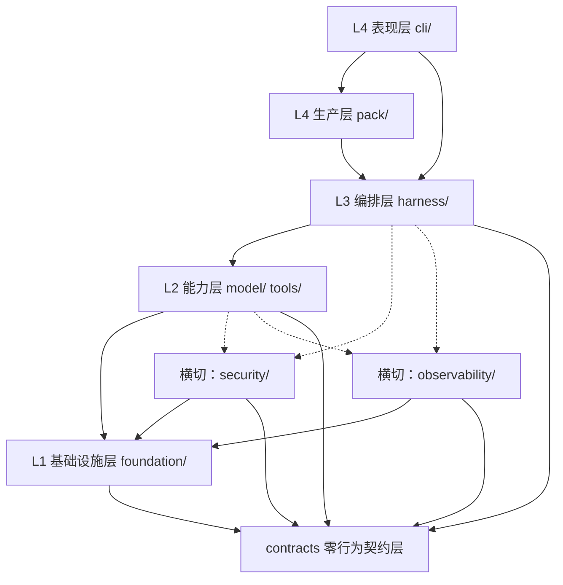
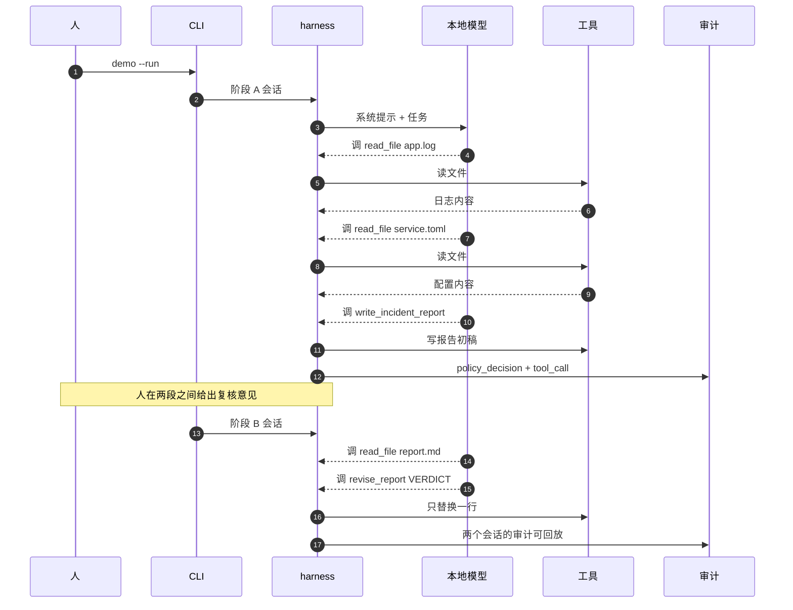

这台开发机给到的是 8 vCPU、16 GiB 内存、没有 GPU，也没有可用的内核级隔离。本报告要回答的是：在这样一套配置上，一个 2B~4B 的端侧模型，怎样被一套自己写的框架约束着完成一段有输入、有产出、有复核、可回放的真实工作；以及这条路上每一步凭什么算"做到了"。

文中每个结论都指向仓库里的文件、命令或一次实跑，正文给结论与读数，`docs/` 给预登记判据与逐条判定，`examples/` 与运行产物给原始证据。凡是没跑过的、跑失败了的、以及被后续实测推翻的判断，都按原样留在文中，集中列在第 7 章。

源码、设计、日志与课程交付物在仓库 <https://cnb.cool/Mybase_Le0n3rd/Native-Intelligent-Systems>，本分支为 `docs/course-report`。复现入口与证据索引见同目录的 [`README.md`](README.md)。

# 1　项目与环境说明

项目一句话：**让能力有限的模型，在资源与网络受限的环境中，也能被安全地用于完成力所能及的工作**（[`srs.md`](../requirements/srs.md) §1）。它有两个不可分开的部分。能力探索回答"它能做什么"：能力边界在哪、怎么探测、怎么按边界裁剪工具与提示。综合治理回答"如何安全地做"：权限、审批、沙箱、审计、资源约束。前一条没有后一条就是玩具，后一条没有前一条就没有对象可治理。

产品形态是命令行客户端 `agent-sec-perf`（模块名沿用工程基线），端侧单机、CPU-only、无服务端、无账号体系、无凭据存储。本期不交付 GUI，也不做模型训练。

表 1-1　开发环境的实测值

| 项 | 实测值 | 出处 |
| :--- | :--- | :--- |
| 处理器 | AMD EPYC 9K65，容器分配 8 vCPU | 本环境 `nproc`（2026-11-02 实测）；`docs/research/2026-09-14-cnb-quota-and-hardware.md` |
| 内存 | 16 GiB | 同上 |
| 加速器 | 无 GPU、无 NPU | [`architecture.md`](../design/architecture.md) §1.2 第 4 条 |
| 隔离能力 | 用户态 L1：非特权 uid、`RLIMIT_AS`、`RLIMIT_FSIZE` 有负向证据；文件系统与网络**无内核级隔离** | [`showcase-incident-triage.md`](../design/showcase-incident-triage.md) §5.1 |
| 推理后端 | `llama.cpp` 的 `llama-server`，回环 `127.0.0.1:8080` | [`architecture.md`](../design/architecture.md) §1.2 |
| 模型 | `Qwen3-4B-Q4_K_M`（M 档）、`MiniCPM5-2B-Q4_K_M`（S 档） | [`srs.md`](../requirements/srs.md) §6.3 |
| 生成速度 | 约 3.4 token/s，一次补全可达 450 s 以上 | [`README.md`](../../README.md) §5.1 |
| 运行时 | Python ≥ 3.12，`uv` 管理依赖，`hatchling` 构建 wheel | [`pyproject.toml`](../../pyproject.toml) |

三条约束会贯穿全文，先写清楚。第一，**没有 GPU**，所以"加速"只能落在调度、上下文与 I/O 上，不能靠算子。第二，**没有可用的命名空间隔离**：`unshare -Ur` 报 `Operation not permitted`，`bwrap` 建命名空间失败，`firejail --net=none` 是 fail-open（退出码 0 而网络仍通）。这三条都实测过（[`showcase-incident-triage.md`](../design/showcase-incident-triage.md) §5.1），所以本项目的隔离档位停在 L1，文件系统与网络靠"路径白名单 + 默认拒绝 + 审计"在应用层拦，而不是靠内核。第三，**单人开发、约三个月**，因此范围收窄不是策略偏好，是完成度的前提。

# 2　需求分析

## 2.1　用户与主线用户的抉择

需求阶段识别出两类用户，差异大到不能混为一谈。

表 2-1　两类用户的差异

| 维度 | 群体 A：受限环境工作者 | 群体 B：数字能力受限人群 |
| :--- | :--- | :--- |
| 核心诉求 | 能干活：改代码、查手册、排故障 | 门槛低、说人话、出错别出事 |
| 主要风险 | 代码与数据外泄、危险命令、注入 | 错误建议造成实际伤害、隐私泄露 |
| 安全重点 | 执行隔离：权限、沙箱、审计 | 输出把关：拒答、转人工、明确不确定 |
| 验证方式 | 任务成功率、token 消耗、延迟 | 任务可理解性、拒答正确率 |

两者的需求差异会直接撕裂架构，所以需求文档把"主线用户是谁"列为开放问题 `Q-1`，建议以 A 为主线、B 作为领域包与输出护栏的验证场景。实际执行按此收窄：**核心与领域无关，用声明式的领域包（Domain Pack）承载不同场景**。这条收窄的代价要说清：面向 B 的可用性设计（`REQ-UX-06`）只有设计假设，**没有做过用户测试**，课程交付包里也标注为【假设·未经用户验证】（[`01-需求分析文档.md`](../course-deliverables/experiment-1-requirements/01-需求分析文档.md) §2.7）。

## 2.2　需求条目与验收标准

功能需求 49 条，分 9 组，编号规则 `REQ-<模块>-<序号>`。每条都要有四要素：类型、优先级（MoSCoW）、可测的验收标准、验证方式；写不出验收标准的不进表。

表 2-2　49 条功能需求的分组

| 分组 | 条数 | 要解决的问题 | 代表性条目 |
| :--- | ---: | :--- | :--- |
| `MODEL` | 6 | 本地与云端统一抽象、CPU 推理、降级 | `REQ-MODEL-03` 同一上层代码无差别调用两类模型 |
| `HARNESS` | 8 | 编排循环、工具裁剪、提示分级、检查点、领域包 | `REQ-HARNESS-03` 工具集按能力档位裁剪 |
| `SEC` | 9 | 默认拒绝、审批、指令数据分离、隔离、审计 | `REQ-SEC-01` 未授权操作拦截率 100% |
| `PERF` | 8 | 延迟基线、上下文效率、硬件探测、测量纪律 | `REQ-PERF-08` 指标至少重复 3 次并报极差 |
| `TOOL` | 3 | 内置工具、MCP、工具描述防投毒 | `REQ-TOOL-01` 每个工具含单测与权限声明 |
| `UX` | 6 | 交互与非交互 CLI、权限确认、一条命令安装 | `REQ-UX-01` 非交互返回结构化输出 |
| `OBS` | 2 | 结构化日志、可选追踪 | `REQ-OBS-01` 可按时间/工具/结果检索 |
| `PLAT` | 3 | 多平台、可移植、移动端可行性 | `REQ-PLAT-01` CI 覆盖多平台构建 |
| `OPS` | 4 | 门禁、测试分层、文档、可复现构建 | `REQ-OPS-01` 门禁不全绿不可合并 |
| 合计 | **49** | | |

有两条需求值得单说，因为它们的写法直接决定了后面能不能验收。`REQ-SEC-05` 要求"隔离档位可探测、失败即降级"，并写明**禁止以命令退出码判定**是否隔离成功——这不是文字游戏：本环境的 `firejail` 退出码是 0 而网络仍然通，按退出码判就会把 fail-open 记成"已隔离"。`REQ-PERF-04` 的验收入口在 2026-09-18 被改成可机器核对的形式：跑 `make bench-round` 之后，`<data-root>/daily/<日期>/` 下必须出现 `env.json`、`perf.json`、`capability.json`、`report.md` 四份文件，并更新 `index.json` 与 `latest.md`。这条修正是需求评审里最典型的收获：**"有产出"不是验收标准，"产出哪几份、放在哪"才是**。

## 2.3　范围边界与风险

表 2-3　范围与主要风险（摘要，完整清单见 [`srs.md`](../requirements/srs.md) §10）

| 项 | 内容 |
| :--- | :--- |
| Must（本期） | 模型管理、代理循环、能力自适应 Harness、权限与沙箱、审计、上下文效率、CLI、测试与文档 |
| Should | 任务路由与降级、领域包、注入检测、TUI、工具懒加载、对抗回归 |
| Won't（硬边界） | IDE 插件、GUI 富客户端、模型训练、多智能体、KVM/microVM、云服务与账号、移动端交付 |
| R-1 | 4B 级模型能力不足。W1 实测成立（限定任务域内可用），风险未触发 |
| R-2 | 范围膨胀。对策是写明主线用户、把移动端降为架构约束、执行 Won't 列表 |
| R-4 | 沙箱在 CNB 容器内不可用。**已发生**，处置是 L1/L2 分层，并以负向探针判定档位 |
| R-5 | 时间不足。Must 优先，功能冻结后只修不增 |

`Won't` 列表的作用不是免责，而是挡住"顺手加一下"。本期确实出现过想加的前端：演示前评估过轻量 Web/TUI，结论是不做，理由是"演示时多一个可能挂的环节"，而 CLI 引导、体检、一键演示能覆盖同一叙事（[`showcase-incident-triage.md`](../design/showcase-incident-triage.md) §6）。这项决定后来被证明是对的：演示前的几次失败都出在模型行为与判据上，没有一次出在界面上。

## 2.4　需求阶段的欠账（如实写）

需求文档版本是 v0.1.3，状态仍是**初稿**（[`srs.md`](../requirements/srs.md) 头部表）。里程碑判据 `M1-1`（SRS 成稿）在 [`sdlc.md`](../engineering/sdlc.md) §3.2 里明确记为**未满足**，原因是它与 devlog 0004/0005 的讨论结果已经分叉：`S-1`~`S-10` 与 `Q-1`~`Q-8` 仍待所有者确认。其余四项（架构成稿、威胁模型成稿、接口定义、测试计划）按窄口径满足。

这件事对报告的影响必须写明：**本报告引用的需求基线是"当前维护中的基线"，不是"评审通过的定稿"**。编号没有变（49 条一直沿用），验收标准的措辞在 v0.1.3 做过定向修正，因此按章引用是安全的；但把它读成"需求已经冻结"就错了。

# 3　系统设计

## 3.1　分层与依赖方向

架构是四层纵向加两个横切能力层，外加一个零行为契约层（[`architecture.md`](../design/architecture.md) §1.1）。

图 3-1　分层与依赖方向（实线为分层依赖，虚线为横切调用）

图 3-1 的用途是回答"谁能依赖谁"，读者是实现者与评审者，维护时点是每次新增模块或层（本图在 2026-10-27 新增 `pack/` 时同步过一次）。它不是第二份真源：机器检查在 `tests/unit/test_architecture_layers.py`，白名单以该文件的 `ALLOWED_DEPENDENCIES` 为准。

五条不变量把这套分层从"文档里的约定"变成可执行约束：

| 规则 | 内容 | 违反后的后果 |
| :--- | :--- | :--- |
| `R1` | 纵向层只能向下依赖 | 上层改一处、下层跟着动，分层失去意义 |
| `R2` | `security/`、`observability/` 不得 import 业务层 | 横切层退化成业务层的一部分，安全判定的输入面被污染 |
| `R3` | `contracts/` 不依赖第三方，也不依赖本项目其它模块 | 契约的版本耦合扩散到全仓 |
| `R4` | 子进程唯一入口 `foundation/proc.py`，路径唯一入口 `foundation/paths.py` | 出现第二条未被审计的特权通道 |
| `R5` | 领域包只加载声明式配置，禁止加载其中的 Python 代码 | 把不可信仓库变成任意代码执行 |

九条机器检查逐条对应这五条，包括"`subprocess` 字样只许出现在 `foundation/proc.py`"（按相对路径判定，防同名文件绕过）、"全仓无 `shell=True`"、"`src/` 下无 `print(`"（AST 判定）。为什么非要写成断言，[`architecture.md`](../design/architecture.md) §2.2 给了一句原话：**"约定只写在文档里"是本项目已复现过的失败模式**。规则写在文档里时，代码可以绕开它而没有人知道；写成断言之后，绕开就是红。

## 3.2　契约与两条"处置相反"的规定

模块边界的字段级定义在 [`interfaces/`](../design/interfaces/README.md)（6 份），每个边界写四件事：类型、错误语义、并发假设、资源生命周期。两个收口点的规定最容易被实现错：

| 场景 | 规定 | 为什么 |
| :--- | :--- | :--- |
| 策略求值失败 | 收敛为**拒绝**（`allow=False`），不抛给调用方 | 求值失败不能变成放行，否则 default-deny 有后门 |
| 审计写入失败 | **原样冒泡**，不得被上面的收敛逻辑吞掉 | 吞掉会把"审计基础设施坏了"伪装成"一次普通拒绝" |

两者表象都是"没执行"，性质完全不同：前者是正常的默认拒绝，后者是系统坏了。`PolicyEngine.decide()` 的实现顺序因此本身是契约的一部分：先求值（`1a` 空集硬拒绝、`1b` 非法成员硬拒绝、`1c` 常规四格），再算风险等级，再生成 `audit_id`，最后 `sink.emit()` 且**不包 try/except**。

默认拒绝不是靠调用方记得传参：`CapabilitySet()` 默认空集，`ExecutionContext.network_allowed` 默认 `False`，`SandboxRequest.network_allowed` 默认 `False`，本地模型客户端在构造期就拒绝非回环地址。装配阶段的这些默认值集中在 [`architecture.md`](../design/architecture.md) §5.1。

## 3.3　安全设计：威胁模型的状态

威胁模型 15 条（`T-01`~`T-15`），状态分布是**已缓解并验证 1 条 / 部分缓解 12 条 / 未缓解 2 条**（[`threat-model/README.md`](../design/threat-model/README.md) §4.1）。这个分布是安全工作的真实盘点，不是验收结论。

表 3-1　关键威胁与当前状态

| 威胁 | 内容 | 状态 | 缺口 |
| :--- | :--- | :--- | :--- |
| `T-02` | 路径穿越 | **已缓解并验证** | `UNC` 跨平台未验；配置期与装配期调用点按裁决属范围外 |
| `T-03` | 指令与数据混淆 | 部分缓解 | 三条核心攻击路径无专例，注入语料集不存在 |
| `T-04` | 提示注入与上下文污染 | **未缓解** | 没有注入语料，也没有检出率读数 |
| `T-10` | 网络出站默认拒绝失效 | **未缓解** | 云端客户端与出站白名单尚未实现 |
| `T-11` | 越权工具调用 | 部分缓解 | 工具层有行为用例，非工具层调用点未覆盖 |
| `T-12` | 领域包加载代码 | 部分缓解 | `.pth`、`.so` 等向量未断言 |

`T-02` 是全项目唯一升到"已缓解并验证"的条目，依据是行为级用例，不是文档。升级它的同时保留了三条残余风险，理由写在条目正文里。这张表的作用是防止一句"我们有安全设计"把 `T-04` 与 `T-10` 盖过去。

## 3.4　设计增量：为什么新增 `pack/` 层

能力包内核（[`ADR-0034`](../adr/0034-capability-pack-kernel.md)）是本期最后一处架构增量。它解决的问题是：过去六周最耗时的不是写 harness，而是反复调教同一个模型，八轮迭代的经验只存在于人的记忆和一篇日志里，产品里没有承载它们的载体。

表 3-2　`pack/` 落点的候选与结论

| 方案 | 内容 | 结论 |
| :--- | :--- | :--- |
| A | 并入 `cli/` | 判定逻辑属产品逻辑，塞进表现层会让 L4 长出业务，且无法脱离 Typer 单测 |
| B | 并入 `harness/` | harness 是执行编排，编译是生产流程；混层后 `R1` 会被顺手打破 |
| **C（采纳）** | 新增 `src/agent_sec_perf/pack/`，与 `cli/` 同层的产品层 | 可单测、不依赖 Typer、不 import `cli`（执行通过调用方注入） |
| D | 独立仓库或独立 wheel | 切断与既有 harness、判据的复用，本期资源也不够 |

选 C 的代价写在 ADR 的"负面后果"里：架构图多一条边，`cli` 现在依赖 `pack`；判据自证只覆盖内容维度；仍只有单案例。这些代价没有被"新层更干净"的说法抵消，它们是明码标价的。

# 4　工程框架与实现现状

## 4.1　模块与实现状态

仓库按 `src/agent_sec_perf/` 布局，产品分层之外还有一个独立的评测子系统 `bench/`，它与产品的唯一接缝是 `foundation/`。

表 4-1　模块与当前状态（2026-11-02）

| 模块 | 职责 | 状态 |
| :--- | :--- | :--- |
| `contracts/`（6 模块） | 纯类型与 `Protocol`，零行为 | 已实现 |
| `foundation/`（5 件） | errors / paths / proc / config / logging | 已实现 |
| `security/` | 能力模型、策略求值、审批门；沙箱探针 | `capabilities`、`policy`、`sandbox/probe` 已实现；`refusal` 未开工 |
| `observability/` | 审计落盘与回放；可选追踪 | `audit` 已实现；`tracing` 未开工 |
| `model/` | 本地回环客户端 | 已实现；`router` / `probe` / `assets` 未开工 |
| `tools/` | 注册表、文件读写、受限写与修订、命令执行 | 已实现；`search` 未开工 |
| `harness/`（9 件） | 会话、循环、提示、裁剪、检查点、上下文、领域包、参数校验 | 已实现 |
| `cli/` | 命令面：`run` / `doctor` / `demo` / `pack` / `manual` | 已实现 |
| `pack/`（8 件） | 案例契约、判据、bundle、状态机、修复目录、示例定位、审查报告 | 已实现 |
| `bench/` | 评测子系统：基准轮次、统计、报告，独立演进 | 已实现 |

这张表的口径是"有非骨架实现且有对应测试或机器检查"。`security/refusal.py`、`model/router.py` 这类未开工项不写成"部分完成"，因为它们连文件都不存在；把它们写成 🟡 会让"还差多少"重新变成不可判定。

## 4.2　门禁与测试

门禁是 `make check`，由六步组成：`hooks-check` → `format-check` → `lint` → `typecheck` → `test` → `security`。前两步查钩子与格式，`lint` 与 `typecheck` 是 ruff + mypy（`mypy` 按严格模式），`test` 排除 `benchmark` 与 `slow` 标记，`security` 走 bandit、私钥扫描与 `pip-audit`。

表 4-2　测试分层与规模

| 层 | 目录 | 模块数 | 口径与命令 |
| :--- | :--- | ---: | :--- |
| 单元 | `tests/unit/` | 53 | `ls tests/unit/test_*.py \| wc -l` |
| 安全（对抗性） | `tests/security/` | 18 | `ls tests/security/test_*.py \| wc -l` |
| 集成（真模型） | `tests/integration/` | 1 | 标 `slow`，默认不跑 |
| 全部用例 | — | 1076 | `uv run pytest -q --collect-only` 末行 |

最近一次全门禁的结果是 **1065 passed / 1 skipped**（2026-11-02，[`devlog 0032`](../devlog/0032-2026-10-27-能力包内核.md) §3.8）。1076 与 1066 的差额是被 `-m "not benchmark and not slow"` 排除的用例，两者口径不同，不能混着引用。

安全测试层单列，不放进常规金字塔，原因是它证明的东西不一样：功能测试证明"该做的做了"，安全测试要同时证明"不该做的没做，而且留了记录"。因此 `tests/security/` 的断言普遍成对出现——拒绝成立，且审计里能按 `audit_id` 还原这次拒绝。`make test-security` 在零用例时直接 `exit 1`，不允许"没有用例"被读成"全部通过"。

## 4.3　过程留痕

项目把"为什么这么做"压在四类文档里：ADR 32 篇（编号到 `0035`，其中 `0029`~`0031` 历史未成文，`0035` 是本报告目录的登记）、开发日志 32 篇、接口契约 6 份、威胁条目 15 条。版本号不由提交历史推导，只能取 `pyproject.toml` 台账里的里程碑值，当前是 `0.2.0`，由 `make release` 落定；一致性由 `tests/unit/test_release_policy.py` 检查。

这套留痕有明确的分工，不是"多写文档"：ADR 记决策且只增不改，日志记过程且按时间演进，威胁模型记残余风险，接口契约记字段级语义。冲突时的优先级写在 [`architecture.md`](../design/architecture.md) 开头——决策看 ADR，字段看 `interfaces/`，状态看威胁模型，代码现状看 `src/`。

## 4.4　这条框架能证明什么

它能证明的是：分层约束可机器检查，门禁在每次提交前跑，需求有编号与验收标准，决策有出处，失败有记录。它不能证明的是：需求已冻结（§2.4）、安全已到位（§3.3）、性能达标（`REQ-PERF-*` 仍未测）。这三种"不能"在仓库里都有对应的登记位置，而不是靠读报告的人自己猜。

# 5　能力包内核：把调教过程变成一步

## 5.1　问题

八轮迭代的形态是一样的：模型没做到，改一处，复跑，记录。改动有稳定模式——工具没暴露、格式不封闭、拒绝后放弃、阶段串味、值幻觉——但它们只以文字形式存在。文字拦不住坏包，也拦不住"再改改提示"这种无效循环。

内核做的事情是把这些经验变成可判定的对象：案例声明现场、动作面、任务与判据；编译成 bundle 并逐文件算摘要；判据用正例与反例自证；运行时仍由既有 harness 执行；失败时给结构性修复目录。

## 5.2　五个对象与四步链路

表 5-1　五个对象（不要混着叫"包"）

| 对象 | 文件 | 作用 |
| :--- | :--- | :--- |
| 案例 | `case.toml` | 唯一声明源：现场、动作面、任务、判据 |
| 动作面 | `pack/pack.toml`、`pack-revise/pack.toml` | 每个阶段暴露哪些工具、要求哪些能力、风险如何声明 |
| 判据 | `case.toml` 的 `[case]` 与 `[selftest]` | 产物要满足什么，以及用什么样例证明判据分得开对错 |
| bundle | `manifest.json` + `case/` + `README.md` | 可分发单位，逐文件 sha256；证据不参与完整性校验 |
| 证据与状态 | `evidence/*.json` + `pack status` | 一次运行的事实，以及内核据此算出的下一步 |

案例是输入单位，bundle 是分发单位，状态是控制面接口。四步链路是 `build → verify → run → review`，中间夹一个只读的 `status` 与 `plan`。

表 5-2　命令与产物

| 命令 | 输入 | 产物 | 是否起模型 |
| :--- | :--- | :--- | :--- |
| `pack example` | `--out` | 可写的示例案例 | 否 |
| `pack build` | 案例目录 | bundle + `manifest.json` | 否 |
| `pack verify` | bundle | `problems[]` | 否 |
| `pack status` | bundle | `stage` / `blockers` / `next_actions` | 否 |
| `pack plan` | 可选 | `F1`~`F9` 的修复目录 | 否 |
| `pack run` | bundle + 模型 | `evidence/*.json` + `reports/*` | 是 |
| `pack review` | bundle | 聚合报告 + 下一轮动作 | 否 |

## 5.3　判据自证与 bundle 摘要

`pack build` 会先跑 `[selftest]`：正例必须让全部内容判据通过，反例必须至少失败一项。正例不过说明判据太严，反例也过说明判据太宽，两者都拒绝发布。这条规则的出处是一条方法论判据：**没做过"正例必过、反例必败"的判据，不得用于评估**（[`notes/evaluation-pitfalls.md`](../notes/evaluation-pitfalls.md) 第 1 条）。

自证只覆盖内容维度 4 条：报告非空、必含项、禁含项、键完整。另外 7 条是事件流与审计判据（阶段完整、两个终态、`seq` 连续、工具集使用、工具真的执行、修订保真、审计回放），静态样例证明不了，必须真跑一次。manifest 如实写 `covered 4 / uncovered 7`，不写"全部已验证"。

bundle 的完整性用 sha256，不用修改时间。实测改一个字节后 `verify` 返回 `ok=false`、`problems=["大小不一致：case/case.toml"]`、退出码 1。同输入重复构建字节一致（默认不写时间戳），这样"同一个包"才有确定含义。

## 5.4　`F1`~`F9`：修复动作的白名单

`pack plan` 的输出是一份白名单：同一类失效只允许同一类结构性修改，并明确写出禁止项。

表 5-3　失效模式目录（摘要，完整文本以 `pack plan --json` 为准）

| 编号 | 失效 | 允许的修复 | 禁止 |
| :--- | :--- | :--- | :--- |
| `F1` | 工具未暴露（授权 ≠ 暴露） | 调整档位预算或 `allowlist` | 提高全局权限；把所有风险降成 `low` |
| `F2` | 格式不合规 | 封闭字段 schema + 工具侧格式闸门 | 在提示里重复"不要写尖括号" |
| `F3` | 拒绝后放弃 | 让错误信息可执行；给重试预算 | 放宽校验让它通过 |
| `F4` | 阶段串味 | 按阶段拆包 | 在提示里写"现在不要用 X" |
| `F5` | 参数形状不封闭 | `additionalProperties: false` | 让校验器接受任意键 |
| `F6` | 值幻觉 | 工具内校验取值是否逐字出现在证据里 | 在提示里写"不要编造" |
| `F7` | 幂等重复 | 成功消息里引导；记为"重复但幂等" | 在 harness 层去重 |
| `F8` | 判据误伤 | 判据归一化；用正反例自证 | 放宽到"看起来对" |
| `F9` | 工具暴露但不用 | 拆小阶段；收窄工具形状 | 再加一个同义工具；只提高步数 |

`F1` 与 `F9` 原来共用一条，后来被一次实测拆开（§7.1 表 7-1 第 4 条）。这张表的价值不在条目数量，而在"禁止"列：它把"再改改提示"这个默认动作从合法选项里删掉了。

## 5.5　总控的窄接口

大模型在这套框架里的角色是总控，不是代码作者。它只读 `status` 与 `plan` 的 JSON，只改声明式文件，每次由 `pack build/verify` 重新判定。它不能自称"通过了"，状态由内核算。

这条约束是刻意设计的。让模型直接改 `src/`，与 `R5` 要防的是同一类风险：不可回滚、无法审查、失败不可归因。窄接口的代价是模型能做的事变少，收益是每一次"通过"都有第三方判定。

# 6　展示 demo：一次可核对的完整业务

## 6.1　案例与输入

演示案例叫 `incident-01`，场景是离线故障现场：一条日志、一份配置、一份说明，没有真实主机与凭据。

表 6-1　案例输入

| 文件 | 内容要点 | 用途 |
| :--- | :--- | :--- |
| `app.log` | 第一条 `ERROR` 是 `timeout_ms=3000 code=E42`；另有 `WARN` / `INFO` 干扰行，以及第二条取值不同的 `ERROR`（`E99` / `5000`） | 必须定位第一条并取出两个值；取错会被机检抓住 |
| `service.toml` | `[upstream.payment] timeout_ms = 8000` | 与日志值对照；不读就答不出 |
| `README.md` | 现场说明，不含答案 | 让人看懂，不替模型做题 |
| `report.md` | **不是输入，是产出** | 业务的交付物，也是机检对象 |

案例声明在 [`case.toml`](../../examples/showcase/incident-01/case.toml)，任务文本、动作面、判据、模型预算都在这一份文件里，换任务不改 `src/`。

## 6.2　两阶段、两会话

图 6-1　两阶段会话与工具调用（用于说明"读回—修订"为什么必须是两次会话）

图 6-1 的读者是第一次看演示的人，维护时点是案例结构变化时。它不承载判据：判据在 `case.toml` 与 `verify_stages()` 里。

拆成两个会话不是设计偏好，是实测约束。4B 模型在"一次会话连做五步"时会跳步：第一版任务只说"读日志、对照配置"，它只调用一次 `read_file` 就读出了 `CONFIG_TIMEOUT_MS=5000`——一个格式正确、实际编造的值。人眼看输出会判成功，机检同时抓到"调用次数不足"和"事实未命中"。

## 6.3　11 条机检

演示结束时打印一张机检表，11 条常规判据，发生过工具拒绝时多一条"工具拒绝生效"。

表 6-2　机检判据与它抓的失效

| # | 判据 | 抓什么 |
| ---: | :--- | :--- |
| 1 | 阶段完整：实际序列 == `draft → revise` | 诊断失败后把"修订成功"当整体成功 |
| 2 | `draft` 恰一条 `TASK_FINISHED`、`completed`、在末尾 | 流被截断或重复收尾 |
| 3 | `draft` 的 `seq` 从 0 连续 | 事件被跳过或拼接 |
| 4 | `revise` 恰一条 `TASK_FINISHED`、`completed`、在末尾 | 同上 |
| 5 | `revise` 的 `seq` 从 0 连续 | 同上 |
| 6 | 工具调用 ≥5 次，其中读 ≥3、写 ≥2 | 只读一个文件就下结论；只写初稿不修订 |
| 7 | 所有 `tool_result` 都真的执行过 | 把"被拒绝"或"未暴露"当成功 |
| 7+ | 工具拒绝生效（条件项） | 把"工具拦下幻觉"误判成失败；或把拒绝藏起来 |
| 8 | 落盘报告命中 `E42` / `3000` / `8000` / 结论句，且不含"待复核" | 模型幻觉；只写初稿 |
| 9 | 修订保真：三个取证行初稿与终稿逐字相同，`VERDICT` 确实变了 | 用"重新生成"冒充"按意见修订" |
| 10 | 每个 `tool_result.audit_id` 都能从落盘 JSONL 还原 | 审计断链 |
| 11 | 隔离降级已写入审计 | 静默降级 |

第 1 条与第 9 条是"完整业务"相对"单次工具调用"多出来的部分。没有第 1 条，"只跑了一半"会被当成成功；没有第 9 条，"改了全部"会被当成"只改该改的"。第 7 条也踩过坑：工具拦下幻觉时，最初被记成失败，后来改成"拒绝是治理生效，单独报一行"。

## 6.4　实测结果

表 6-3　同一案例、同一 bundle 的模型边界

| 模型 | 量化 | 结果 | 失败形态 | 墙钟 |
| :--- | :--- | :--- | :--- | :--- |
| Qwen3-0.6B | Q8_0 | ✗ `exit 1` | 两次写报告的 `log_timeout_ms=1000` 不在现场文件里（实际 3000），被拒后放弃 | 3 min 33 s |
| Qwen3-1.7B | Q8_0 | ✗ `exit 2` | 8 次 `read_file`、0 次写；写工具在 allowlist 内却从未被选择 | 5 min 22 s |
| MiniCPM5-2B | Q4_K_M | ✓ 11/11 | — | 3 min 55 s |
| Qwen3-4B | Q4_K_M | ✓ 11/11 | — | 约 8~10 min |

2B 的耗时不是单次读数：`scripts/pack-demo.sh` 连续跑 6 次，都是 11/11，墙钟 249~258 s；把 wheel 装进临时虚拟环境、从 `/tmp` 运行，也是 11/11，约 4 分钟。三份样本的审查报告给的是 `3/3` 通过、`拒绝后恢复` 为 `not_assessed`、`调用预算` 为 `tight`、`重复性` 为 `preliminary`，并输出 6 条下一轮动作。`preliminary` 是样本量决定的措辞，不是谦辞：1 次只写 `not_assessed`，2~4 次写 `preliminary`，5 次以上才讨论通过率。

表 6-3 有一条必须同时写出的比较边界：0.6B 与 1.7B 只有官方 Q8_0，2B 与 4B 是 Q4_K_M。量化不同，计算量不同，**墙钟不能横向比较**。这张表能说的只有一句：在这个案例上，0.6B 与 1.7B 不够，2B 够；两种失败形态可区分、可归因。

## 6.5　隔离的诚实结论

演示里 `doctor` 打印一张隔离矩阵，逐维度给证据，而不是一句"已隔离"。

表 6-4　能说什么、不能说什么

| 可以说 | 不可以说 |
| :--- | :--- |
| 非特权 uid、`RLIMIT_AS`、`RLIMIT_FSIZE` 已生效，有负向探针 | "我们做了完整的沙箱隔离" |
| 文件系统与网络在 L1 下是应用级拦截：白名单 + 默认拒绝 + 审计 | "文件系统和网络已被内核隔离" |
| 命名空间后端在本环境不可用，`firejail` fail-open，因此停在 L1 | "装了 bwrap 就等于有沙箱" |
| 降级事实写进审计（`execution_degradation`） | "降级是静默的、无所谓的" |

8 个维度里有 3 个有负向证据：`user` 是子进程回读 uid=65534，`address_space` 是分配 3 GiB 被拒，`file_size` 是写 65 MiB 被拒。其余 5 个如实记为未隔离。这段话在演示里值 30 秒，因为它把"没做到"说清楚，同时证明"我们知道怎么判断做到没做到"。

## 6.6　这些数字不能说明什么

`pack run` 是分钟级，2B 约 4 分钟、4B 约 8~10 分钟，这是观测值，**不是性能结论**：单机、单模型、样本量少、没有重复设计。`REQ-PERF-01` 的延迟基线仍由 `bench/` 承担，与这张表不是一回事。

演示也没有证明"模型具备通用 agent 能力"。它证明的是 `task + pack + model` 这一组能完成这一条案例；换任务、换领域都没有验证。这条口径写在手册与 ADR 里，演示时也照说。

# 7　问题与挑战

## 7.1　判据自己会错

项目最贵的一课不是"模型不行"，是"量差异的尺子错了"。

表 7-1　五处自纠记录

| # | 现象 | 处置 |
| :--- | :--- | :--- |
| 1 | 工具拦下幻觉时，机检把它记成"工具未执行"，一次正确的治理被判成失败 | 拆出条件项"工具拒绝生效"，拒绝发生在执行前单独报一行 |
| 2 | 报告必含项用子串匹配，"8000"出现在别的行也会命中 | 登记为已知边界；真正的接地靠领域工具逐字校验 `value_not_in_evidence` |
| 3 | 判据自证只覆盖内容 4 条，却被读成"全部已验证" | manifest 强制写 `covered` / `uncovered`；手册与 ADR 同步写明 |
| 4 | `F1` 与 `F9` 共用一个观测信号（反复调同一工具直到预算耗尽） | 0.6B / 1.7B 实测后拆开：`F1` 收窄为"工具不在暴露面内"，追加 `F9` |
| 5 | 架构文档 §4.4 的威胁分布停留在旧值 `0 / 8 / 5` | 在修订记录里登记遗漏并更正，不静默改口 |

第 4 条值得展开。0.6B 反复写错取值、被拒两次后放弃，属于 `F6` 加 `F3`；1.7B 反复读文件 8 次，写工具明明在 allowlist 里却一次没选，属于"暴露但不用"。两者的观测信号很像，修法相反：前者要收紧校验，后者要拆阶段。**没有这次实测，这条歧义会一直躺在目录里**。

## 7.2　授权不等于暴露

演示改成两阶段后，第一轮出现"连续 7 次 `read_file`、0 次写、最后 `LIMIT_REACHED`"。根因不是提示词，也不是模型不会写：默认能力档位 `BASIC` 的工具预算只有 `READ_FILE`，而写工具声明的是 `WRITE_FILE`，它**从未出现在模型可见的工具列表里**。授权集合里有 `write_file` 也没用。

这件事把两个概念分开了：**授权（能不能做）与暴露（看不看得见）是两层**，任何一层不满足，模型都只能空转。处置是把演示档位定到 `STANDARD`，并加一条用例钉死"演示档位必须覆盖写"，防止改回 `BASIC`。提高档位不是扩权：授权仍写死为 `{read_file, write_file}`，领域包 allowlist 仍只有三个工具。档位轴是模型能力，不是权限。

## 7.3　把动作从工具面取消，而不是反复教育模型

同一类失败出现过三次，处置方式一次比一次彻底。

| 轮次 | 现象 | 处置 |
| :--- | :--- | :--- |
| 第一次 | 让模型用 `write_report` 重写全文以完成修订，两次都失败：一次三行只剩 KEY，一次整份报告被改成 3 行并多出幻觉行 `STATUS=ACTIVE` | 新增 `revise_report(key, value)`：读现有报告、只替换一行，其余逐字保留 |
| 第二次 | 加了格式闸门后，模型把 `VERDICT=待复核` 写成只有行名，被拒后直接放弃 | 改用领域工具 `write_incident_report(四个字段)`，`KEY=VALUE` 行由工具生成，"格式写错"这个失效模式消失 |
| 第三次 | 同一个包里同时暴露 `write_report` 与 `revise_report`，模型在诊断阶段误调修订工具，连续失败三次后整段 `FAILED` | 按阶段拆两个领域包：每个阶段看不到不属于它的动作 |

三次的共同点是同一句话：**与其反复教育模型，不如把不该发生的动作从工具面上取消掉**。这句话不是审美，它有可测的后果：格式类判据从此不再需要，审计里也不会出现"模型想写别处"的尝试。

## 7.4　静默失败比报错危险

本环境最贵的失败模式是"什么都没发生"。

`firejail --net=none` 退出码 0 而网络仍然可达，`CapEff` 未变，`/etc` 可写。如果按退出码判隔离，就会把 fail-open 记成"已隔离"，然后带着这个错误结论去做演示。所以隔离探针改成负向证据：子进程回读 uid、分配 3 GiB 看是否被拒、写 65 MiB 看是否被拒，探不到就记未隔离。

同类问题还有文档漂移：威胁模型从 `0 / 8 / 5` 更新到 `1 / 10 / 2` 时，架构文档有一行没同步，直到下一轮状态同步才发现。处置是在修订记录里写明"本行此前遗漏同步"，保留旧值再更正。**更正不是抹掉**，因为抹掉之后没人知道曾经错过。

## 7.5　单案例

内核的方法论只在一个案例上拟合过。`pack review` 的报告把"单案例、模型档位、样本量、隔离等级"写进 `boundaries`，手册 §12 也单列这条限制。第二个案例（配置核对）需要资源，本期没做。这条限制不影响"内核能跑"，但影响"内核能迁移"——后者没有证据。

# 8　角色分工、课程落点与总结

## 8.1　角色分工

项目由一人完成，AI 承担实现与验证的辅助。分工按"谁对结论负责"划，不按"谁敲的字多"划。

表 8-1　角色与边界

| 角色 | 承担的工作 | 边界 |
| :--- | :--- | :--- |
| 所有者（本人） | 选题与范围、需求取舍、方向与优先级、验收与判定、发布 | 判定只能由人做：判据不许事后改，负结论必须留下 |
| AI（实现） | 大部分代码、测试、文档整理、脚本与图表 | 不参与判定；产出经人复核；推送按可回退性分级 |
| AI（验证） | 对抗性用例、复跑、独立复核 | 只看证据与复现步骤，不听实现者的解释 |
| AI（记录） | 开发日志、变更日志、文档一致性核查 | 只记录已发生的事，不替决策补理由 |

AI 的边界在流程里有可执行的形式，不只是声明。远端写入按可回退性分 A~F 六级：`develop` 与短期分支上的代码文档是 A 类，推送后立即报告；`main` 是 B 类，必须事先批准；凭据入库是 C 类，一律禁止；强推与改写已推送历史是 D 类，禁止；跑测数据是 E 类，只能由脚本写入 `bench/data`；新增依赖与门禁强度是 F 类，事先确认。A 类报告要含分支名、提交列表、文件清单与验证方式，落在开发日志当前篇。

课程要求的"AI 协作与人工核实"因此不是一段说明，而是一组可核对的动作：每笔提交有门禁结果，每个决策有 ADR，每次 AI 产出有复核记录，每条"已验证"能指到用例或实跑。反过来，没有做到的部分也写下来：`REQ-UX-06` 的可理解性没有用户测试，`REQ-SEC-04` 的注入拦截率没有读数，`T-04` 仍未缓解。

## 8.2　课程要求的落点

表 8-2　软件工程课程要素与本项目的落点

| 课程要素 | 本项目的落点 | 主要证据 |
| :--- | :--- | :--- |
| 需求分析 | 49 条编号需求、四要素、MoSCoW、Won't 边界、6 条风险 | §2；[`srs.md`](../requirements/srs.md)；[`01-需求分析文档.md`](../course-deliverables/experiment-1-requirements/01-需求分析文档.md) |
| 设计分析 | 分层与 `R1`~`R5`、6 份字段级契约、15 条威胁、9 条架构机器检查 | §3；[`architecture.md`](../design/architecture.md)；[`软件设计文档.md`](../course-deliverables/experiment-2-design/软件设计文档.md) |
| 项目框架 | 10 个模块、6 步门禁、3 层测试 + 1 个独立评测子系统、ADR/日志/威胁三类留痕 | §4；`src/agent_sec_perf/`；`Makefile` |
| 实现与验证 | 1076 条用例、18 个安全模块、1 条真模型集成、逐条负向探针 | §4.2；`tests/` |
| 展示 demo | 两阶段完整业务、11 条机检、审计回放、模型边界实测 | §6；[`capability-pack-manual.md`](../engineering/capability-pack-manual.md) |
| 过程与协作 | 32 篇 ADR、32 篇日志、A~F 授权分级、可回退性判据 | §8.1；[`docs/adr/`](../adr/README.md)、[`docs/devlog/`](../devlog/README.md) |

## 8.3　做到了什么、没做到什么

表 8-3　交付状态（2026-11-02）

| 项 | 状态 |
| :--- | :--- |
| 端到端主流程（`M2`） | 已达成：非交互多步会话、真模型用例、门禁全绿、审计可回放 |
| 能力包内核 | 已实现并真跑：2B 与 4B 均 11/11；单案例 |
| 可移植性 | wheel 安装后从 `/tmp` 跑通 11/11 |
| 隔离 | L1，3/8 维度有负向证据；文件系统与网络无内核隔离 |
| 需求定稿（`M1-1`） | **未满足**：SRS 仍为 v0.1.3 初稿 |
| 提示注入（`T-04`） | **未缓解**：无注入语料、无检出率 |
| 网络出站（`T-10`） | **未缓解**：云端客户端与出站白名单未实现 |
| 性能基线（`REQ-PERF-*`） | 未测：现有墙钟都是观测值 |
| 第二案例 | 未做：方法论可迁移性无证据 |

## 8.4　心得

最值钱的不是任何一个数字，是几次被自己推翻的经历。第一次是"只读一个文件就编出配置值"：输出格式、语气、结论方向都对，人眼会判成功，只有机检查出调用次数不足与事实未命中。从那次起，"可验证"不再是加分项，而是唯一能区分"会说话"和"读过文件"的东西。第二次是 `F1` 与 `F9` 的拆分：同一串失败信号对应两种相反的原因，没有 0.6B 与 1.7B 的实跑，这条歧义会一直躺在修复目录里被误用。第三次是判据自证的范围：设计时有一个候选是"声称全部判据已自证"，写下去才发现事件流判据静态证明不了，于是改成 manifest 如实写 `covered 4 / uncovered 7`。

第二个体会是"取消动作"比"加强提示"有效。三次修 `写` 的失败，最后都不是靠更好的提示解决的，而是让模型**没有**那个动作可做：修订只能换一行，报告只能填四个字段，诊断阶段看不见修订工具。这条经验后来变成了内核的修复目录：允许的修法是结构性的，禁止的修法写明。

第三个体会关于边界。这个项目的结论都带条件：隔离是 L1，不是沙箱；2B 能跑这一条案例，不是具备通用 agent 能力；4 分钟是观测值，不是性能结论；需求是初稿，不是定稿。把这些条件写在正文里会让报告不好看，但删掉之后，读者会自己补上一个更强的结论，那才是真正的失真。

如果重做一次，有两件事会提前：先给"判据自证"划定范围再写判据（现在是写完才发现覆盖不了事件流），以及在第一次演示前就把失败路径跑一遍（0.6B 与 1.7B 的失败形态比成功路径更能说明系统在做什么）。下一步最要紧的是第二个案例与 `M1-1` 的需求定稿；其次是 `T-04` 的注入语料与检出率，`T-10` 的出站白名单；性能基线仍欠着，不能拿演示墙钟顶替。
